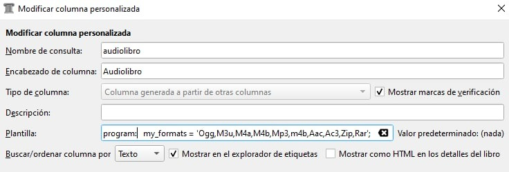
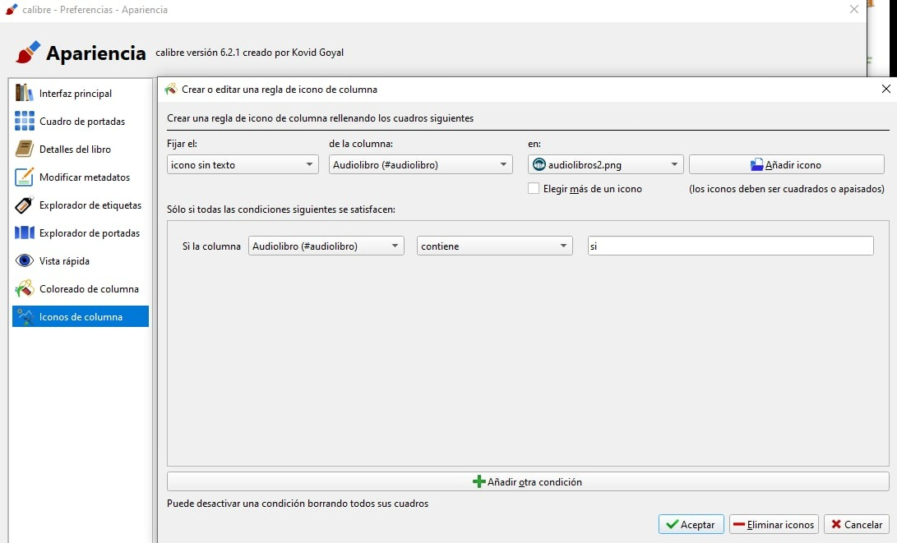
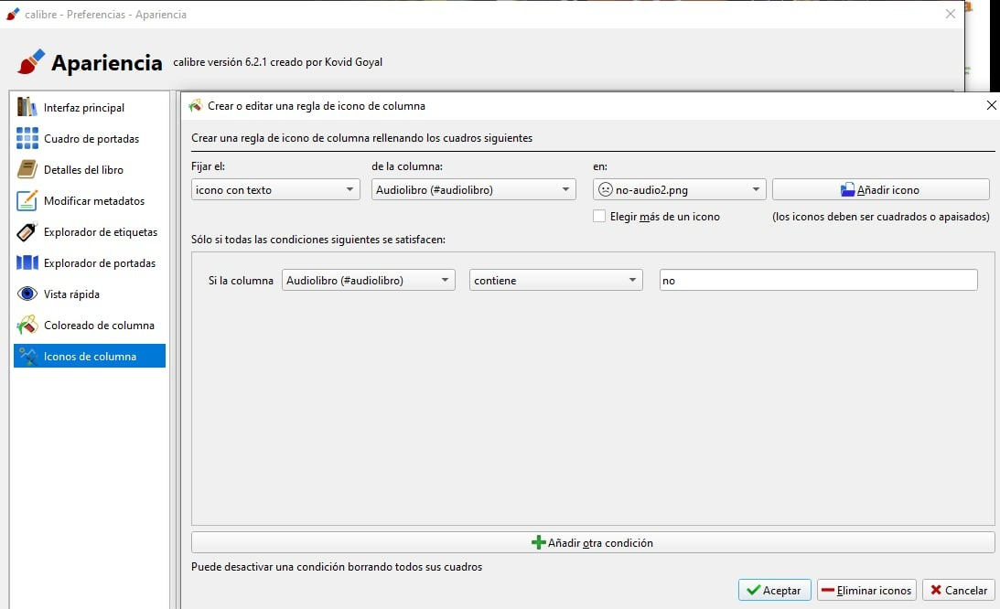
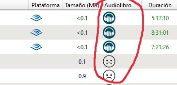

# Columna personalizada - Audiolibros

:material-account: [Walter](https://t.me/Dunhill69){ target=_blank } · :material-link-variant: [Ver el original en Telegraph](https://telegra.ph/Columnas-personalizadas---Audiolibros-08-13){ target=_blank }
{ .tut-datos }

---

Aporte de @wiso\_wolo

Yo agrego los audiolibros directamente a Calibre, ya sean mp3, zip o el formato que sea.

Con el plugin de Goodreads descargo los metadatos.

Y por ultimo columnas personalizadas:

Narrador/es -\> De momento los busco y añado a mano (mientras no exista un plugin que obtenga todos los metadatos que necesitemos de audiolibros)

Plataforma (en metadatos está como texto, en mi columna como icono)

Duración -\> Usando el plugin AudioBook\_Duration

Formatos (mp3, zip, m4a, m4b...) -\> (\*)

Audiolibro (en caso de que sea un audiolibro por tener algún formato/tipo de archivo concreto le asigno un icono) -\> ()

 

(\*)

columna creada a partir de otras columnas

plantilla -\> {formats}

texto

 

(\*\*)

columa generada a partir de otras columnas

plantilla-\>

program:

my\_formats = 'Ogg,M3u,M4a,M4b,Mp3,m4b,Aac,Ac3,Zip,Rar';

if list\_intersection(lowercase($formats), my\_formats, ',') then

'Si'

else

'No'

fi

texto y si te interesa puedes marcar el recuadro de mostrar en el explorador de etiquetas

ejemplo de columnas personalizadas:

#columna Audiolibro

program:

my\_formats = 'Ogg,M3u,M4a,M4b,Mp3,m4b,Aac,Ac3,Zip,Rar';

if list\_intersection(lowercase($formats), my\_formats, ',') then

'Si'

else

'No'

fi

Con esta regla de apariencia, pondremos un icono cuando la Columna Audiolibro tenga el texto "SI"

Con esta regla de apariencia, pondremos un icono cuando la Columna Audiolibro tenga el texto "NO"

iconos: (los guardamos previamente en la carpeta iconos, a la que podemos acceder desde /preferencias/apariencia/iconos de columna (en el botón de abajo, Abrir carpeta de iconos))

Resultado Final cuando ya tengamos nuestra columna Audiolibro

 

## [Volver al inicio](https://telegra.ph/Indice-Calibre-en-Espa%C3%B1ol-10-03)

 

 

---

[:material-arrow-left: Volver al índice](../../alfabetico.md) · [:fontawesome-brands-telegram: Preguntar en el grupo](https://t.me/calibreconfiguraciones){ target=_blank }
