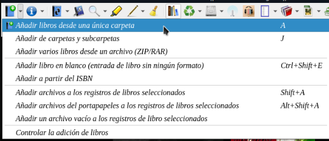
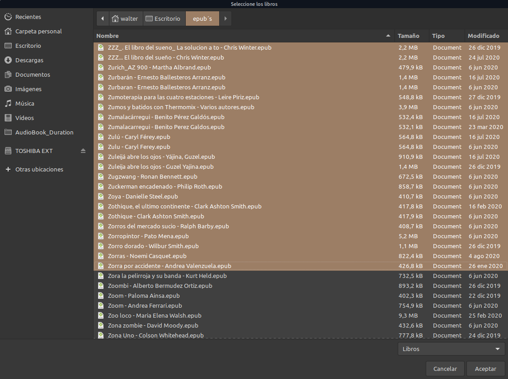
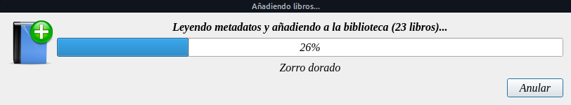
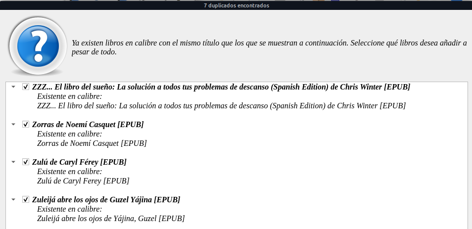
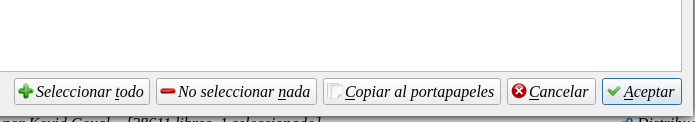
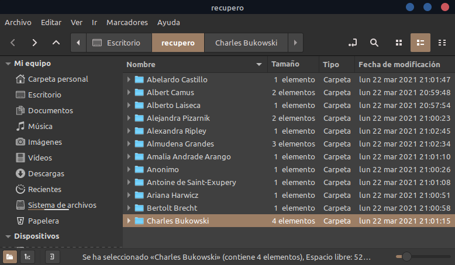
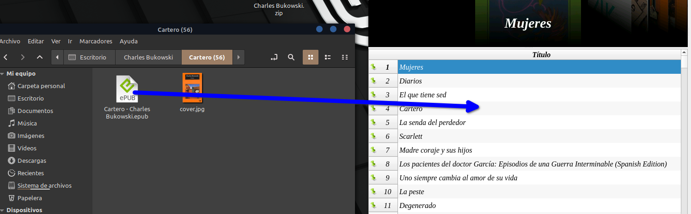

# Añadir libros, ¿cómo se hace?

:material-account: [Walter](https://t.me/Dunhill69){ target=_blank } · :material-link-variant: [Ver el original en Telegraph](https://telegra.ph/Como-a%C3%B1adir-libros-a-Calibre-01-23){ target=_blank }
{ .tut-datos }

---

Una vez hayamos descargado e instalado Calibre, lo que nos queda es ir agregando libros como hacerlo ?

En la barra de herramientas veremos un icono que se llama **Añadir libros. **Si tocamos en el tendremos varias opciones a saber:

1. **Añadir libros desde una única carpeta**

Tocando acá se nos abre el navegador de archivos para que nosotros podamos decirle a Calibre donde estan los libros que queremos cargar.

Seleccionamos los libros y le damos en Aceptar.

Y empieza la carga de libros estos libros no se borran de su carpeta de destino.

Calibre en todos los agregados nos avisará si tenemos libros duplicados.

Debajo hay unos botones, que si son todos repetidos podemos tocar en No seleccionar nada, para que los desmarque o podemos ir desmarcando nosotros uno a uno los archivos a medida que los vamos revisando y despues le damos en Aceptar.

**2. Añadir de carpetas y subcarpetas**

Esta opción sirve en el caso que nosotros hubieramos tenido, antes de conocer a Calibre, nuestros libros en una carpeta y que esa carpeta a su vez tenga un subdirectorio. Como se ve en la imagen

Si elegimos esta opción Calibre nos preguntará

Si son libros distintos, tocamos en Si y otra vez se nos abrirá el explorador de archivos para seleccionar la carpeta deonde estan los libros y le damos en Aceptar e inicia la carga. Estos archivos no se borran de la carpeta de destino.

**3. Añadir varios libros desde un archivo Zip / Rar**

Esta opción sirve en el caso de tener en un archivo zip o rar los libros y Calibre nos preguntará

Y otra vez se abrirá el navegador de archivos para que podamos localizar nuestro archivo Zip o Rar y Calibre los agregará sin nosotros tener que descomprimir el archivo.

 

Otra manera es arrastrar el archivo del libro dentro de Calibre como se ve en la imagen

Con el mouse agarramos el archivo de la carpeta y lo arrastramos dentro de Calibre.

Este metodo no elimina el archivo de su carpeta original.

 

Para algo más avanzado tambien se encuentra la opción de Añadir libros de forma automática que ya hemos hablado en este post

[https://telegra.ph/Agregar-libros-autom%C3%A1ticamente-08-15](https://telegra.ph/Agregar-libros-autom%C3%A1ticamente-08-15)

 

## [Volver al inicio](https://telegra.ph/Indice-Calibre-en-Espa%C3%B1ol-10-03)

##  

 

 

---

[:material-arrow-left: Volver al índice](../../alfabetico.md) · [:fontawesome-brands-telegram: Preguntar en el grupo](https://t.me/calibreconfiguraciones){ target=_blank }
