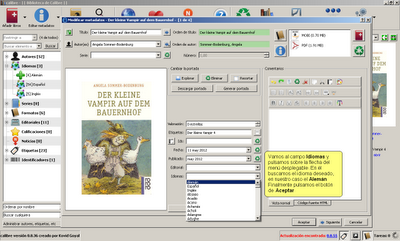

# Cambiar el idioma de un ebook desde Calibre

:material-account: [Walter Paterno](https://t.me/Dunhill69){ target=_blank } · :material-link-variant: [Ver el original en Telegraph](https://telegra.ph/Como-cambiar-el-idioma-de-ebook-desde-Calibre-01-31){ target=_blank }
{ .tut-datos }

---

 

Hace un tiempo hablé en este blog sobre el lector **Kindle** de **Amazon** y [cómo encontrar un diccionario aleman-español](http://tomasingermany.blogspot.com.es/2012/05/diccionario-aleman-espanol-para-kindle.html) en Internet e integrarlo en el dispositivo, puesto que los diccionarios que vienen de serie con el Kindle son sólo diccionarios de definiciones y la verdad es que lo que nos interesa, si estamos aprendiendo algún idioma, es poder consultar la traducción al castellano de la palabra que no entendamos.

Una vez integrado el diccionario, [como también expliqué en el mismo post](http://tomasingermany.blogspot.com.es/2012/05/diccionario-aleman-espanol-para-kindle.html), no debería haber ningún problema, pues el Kindle reconoce automáticamente el idioma de los libros que le metemos y selecciona el diccionario asociado. La cuestión es que esto **no siempre es así**, y puede que **al intentar leer un libro en alemán** y seleccionar una palabra para conocer la traducción, **el Kindle acceda al diccionario en castellano de la RAE, se líe y acabe no traduciendo nada.**

Si esto ocurre, lo que tendremos que hacer será **modificar los metadatos** del ebook (es decir, la ficha del libro) con algún programa para ordenador y volver a pasar el ebook con los metadatos modificados al Kindle. Por ejemplo, esto lo podemos hacer muy fácilmente con el programa **Calibre**, el cual podemos descargar de [ésta página](http://calibre-ebook.com/).

Calibre ofrece una gran variedad de opciones: gestionar lectores electrónicos de diferentes marcas, organizar nuestra biblioteca de libros, cambiar el formato de los ebooks para adecuarlo al de nuestro lector particular (en el caso del Kindle, pasar del formato estándar **epub** al **mobi** específico de Amazon), etc. Aunque lo que ahora nos interesa es la característica de poder cambiar los metadatos de un ebook.

Para ello y una vez cargado el ebook en cuestión en nuestra biblioteca de Calibre, lo buscamos en la lista y pulsamos con el botón derecho del ratón sobre él. Nos movemos a ***Editar metadatos*** y pulsamos sobre ***Editar metadatos por separado***.

En la nueva pantalla que se nos ha abierto encontramos la ficha del libro (los también llamados metadatos). Aquí no tenemos más que localizar el campo donde pone ***Idioma*** y seleccionar en el menú desplegable el ***Alemán*** (o el que sea). A continuación pulsamos sobre el botón de ***Aceptar***.

Una vez hecho esto sólo nos queda **pasar de nuevo el ebook al Kindle** y disfrutar de la lectura :)

Fuente: [https://tomasingermany.blogspot.com/2012/06/como-cambiar-el-idioma-de-un-ebook-con.html](https://tomasingermany.blogspot.com/2012/06/como-cambiar-el-idioma-de-un-ebook-con.html)

Ir al mensaje: [https://t.me/calibreconfiguraciones/1/40438](https://t.me/calibreconfiguraciones/1/40438)

 

---

[:material-arrow-left: Volver al índice](../../alfabetico.md) · [:fontawesome-brands-telegram: Preguntar en el grupo](https://t.me/calibreconfiguraciones){ target=_blank }
