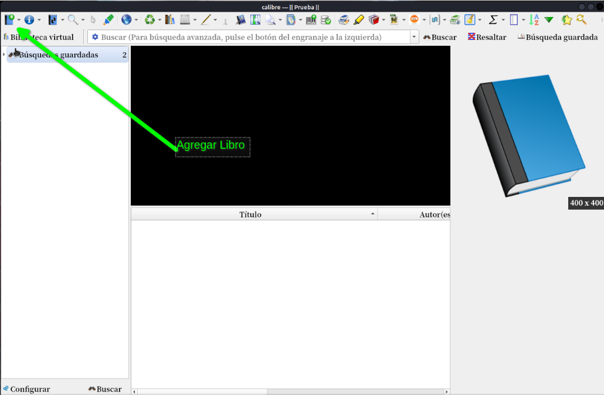
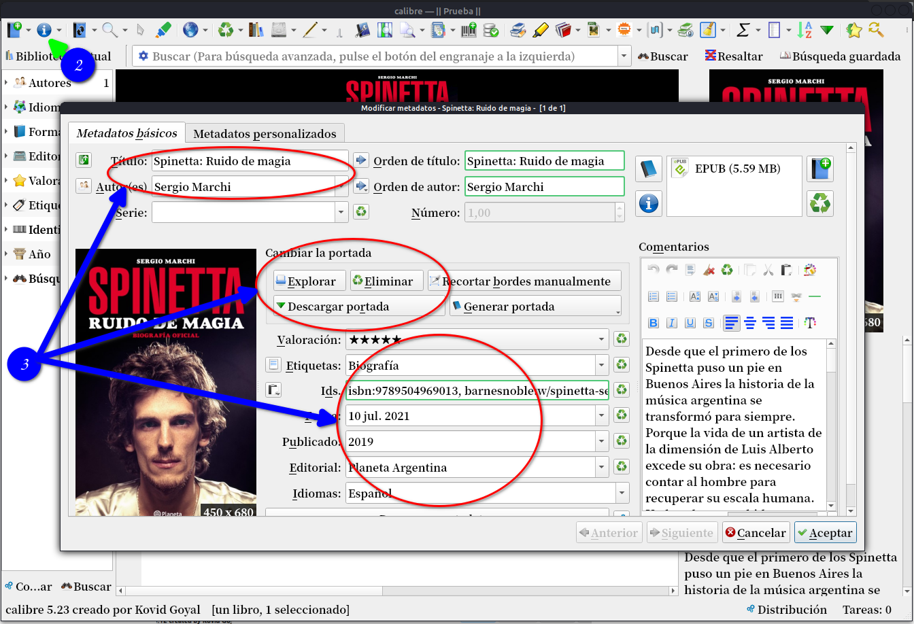
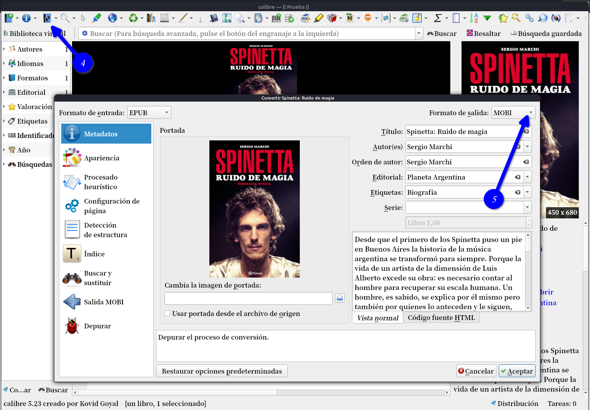
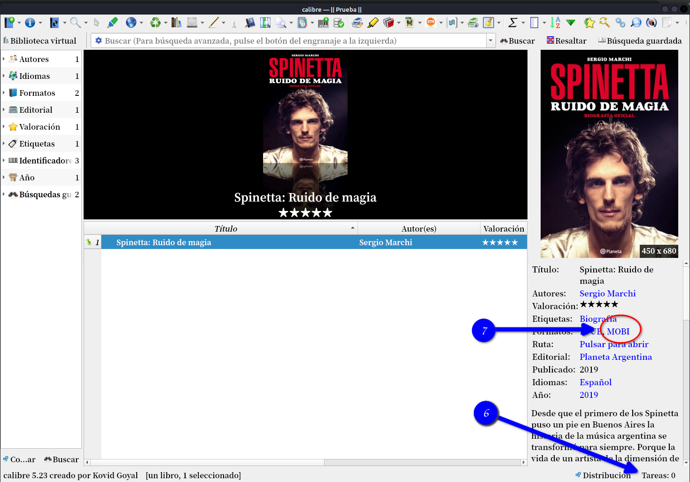

# Cómo convertir formatos de libros con Calibre

:material-account: [Walter](https://t.me/Dunhill69){ target=_blank } · :material-link-variant: [Ver el original en Telegraph](https://telegra.ph/Como-convertir-formatos-de-libros-con-Calibre-07-11){ target=_blank }
{ .tut-datos }

---

## **¿Como funciona?**

Una vez que haya descargado el [programa Calibre](https://calibre-ebook.com/) , deberá tener un documento para cargar. Puede tener el formato que desee.

**Paso 1: ** Haga clic en AGREGAR LIBROS en la parte superior izquierda de la pantalla.

Allí, seleccionará el archivo que desea cargar desde donde esté almacenado en su computadora. O puede arrastrar el archivo debajo del explorador de portadas.

**Paso 2: ** Una vez descargado el archivo, que se puede ver en la cola principal del programa, tendrás que editar los METADATOS. Haga clic en EDITAR METADATOS en la barra de inicio.

**Paso 3: ** Aquí querrá asegurarse de que su título y el nombre del autor sean correctos, agregue etiquetas, ID (ISBN #), editor, fecha de publicación y descargue la portada de su libro.

Cuando haya terminado de agregar toda esa información y haya presionado Aceptar, estará listo para convertir su libro.

**Paso 4: ** Para convertir un libro a otro formato, en el icono converitir en la barra de herramientas, nos aparece esta pantalla.

**Paso 5: ** Aquí es donde decidirá en qué formato estará su libro electrónico. Elija el tipo de archivo que desee y haga clic en Aceptar.

**Paso 6: ** La conversión se convertirá en un TRABAJO en la esquina inferior izquierda del programa. Cuando se complete la conversión, verá el formato elegido en la lista debajo del proyecto que ha seleccionado.

**Paso 7: ** Para obtener el archivo, haga clic en RUTA debajo de los formatos listados y copie y pegue en un lugar seguro en su computadora para un fácil acceso.

¡Y eso es! Ha creado un nuevo formato para su libro electrónico. Ahora, siempre puede volver atrás y crear otros formatos.

## [Volver al inicio](https://telegra.ph/Indice-Calibre-en-Espa%C3%B1ol-10-03)

##  

 

---

[:material-arrow-left: Volver al índice](../../alfabetico.md) · [:fontawesome-brands-telegram: Preguntar en el grupo](https://t.me/calibreconfiguraciones){ target=_blank }
