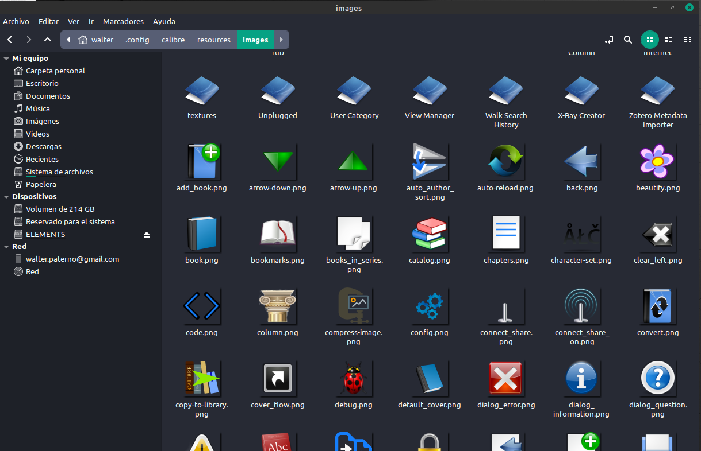
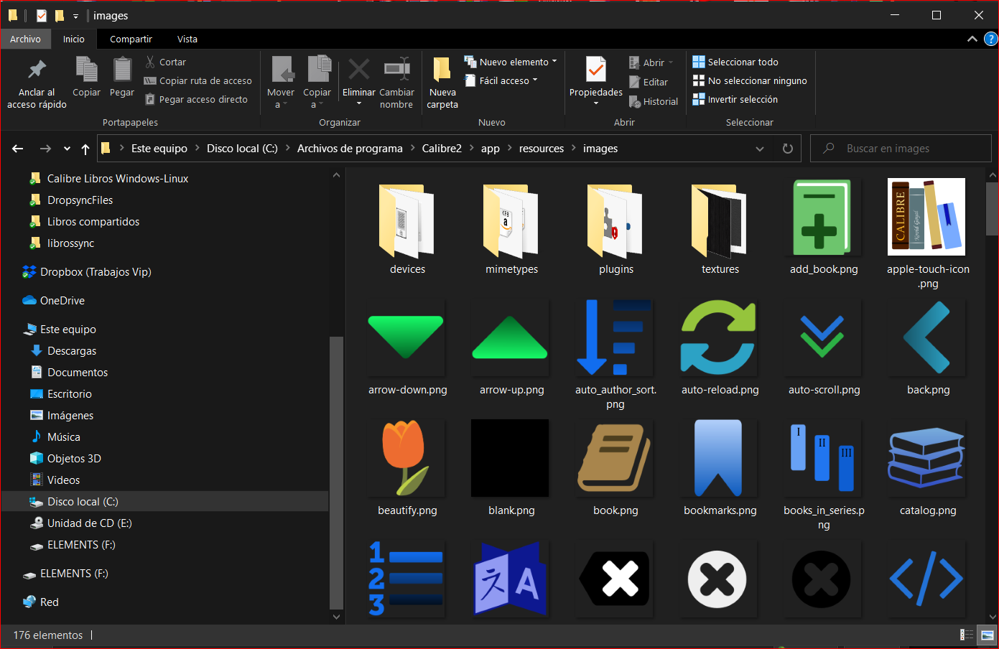
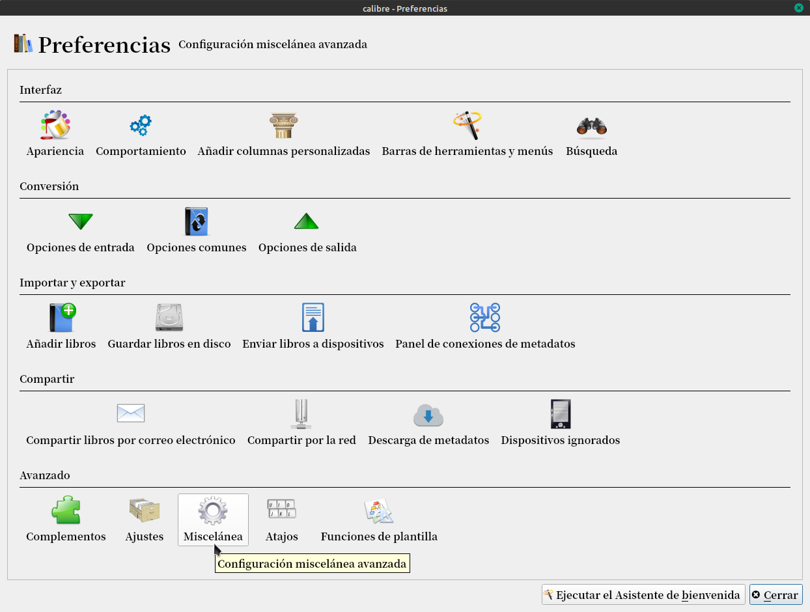
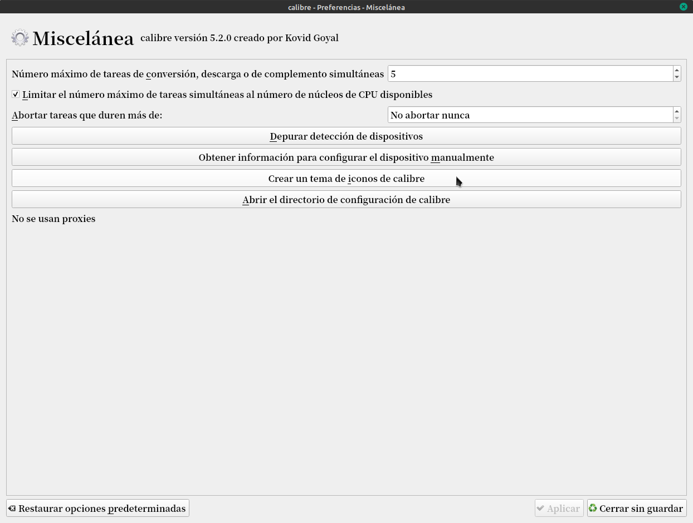
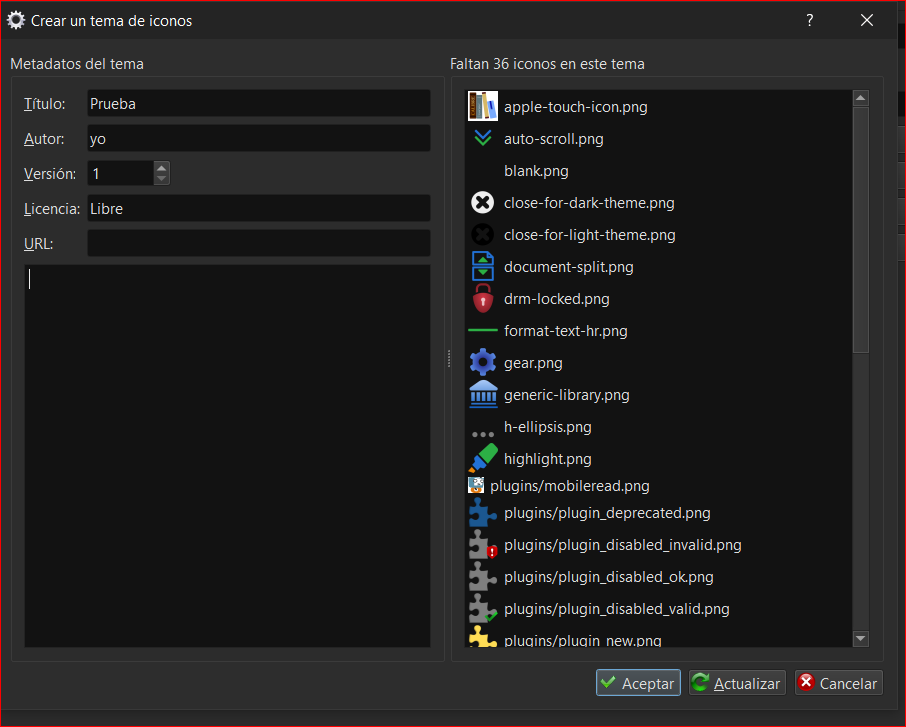
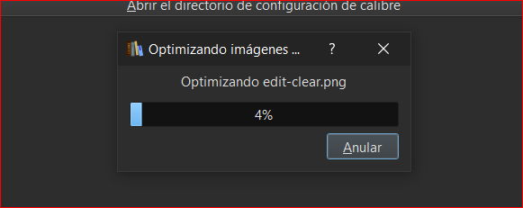
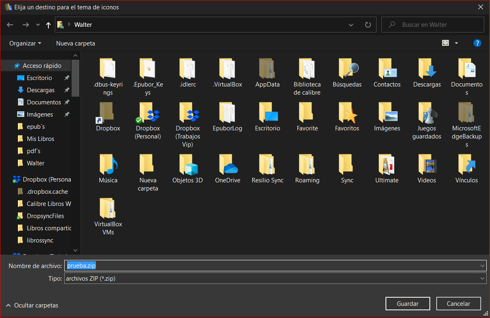

# Cómo crear nuestros propios íconos de Calibre

:material-account: [Walter](https://t.me/Dunhill69){ target=_blank } · :material-link-variant: [Ver el original en Telegraph](https://telegra.ph/Como-crear-nuestros-propios-iconos-de-Calibre-10-18){ target=_blank }
{ .tut-datos }

---

Antes que nada buscaremos la carpeta donde están los iconos originales de Calibre. En linux están en esta ruta /home/nuestro usuario/.config/calibre/resouces/imagenes

En windows están es esta ruta Este equipo/Disco Local/Archivos de programas/Calibre2/app/resources/imagenes

Yo les recomendaría copiar esta carpeta aunque sea en el escritorio para no estropear nada. Desde internet buscamos las imágenes (iconos) que nos gusten que más o menos hagan referencia a la acción remplazamos la imagen nuestra por el mismo nombre que tienen los iconos en esta carpeta. Cuando todo este listo

Vamos a Preferencias/Micelánea

Tocamos en crear un tema de iconos de Calibre

Y buscamos la carpeta en nuestro escritorio con los iconos que hemos modificado. Se nos abre esta pantalla.

En ella como vemos podemos poner el titulo de nuestros iconos, el autor. Tocamos Aceptar y se empieza a compilar.

Una vez terminado el proceso se nos abre una pantalla donde no dice que elijamos el lugar donde guardar el archivo. Ponemos escritorio.

## [Volver al inicio](https://telegra.ph/Indice-Calibre-en-Espa%C3%B1ol-10-03)

##  

 

 

---

[:material-arrow-left: Volver al índice](../../alfabetico.md) · [:fontawesome-brands-telegram: Preguntar en el grupo](https://t.me/calibreconfiguraciones){ target=_blank }
