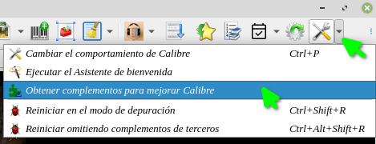
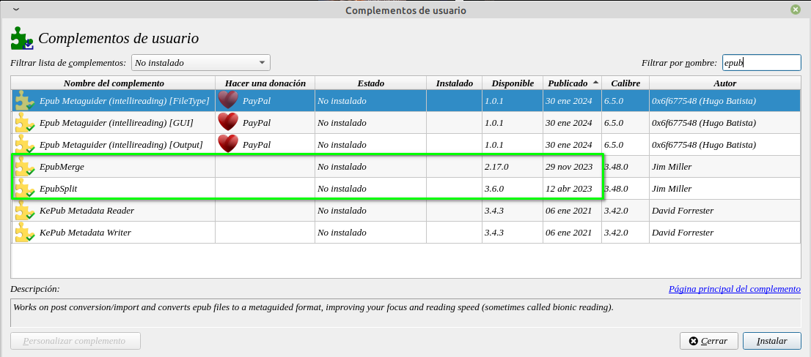
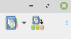
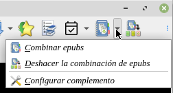
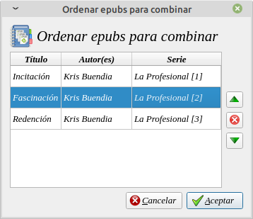
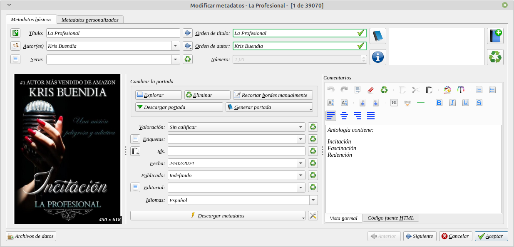
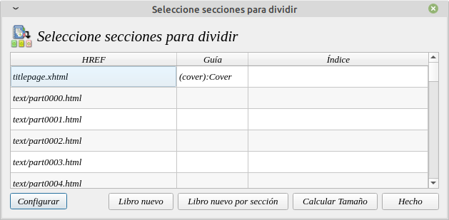

# Cómo dividir o unir EPUB

:material-account: [Walter](https://t.me/Dunhill69){ target=_blank } · :material-link-variant: [Ver el original en Telegraph](https://telegra.ph/Como-dividir-y-unir-epub-con-calibre-02-24){ target=_blank }
{ .tut-datos }

---

Si desea combinar colecciones de cuentos, o si desea dividir un libro en partes, Necesitaremos estos dos plugins. Los Plugins **EpubMerge/EpubSplit**

Ebooks libres de DRM, en formato ePub.

## Instalación y configuración de los plug-ins

Para editar los libros ePub es necesario instalar unos plugins. Dentro Calibre, haga clic en **Preferencias -\> Obtener complementos para mejorar** calibre, como se ve en la imagen.

Cuando se abre la pantalla buscamos con epub e instalaremos EpubMerge y EpubSplit

Si queremos evitar reiniciar dos veces calibre cuando instalamos el primero en lugar de apretar Reiniciar calibre, tocamos Aceptar e instalaremos el segundo y en esta oportunidad tocamos reiniciar.

Una vez que aparecen los iconos en la barra de herramienta veremos que función realizan cada uno.

## Unir Libros Electrónicos

Con el fin de crear la combinación, es necesario **seleccionar todos los Ebooks que desea unir ** y luego en la barra de menús, seleccione

*EpubMerge -\> Combinar epubs*

Este complemento es ideal para unir sagas. Con la segunda opción en caso de tener un epub unido lo podemos separar.

**Nota**: Si alguno de los documentos seleccionados no son epub o son epub protegidos por DRM, el proceso fallará inmediatamente.

Una vez seleccionados los documentos, aparece un cuadro que muestra la posición de los libros, utilice las flechas verdes para moverse hacia arriba, abajo, o eliminar con la X algún Ebook. Posteriormente haga clic en Aceptar.

Y los tendrá unidos en un solo epub

En calibre el archivo unificado se verá de esta manera.

En la sinopsis aparecerán los volúmenes que incluye.

## Dividir y Extraer Partes del Ebook

Después de **seleccionar el libro que desea dividir**, haga clic en icono

*EpubSplit*

Alternativamente, si estuviéramos trabajando con un documento que no tiene demarcación, podríamos mirar la tabla de la columna de Contenidos para ver que cada parte o confirmar las partes a extraer con una vista previa, pasando el cursor sobre la entrada en la lista.

Una vez que se establezca lo que quiere extraer, destaque sólo aquellas entradas y haga clic en Libro nuevo.

Al ser un extracto de un libro podemos editar los metadatos a nuestro gusto.

***"No tiene mensaje descriptivo en el grupo"***

## [Volver al inicio](https://telegra.ph/Indice-Calibre-en-Espa%C3%B1ol-10-03)

 

.

---

[:material-arrow-left: Volver al índice](../../alfabetico.md) · [:fontawesome-brands-telegram: Preguntar en el grupo](https://t.me/calibreconfiguraciones){ target=_blank }
