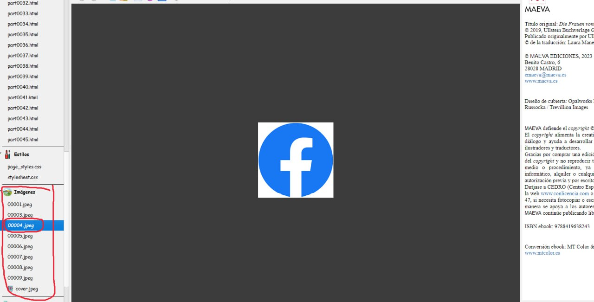
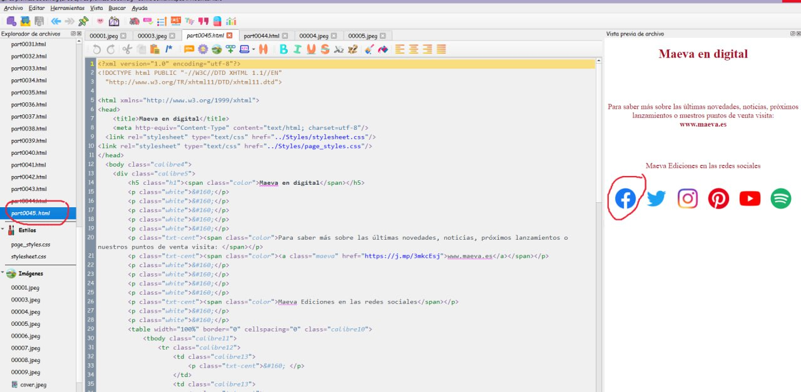
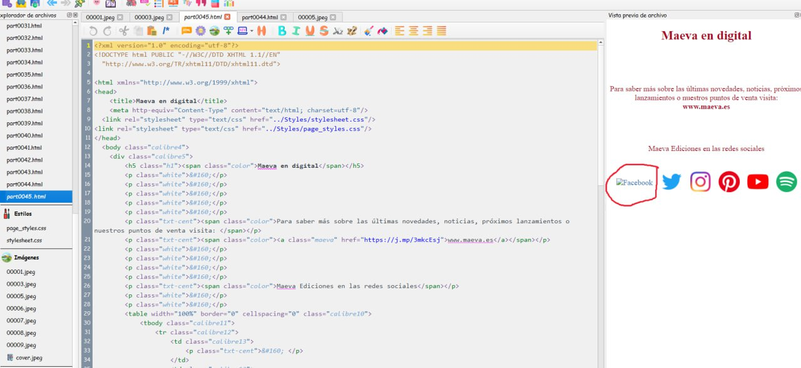

# Eliminar imagen dentro del libro

:material-account: [Walter](https://t.me/Dunhill69){ target=_blank } · :material-link-variant: [Ver el original en Telegraph](https://telegra.ph/Como-eliminar-una-imagen-dentro-del-libro-02-15){ target=_blank }
{ .tut-datos }

---

Explicado por @jane\_morris

Imagina que quieres quitar este logo, que lo has visto mirando todas las imágenes una por una aquí.

Pues te vas al apartado de html y empiezas a mirar uno por uno desde abajo hasta que lo veas, cuando lo veas ya puedes borrar la imagen y cuando hayas hecho lo mismo con todos los logos de esa página ya puedes borrar la página también, pero esta desde donde aparece en este apartado de html

Como ves en Modificar libro tienes un apartado de la columna de la izquierda para todos los html (hojas) del libro, y más abajo otro apartado de todas las imágenes del libro, tienes que jugar con los dos.

Para borrar la imagen le das doble click encima de la linea y le das a la tecla suprimir . Te vas luego al html (hoja) y verás como ya no está donde estaba, pero lo que has hecho también al borrar la imagen es eliminarla del libro, ni figura ni pesa.

Ir al mensaje: [https://t.me/calibreconfiguraciones/144967/145141](https://t.me/calibreconfiguraciones/144967/145141)

## [Volver al inicio](https://telegra.ph/Indice-Calibre-en-Espa%C3%B1ol-10-03)

 

---

[:material-arrow-left: Volver al índice](../../alfabetico.md) · [:fontawesome-brands-telegram: Preguntar en el grupo](https://t.me/calibreconfiguraciones){ target=_blank }
