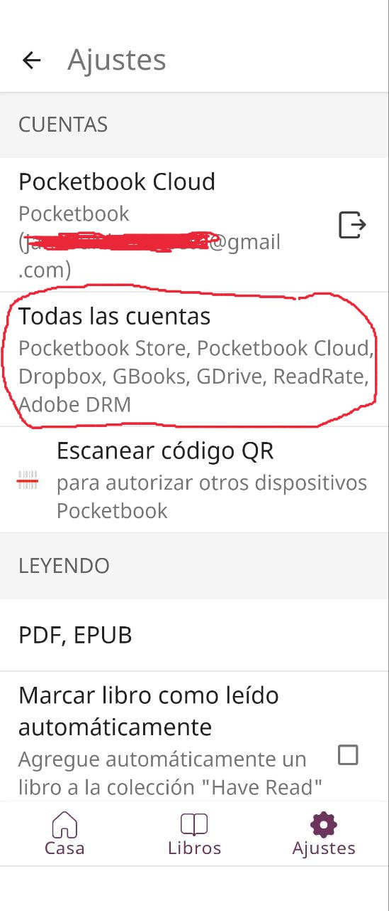
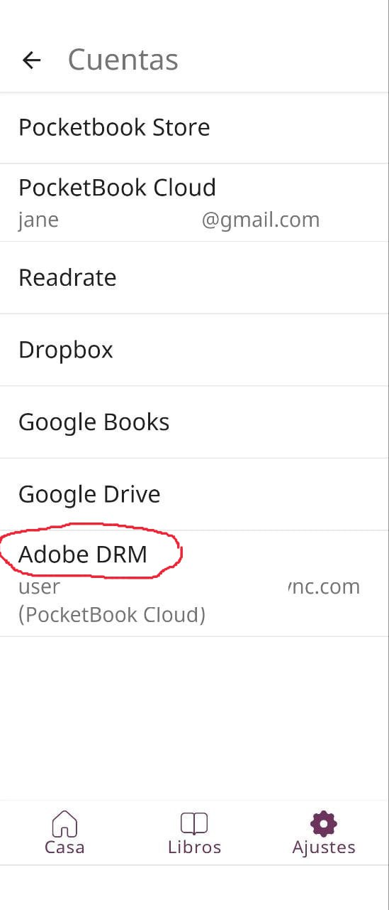
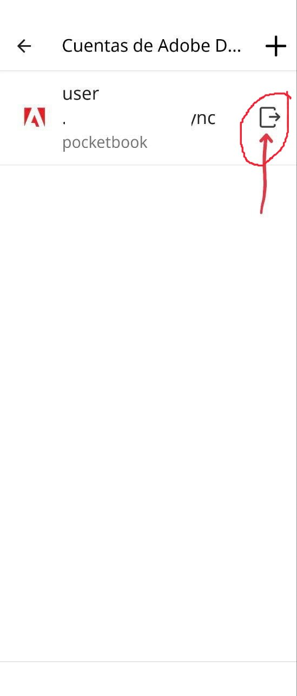
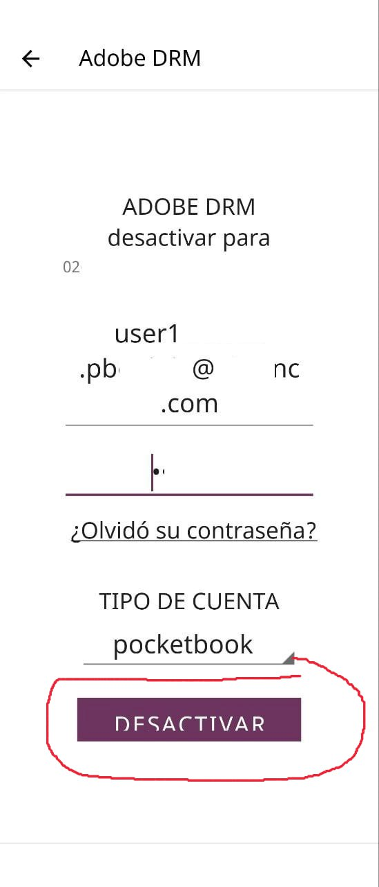
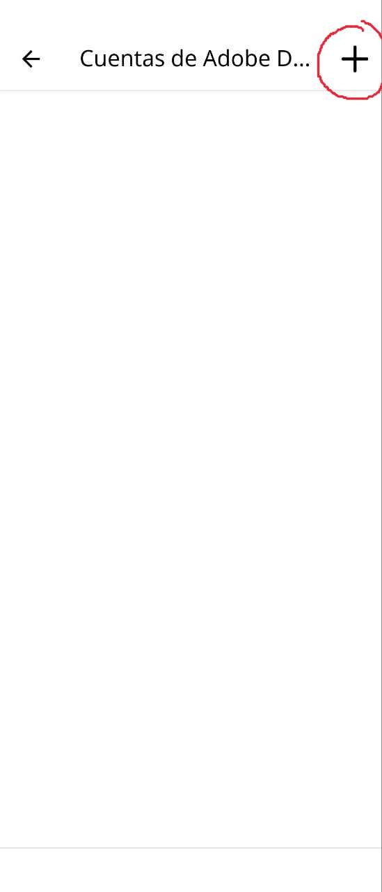
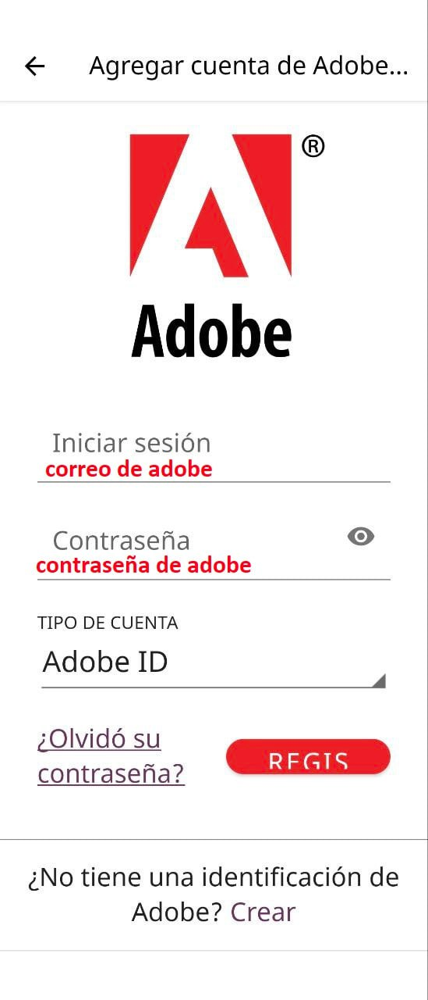
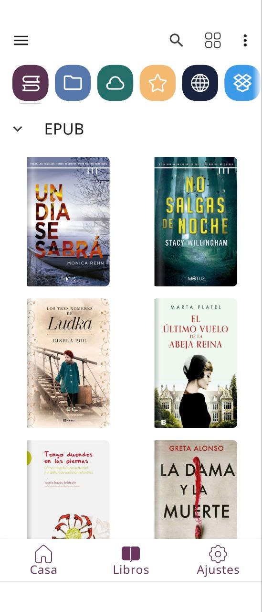

# PocketBook - leer en el móvil los libros comprados

:material-account: [Walter Paterno](https://t.me/Dunhill69){ target=_blank } · :material-link-variant: [Ver el original en Telegraph](https://telegra.ph/Como-leer-en-vuestros-moviles-libros-comprados-en-acms-01-27){ target=_blank }
{ .tut-datos }

---

Explicado por @jane\_morris

1.- Ajustes dentro de la aplicación de pocketbook—\>todas las cuentas

2.- Clic en adobe drm.

3.- Clic en salir, para quitar cualquier cuenta que no sea la vuestra personal

4.- Desactivar

5.- Clic en el +

6.- Aquí ponemos nuestro correo y contraseña de nuestro adobe digital

7.- Pensará un poco y ya os saldrá la pantalla de la biblio.

Es super importante que configureis por defecto vuestro Adobe ID en TODOS vuestros dispositivos y apps de pocketbook, porque si no, no se os abrirán los libros.

Así, sí, y si yo ahora le mando a mi hija mi correo y contraseña de adobe y el libro con drm en acsm ella lo podrá leer en su aplicación de pocketbook .Solo tendría que añadir en su movil o / y pocketbook mi correo y contraseña y lo podría leer perfectamente aun con drm.

No tendría que eliminar su Adobe ID, sino solo añadir el mio, con lo que tendría los dos.

Al pulsar en la portada aún vacía, le intentaría descargar en primer lugar con su Adobe ID y enseguida el sistema se daría cuenta de que no y lo intentaría con el mio que es el segundo y entonces si se le descargaría sin problema alguno.

Y ya estaría preparada vuestra cuenta de pocktebook del movil para recibir libros en acsm con DRM

Continua para la web del pocketbook cloud aqui:

[https://t.me/calibreconfiguraciones/124635/125774](https://t.me/calibreconfiguraciones/124635/125774)

 

Ir al mensaje: [https://t.me/calibreconfiguraciones/124635/125656](https://t.me/calibreconfiguraciones/124635/125656)

## [Volver al inicio](https://telegra.ph/Indice-Calibre-en-Espa%C3%B1ol-10-03)

 

 

 

 

---

[:material-arrow-left: Volver al índice](../../alfabetico.md) · [:fontawesome-brands-telegram: Preguntar en el grupo](https://t.me/calibreconfiguraciones){ target=_blank }
