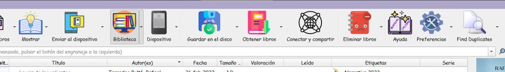
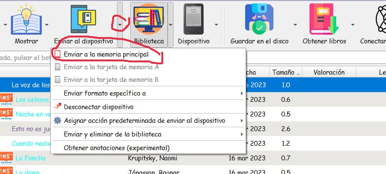
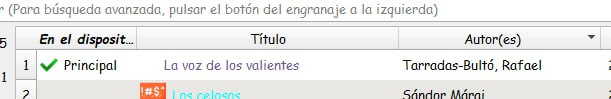
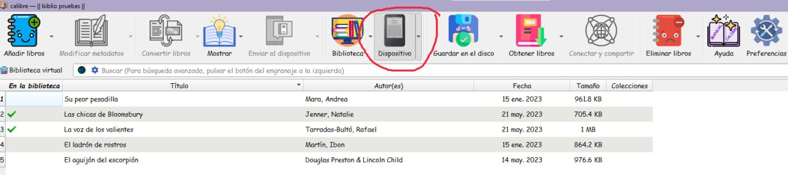

# Kindle - pasar un EPUB al Kindle

:material-account: [Walter Paterno](https://t.me/Dunhill69){ target=_blank } · :material-link-variant: [Ver el original en Telegraph](https://telegra.ph/Como-pasar-un-epub-a-un-kindle-05-21){ target=_blank }
{ .tut-datos }

---

Explicado por @jane\_morris

- Para pasar un epub a un kindle de la mejor manera posible, la que nunca falla:

- Convierte en calibre el epub a azw3

- Conecta con cable el kindle al ordenador

- Verás que los iconos de calibre se transforman un poco, como aquí

Ahora, con estos nuevos iconos que te han aparecido cuando el kindle está conectado al ordenador haz lo siguiente:

Seleccionado el libro que quieres pasar al kindle

Haz clic en los dos sitios que te he redondeado en rojo.

Verás que en la columna de la izquierda en la linea del libro en cuestión te ha aparecido una señal verde y que te pone principal.

y que si ahora marcas en el icono que se llama dispositivo y que es tu kindle ya te aparece el libro.

Ir al mensaje: [https://t.me/calibreconfiguraciones/124637/135497](https://t.me/calibreconfiguraciones/124637/135497)

 

**Para tener portadas**:

Explicado por @Gran\_capitan\_semicurado

 

***Opción 1***:

Dejarlo siempre en modo avión

***Opción 2***:

1)Desconectar desde Calibre (esperando hasta que ya no salga el kindle en Calibre)

2)Desenchufar, volver a enchufar y esperar a que calibre lo reconozca.

3)Volver a desconectar desde Calibre, esperar y desconectar el cable

## [Volver al inicio](https://telegra.ph/Indice-Calibre-en-Espa%C3%B1ol-10-03)

 

 

 

 

 

---

[:material-arrow-left: Volver al índice](../../alfabetico.md) · [:fontawesome-brands-telegram: Preguntar en el grupo](https://t.me/calibreconfiguraciones){ target=_blank }
