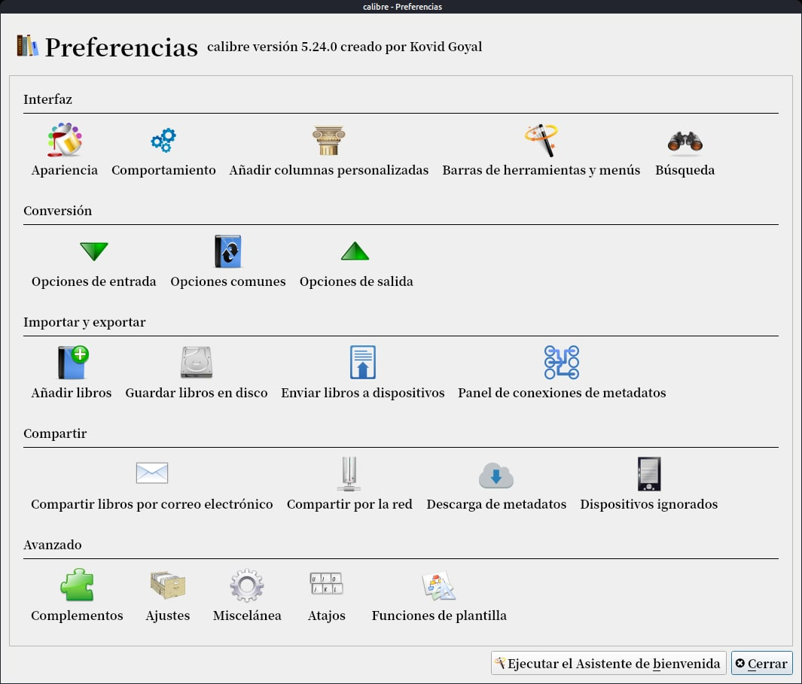
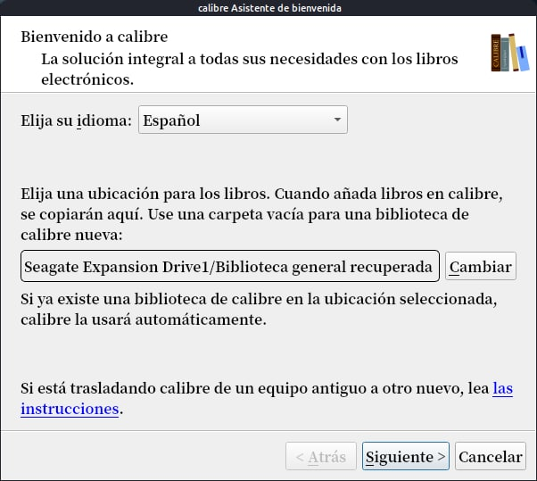

# Cómo poner Calibre en otro idioma

:material-account: [Walter](https://t.me/Dunhill69){ target=_blank } · :material-link-variant: [Ver el original en Telegraph](https://telegra.ph/Como-poner-Calibre-en-otro-idioma-10-08){ target=_blank }
{ .tut-datos }

---

Vamos a preferencias y ejecutamos el asistente de bienvenida.

Se reinicia Calibre y nos sale este cartel donde podemos elegir el idioma y nuestro dispositivo.

Ir al mensaje: [https://t.me/calibreconfiguraciones/42088](https://t.me/calibreconfiguraciones/42088)

 

## [Volver al inicio](https://telegra.ph/Indice-Calibre-en-Espa%C3%B1ol-10-03)

 

---

[:material-arrow-left: Volver al índice](../../alfabetico.md) · [:fontawesome-brands-telegram: Preguntar en el grupo](https://t.me/calibreconfiguraciones){ target=_blank }
