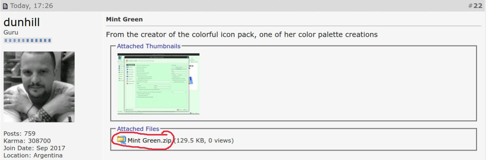
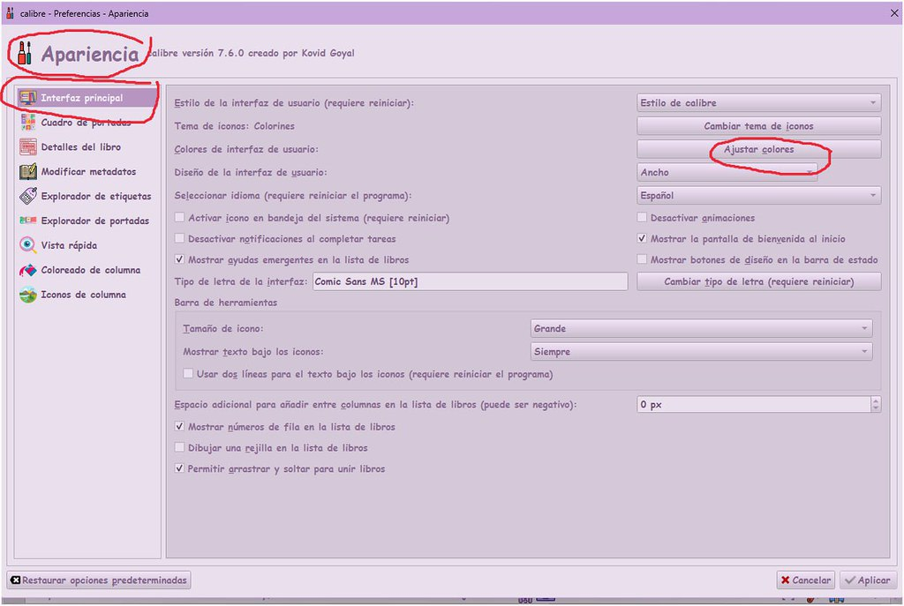
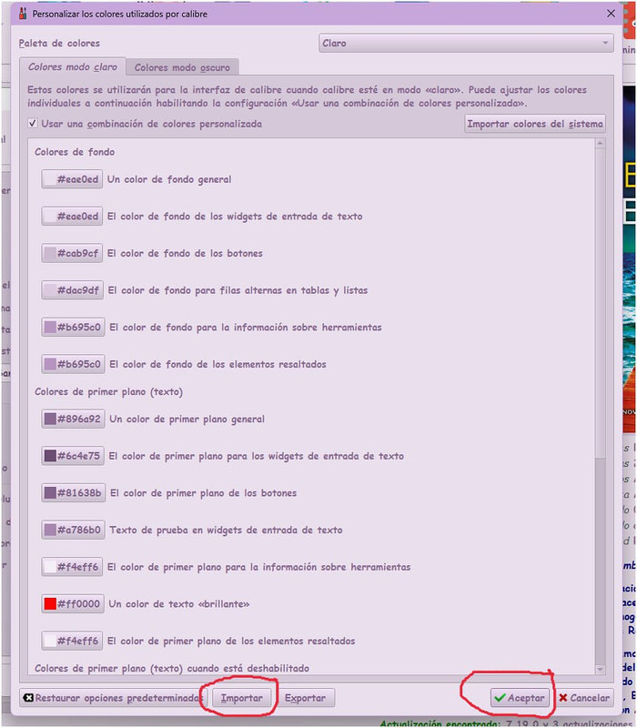

# Paleta de colores - usar una del foro oficial de Calibre

:material-account: [Walter](https://t.me/Dunhill69){ target=_blank } · :material-link-variant: [Ver el original en Telegraph](https://telegra.ph/Como-poner-en-nuestro-Calibre-una-paleta-de-colores-de-las-que-est%C3%A1n-subidas-en-el-foro-oficial-de-Calibre-10-06){ target=_blank }
{ .tut-datos }

---

Ya están subidas las paletas de colores de @Dunhill69 y de @jane\_morris al foro oficial de Calibre (Algo que tenia pendiente) la de @jane\_morris la pueden ver en [https://www.mobileread.com/forums/showthread.php?t=359611&page=2](https://www.mobileread.com/forums/showthread.php?t=359611&page=2)

 

1) Se clica en el zip que está debajo de la paleta —\> se descarga en una carpeta de nuestro ordenador —\> se descomprime con winrar eligiendo extgraer aquí, y veremos que dentro esta el archivo de la paleta y la imagen.

2) Vamos a nuestro calibre a

Preferencias —\> apariencia —\> y en el apartado Interfaz Principal clicamos en Ajustar colores

3) Nos saldrá esta pantalla y clicaremos donde redondeo en rojo

al clicar en Importar nos comunica con nuestro ordenador, buscamos la paleta que nos hemos descargado antes y que estaba dentro del zip, le damos doble clic y veremos que cambian los cuadritos de la imagen por los nuevos colores, entonces clicamos en aceptar.

4) Vamos aplicando y aceptando según nos pidan las pantallas que nos quedan abiertas y listo, cerramos y volvemos a abrir calibre y ya la tendremos

 

Ir al mensaje: [https://t.me/calibreconfiguraciones/112333/172658](https://t.me/calibreconfiguraciones/112333/172658)

 

 

## [Volver al inicio](https://telegra.ph/Indice-Calibre-en-Espa%C3%B1ol-10-03)

 

 

---

[:material-arrow-left: Volver al índice](../../alfabetico.md) · [:fontawesome-brands-telegram: Preguntar en el grupo](https://t.me/calibreconfiguraciones){ target=_blank }
