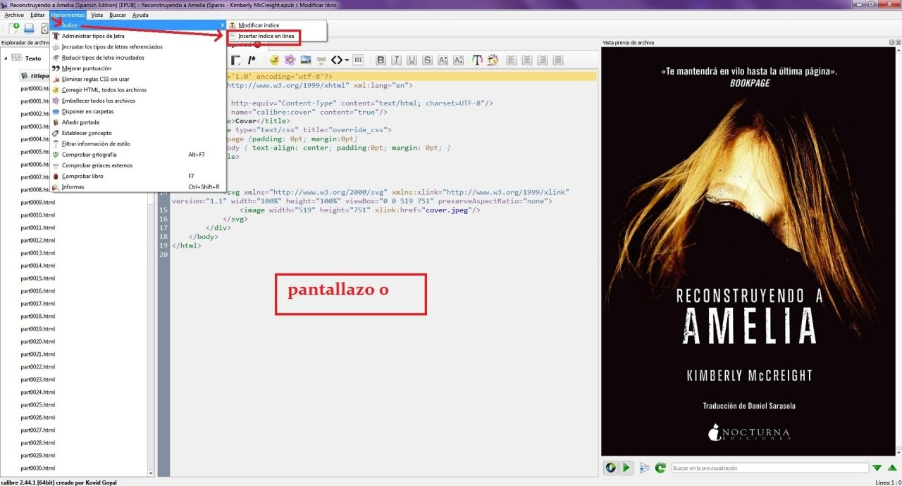
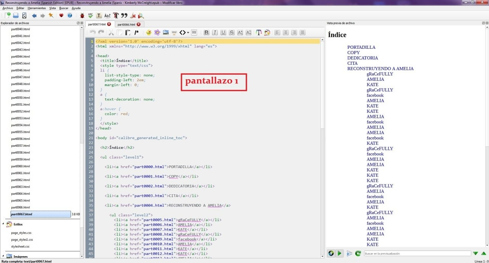
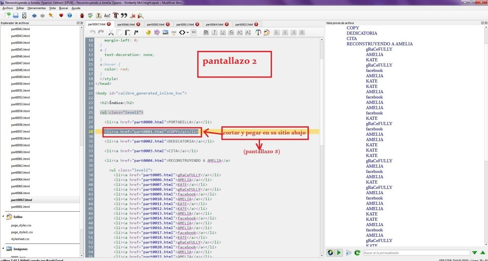
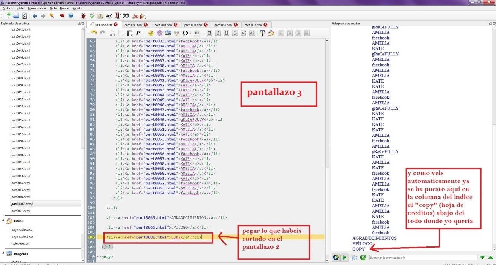
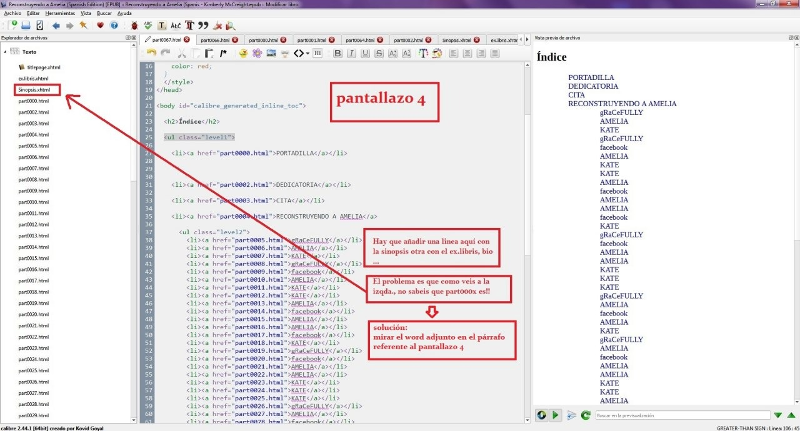
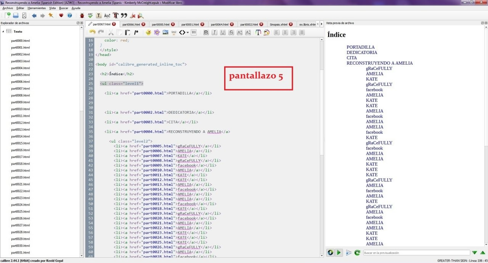
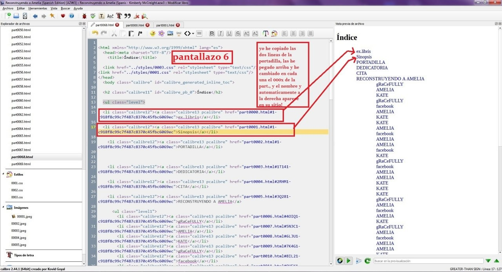
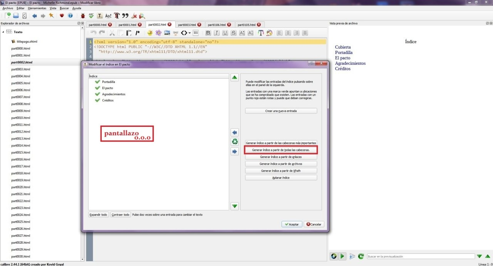
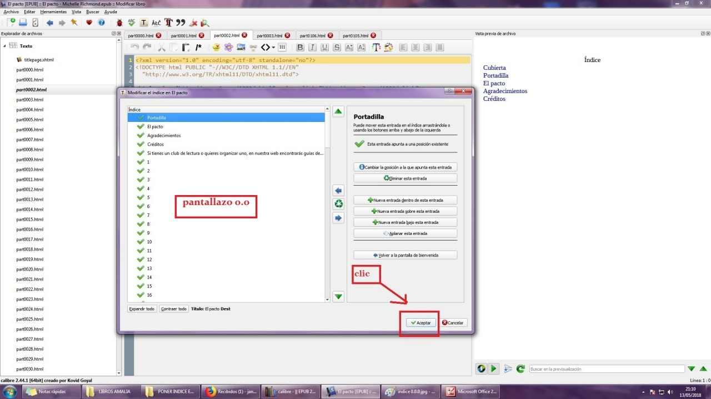

# Cómo poner índice en un libro

:material-account: [Walter](https://t.me/Dunhill69){ target=_blank } · :material-link-variant: [Ver el original en Telegraph](https://telegra.ph/COMO-PONER-INDICE-EN-UN-LIBRO-EN-CALIBRE-10-09){ target=_blank }
{ .tut-datos }

---

Explicado por Jane

OPCION 1) CUANDO NO HAY INDICE:

Convertir como siempre el azw3 en epub y borrar el azw3

Ya en epub, “modificar libro” -🡪arriba izqda. “herramientas” -🡪indice-🡪insertar índice en línea (pantallazo 0)

Os aparecerá el pantallazo 1

Arreglais lo que queráis si no lo habéis hecho antes, como por ejemplo llevar la hoja de créditos abajo del todo en la columna de la izquierda, yo aconsejo hacerlo antes de hacer el índice porque si no como en este caso hay que hacerlo también en la parte central situados en el índice, cortando de donde este lo que queráis cambiar y pegándolo donde lo queráis poner (pantallazos 2 y 3)

Y el índice ya estaría, pero como veis falta añadir la sinopsis, bio, ex.libris …

El problema es que para ello teneis que saber la parte que es (columna izqda.) y en epub no hay manera de saberlo (pantallazo 4)

Para ello el truco está en hacerlo en el formato azw3, (antes guardais los cambios de modificar libro en epub y cerrais y os vais a convertír el epub en azw3, pero no elimineis el epub todavía que lo podeis necesitar por si no os acordais de como le habéis puesto exactamente al ex.libris o la sinopsis o la bio, (cuentan las mayúsculas y todo) y en el azw3 no se ve.

 

Una vez en azw3🡪modificar libro -🡪 abajo clic en la línea del índice

 

Y aquí sí!!! Aquí ya os aparece todo a la izqda.., con los números de “part” incluidos los que habíais hecho nuevos como en este caso el ex.libris y la sinopsis y la bio (pantallazo 5)

Asi que copiáis una línea de en medio desde \<li\> hasta \</li\> la poneis donde queráis que vaya, (en mi caso arriba de la portadilla) y cambiais la “part” por la que toca y también el nombre (por eso os decía que es importante saber si le habéis llamado ex.libris por ejemplo o Ex-libris pongo por caso.) (pantallazo 6)

Ejemplo:

Copiais:

\<li class="calibre12"\>\<a class="calibre13 pcalibre" href="part0002.html#1-c918f8c99c7f487c8370c45fbc6069ec"\>PORTADILLA\</a\>\</li\>

Y sustituis para que os quede así:

\<li class="calibre12"\>\<a class="calibre13 pcalibre" href="part0000.html#1-c918f8c99c7f487c8370c45fbc6069ec"\>ex.libris\</a\>\</li\>

Como vereis en el pantallazo 6 automaticamente aparece en el índice en la columna de la derecha.

Guardad los cambios y salis.

Y ahora ya fuera, elimináis el antiguo epub, convertid el azw3 otra vez en azw3, elimináis el antiguo y el nuevo lo convertís en epub y luego en mobi, y en todos os aparecerá el índice

 

OPCION 2) CUANDO HAY INDICE PERO POCO:

 

Como siempre en epub, “Modificar libro” 🡪 Herramientas 🡪 Indice 🡪 Modificar índice

Clic en “generar índice a partir de todas las cabeceras” (pantallazo 0.0.0)

Te aparece el (pantallazo 0.0),

aceptas y te vas

Otra vez Herramientas 🡪Indice🡪Insertar índice en línea

Y ya te aparece el solito, luego ya lo arreglas como quieras y según las normas de más arriba en la opción 1

 

PARA AÑADIR ENTRADAS NUEVAS COMO POR EJEMPLO EX.LIBRIS, SINOPSIS, BIOS…

 

Para añadir, añades el ex.libris, la sinopsis, lo que quieras en epub, guardas cambios y te sales.

Lo conviertes en azw y luego en azw copias una entrada que ya exista y la pegas en el lugar de por ejemplo la sinopsis, y cambias el número de la entrada que habías cambiado por ejemplo el 0001 por el que sea de verdad, por ejemplo el 0000 ( te fijas a la izqda el nº que tiene la entrada nueva) y tambien sustituyes el nombre de la entrada que has copiado por el de la nueva y ya está, y así con todas las que hayas añadido nuevas. Guardas los cambios y te vas.

Luego conviertes el azw otra vez en azw, eliminas el viejo y también el epub viejo,  y conviertes el nuevo en epub.

 

Ejemplo:

Entrada ya existente "Pasaje al nuevo mundo":

\
\<a class="calibre7" href="part0001.html#caja"\>\Pasaje al nuevo mundo\</span\>\</a\>\</p\>

 

Entrada nueva " Ex-libris":

\
\<a class="calibre7" href="part0000.html#caja"\>\Ex-libris\</span\>\</a\>\</p\>

 

## [Volver al inicio](https://telegra.ph/Indice-Calibre-en-Espa%C3%B1ol-10-03)

##  

 

 

 

---

[:material-arrow-left: Volver al índice](../../alfabetico.md) · [:fontawesome-brands-telegram: Preguntar en el grupo](https://t.me/calibreconfiguraciones){ target=_blank }
