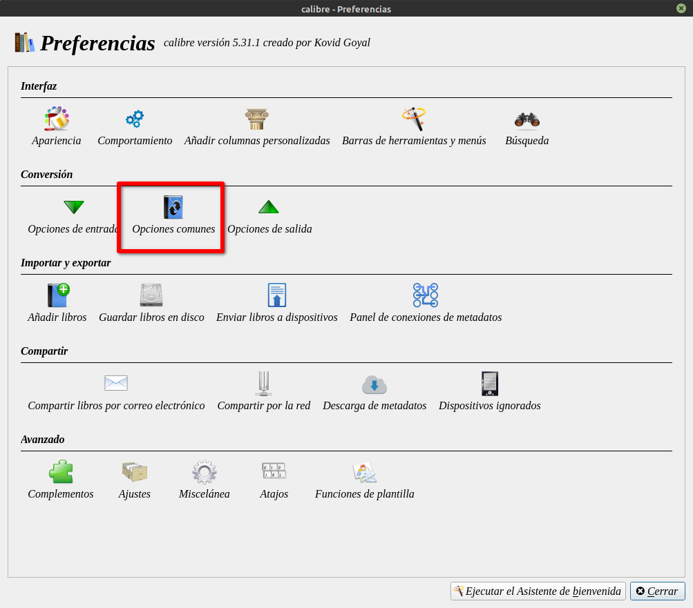
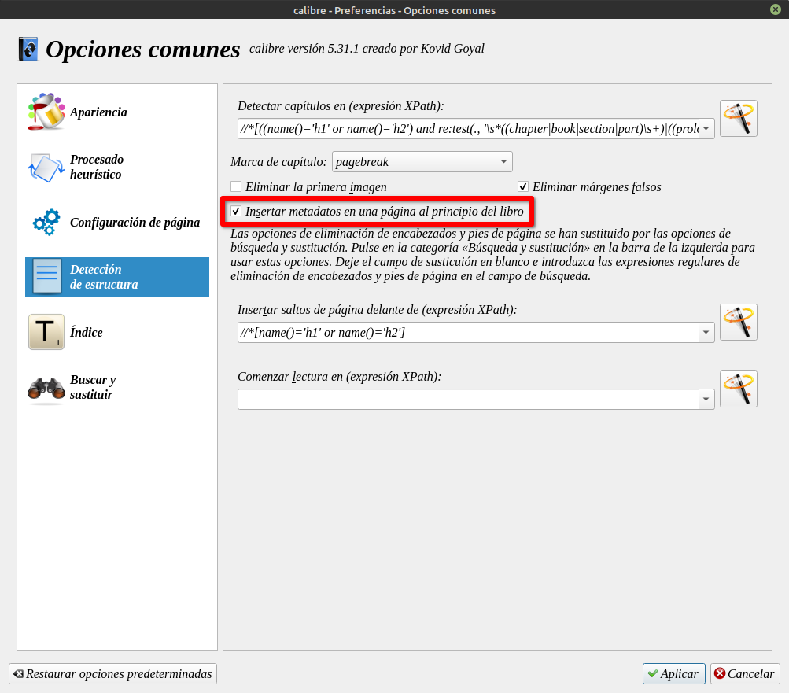

# Sinopsis dentro del libro

:material-account: [Walter](https://t.me/Dunhill69){ target=_blank } · :material-link-variant: [Ver el original en Telegraph](https://telegra.ph/Como-poner-la-sinopsis-dentro-del-libro-10-31){ target=_blank }
{ .tut-datos }

---

Para poner la sinopsis dentro del libro, seleccionamos el libro, vamos a Preferencias Conversiones, Opciones comunes.

Vemos a detección de escritura y marcamos la casilla Insertar metadatos en una página al principio del libro

Y le damos en aceptar

Cuando se haya editado el comentario de un libro, puede convertir el libro (por ejemplo, de epub a epub) y después de la portada hay una página con los metadatos (título, autor, comentario, etc.).

 

## [Volver al inicio](https://telegra.ph/Indice-Calibre-en-Espa%C3%B1ol-10-03)

 

 

---

[:material-arrow-left: Volver al índice](../../alfabetico.md) · [:fontawesome-brands-telegram: Preguntar en el grupo](https://t.me/calibreconfiguraciones){ target=_blank }
