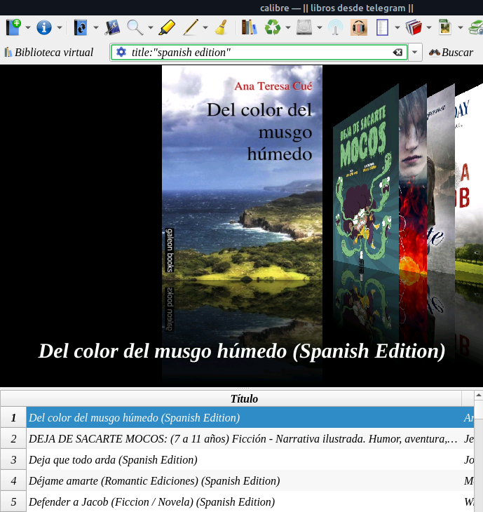
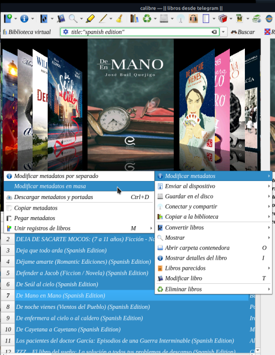
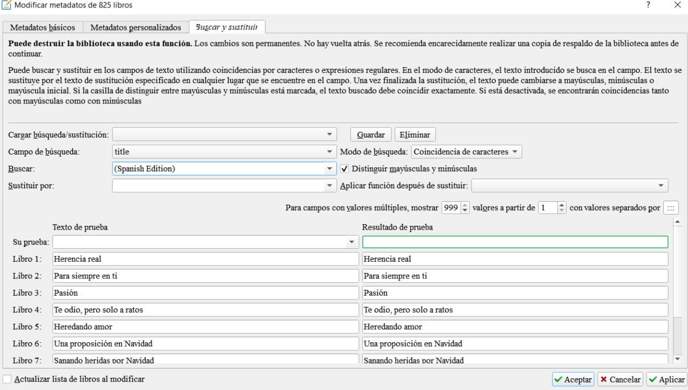
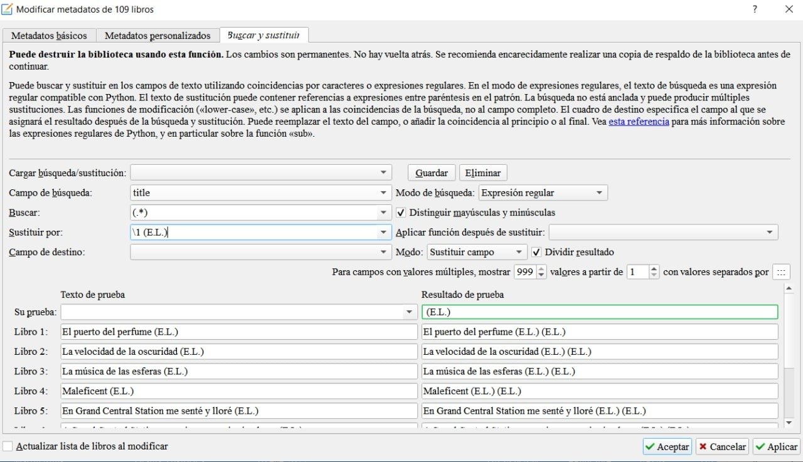

# Cómo quitar de los títulos el «Spanish Edition»

:material-account: [Walter](https://t.me/Dunhill69){ target=_blank } · :material-link-variant: [Ver el original en Telegraph](https://telegra.ph/Como-quitar-de-los-t%C3%ADtulos-el-spanish-edition-01-25){ target=_blank }
{ .tut-datos }

---

Una pregunta de Jane que ha respondido Aurora45 @aurorasu

Primero debemos buscar "spanish edition" en el titulo con

title:"spanish edition" en la barra de busqueda.

Una vez con el resultado seleccionamos todos los libros con Ctrl+A o Ctrl +E segun el sistema operativo

Botón derecho del mouse modificar metadatos en masa

En buscar y sustituir

En campo de busqueda ponemos title

en buscar: en este caso (Spanish Edition)

En modo de búqueda : Coincidencia de caracteres

tal cual como se ve en la imagen de Aurora45

Le damos en Aceptar y Aplicar.

Se puede como opción desmarcar distinguir mayúsculas y minúsculas.

Ir al mensaje: [https://t.me/calibreconfiguraciones/64532](https://t.me/calibreconfiguraciones/64532)

Para poner una marca en el título

y cambia el modo de búsqueda,, que es expresión regular

para añadir alguna marca al título

para poner la / al revés es

alt gr + º

## [Volver al inicio](https://telegra.ph/Indice-Calibre-en-Espa%C3%B1ol-10-03)

 

 

---

[:material-arrow-left: Volver al índice](../../alfabetico.md) · [:fontawesome-brands-telegram: Preguntar en el grupo](https://t.me/calibreconfiguraciones){ target=_blank }
