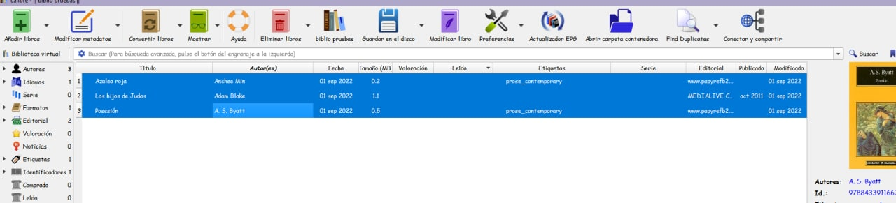
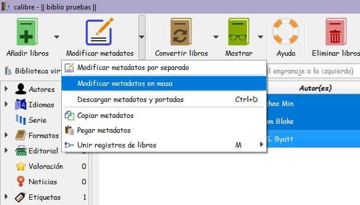
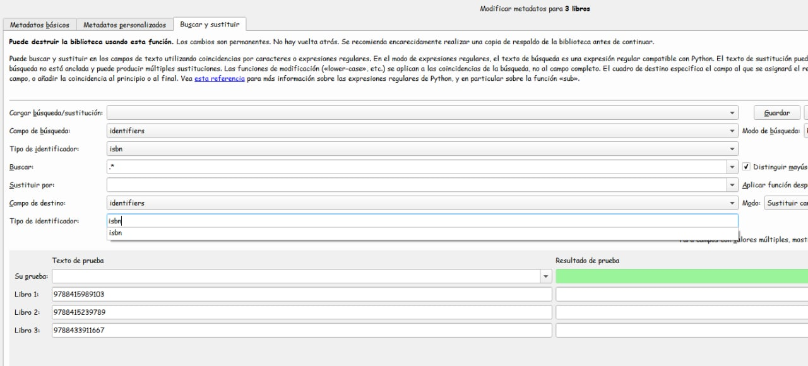
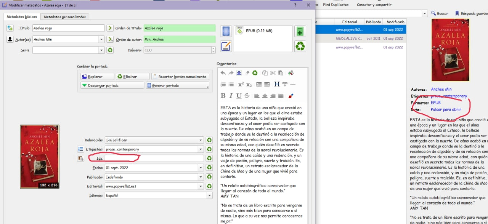
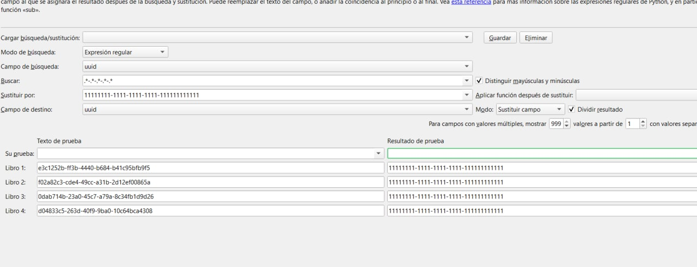

# Quitar indicadores en masa

:material-account: [Walter](https://t.me/Dunhill69){ target=_blank } · :material-link-variant: [Ver el original en Telegraph](https://telegra.ph/Como-quitar-los-indicadores-en-masa-08-31){ target=_blank }
{ .tut-datos }

---

 

1) Seleccionamos todos los libros de nuetro interes.

2) Con todo marcado, clicamos en metadatos en masa.

3) En la solapa Buscar y Reemplazar ponemos tal cual la imagen.

4) Aplicamos y aceptamos

5) Y ya se ha quitado tanto aquí como aquí.

Ir al mensaje:[https://t.me/calibreconfiguraciones/96000](https://t.me/calibreconfiguraciones/96000)

 

Un apunte como sustituir los uuid y que no se dupliquen explicado por @cabezonxl

o sea....  .\*-.\*-.\*-.\*-.\*

Ir al mensaje:[https://t.me/calibreconfiguraciones/96064](https://t.me/calibreconfiguraciones/96064)

## [Volver al inicio](https://telegra.ph/Indice-Calibre-en-Espa%C3%B1ol-10-03)

 

---

[:material-arrow-left: Volver al índice](../../alfabetico.md) · [:fontawesome-brands-telegram: Preguntar en el grupo](https://t.me/calibreconfiguraciones){ target=_blank }
