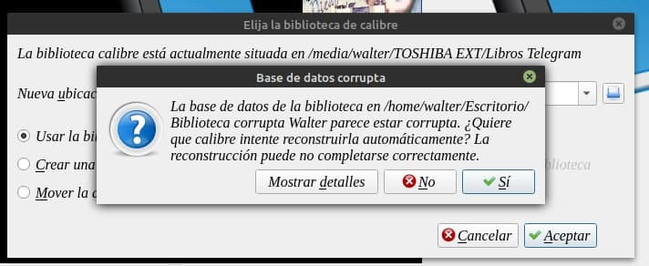
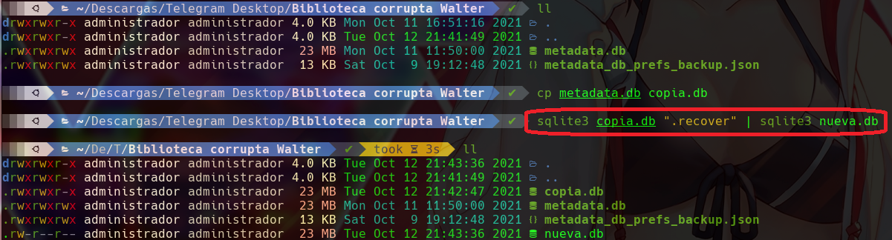
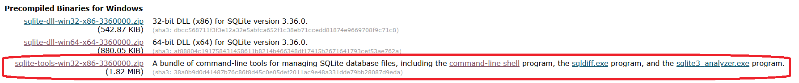
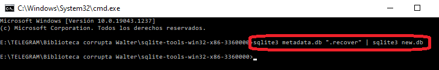
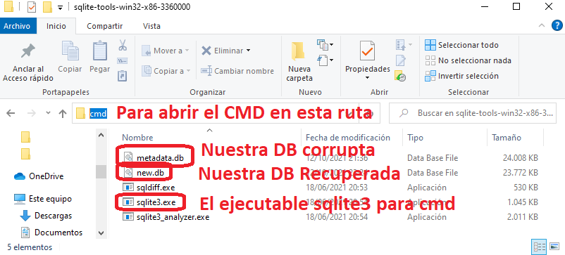
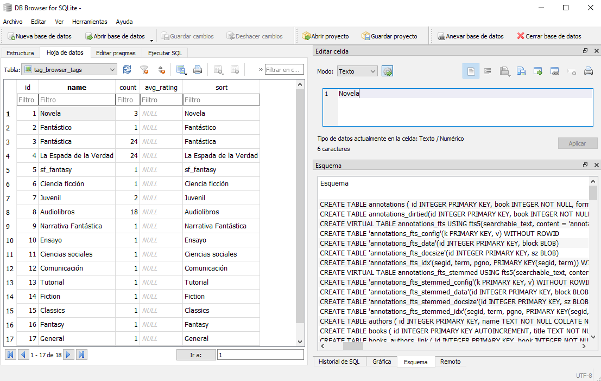
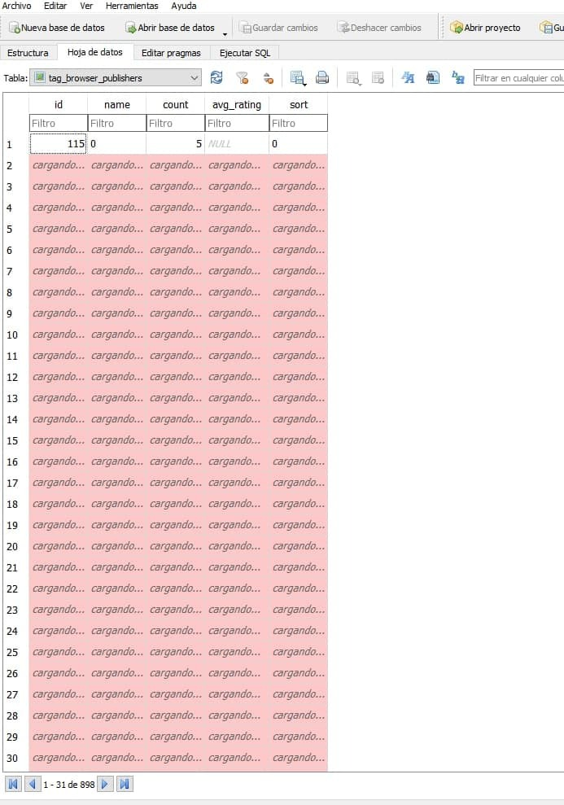

# Base de datos corrupta, cómo recuperarla

:material-account: [@wiso\_wolo](https://t.me/Dunhill69){ target=_blank } · :material-link-variant: [Ver el original en Telegraph](https://telegra.ph/Como-recuperar-una-base-de-datos-corrupta-10-12){ target=_blank }
{ .tut-datos }

---

Explicado por Wiso @wiso\_wolo

**Recuperar biblioteca corrupta en Calibre**

Si tenemos la mala suerte de que nuestra base de datos de Calibre está corrupta (ya sea por desconectar el disco de forma poco segura, un corte de luz, o pura mala suerte) Calibre nos da la opción de repararla, el problema es que tarda MUCHO.

Desde consola (en este manual uso Linux, pero en Windows también se podrá hacer de forma equivalente) podemos intentar recuperar la Base de Datos, y este proceso se hará en segundos.

**<u>LINUX</u>**

En caso de no tener instalado el paquete sqlite3 deberemos instalarlo:

sudo apt-get install sqlite3

Solo tenemos que abrir una terminal, ir a la carpeta que contiene nuestra base de datos y ejecutar el comando para tratar de recuperar el contenido corrupto.

sqlite3 broken.db “.recover” \| sqlite3 nuevo.db

siendo **broken.db** el nombre de nuestra DB corrupta y **nuevo.db** el nombre de salida para la BD reparada.

Una vez tengamos el archivo de la Base de Datos reparada solo falta cambiarle el nombre por el original, en el caso de la biblioteca de calibre es **metadata.db**

 

**<u>WINDOWS</u>**

Para ejecutar este mismo comando en windows deberemos descargar los ejecutables .exe de sqlite3 para poder usarlo desde ms2 o cmd.

Descargamos desde la web oficial de sqlite3, en concreto la versión para windows compatible con la linea de comandos (el último de los 3 disponibles, ocupa unos 2mb)

Para ejecutarlo vamos a hacer lo siguiente:

1) Descomprimimos el archivo descargado en una carpeta.

2) Copiamos nuestra Base de datos corrupta en esta carpeta.

3) En la ruta de la carpeta escribimos CMD y así se abrirá una ventanita de CMD o ms2 en esa ruta.

Para ejecutar la recuperación de la Base de datos de calibre ejecutamos lo siguiente:

sqlite3 metadata.db “recover” \| sqlite3 new.db

Siendo **metadata.db** el nombre de la base de datos de calibre corrupta

**new.db** el nombre de salida para la nueva base de datos recuperada.

Ahora ya podemos borrar la base de datos corrupta, metadata.bd, y cambiarle el nombre a new.bd para que se llame metadata.db.

Copiamos **metadata.db** en la carpeta de la biblioteca de calibre (sobrescribiendo la antigua en caso de no haberla borrado)

i queremos comprobar el estado de la DB (base de datos) de calibre (o cualquier otra sqlite3)

podemos hacerlo usando un programa gratuito y multiplataforma llamado sqlitebrowser.

[<u>https://sqlitebrowser.org/dl/</u>](https://sqlitebrowser.org/dl/)

y se vería tal que así:

 

 

 

## [Volver al inicio](https://telegra.ph/Indice-Calibre-en-Espa%C3%B1ol-10-03)

 

 

 

 

 

 

 

 

 

 

 

 

 

 

 

 

[https://www.sqlite.org/download.html](https://www.sqlite.org/download.html)

 

 

 

 

 

 

 

 

 

 

O pueden descargar el programa desde la página oficial

[https://sqlitebrowser.org/dl/#windows](https://sqlitebrowser.org/dl/#windows)

---

[:material-arrow-left: Volver al índice](../../alfabetico.md) · [:fontawesome-brands-telegram: Preguntar en el grupo](https://t.me/calibreconfiguraciones){ target=_blank }
