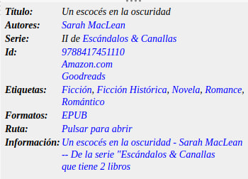
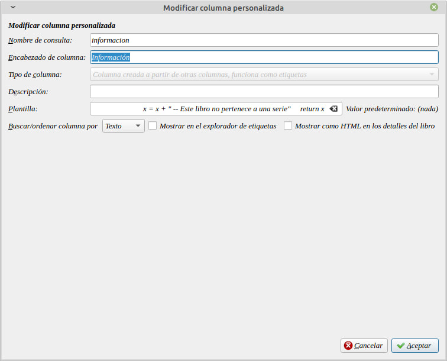
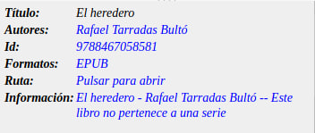
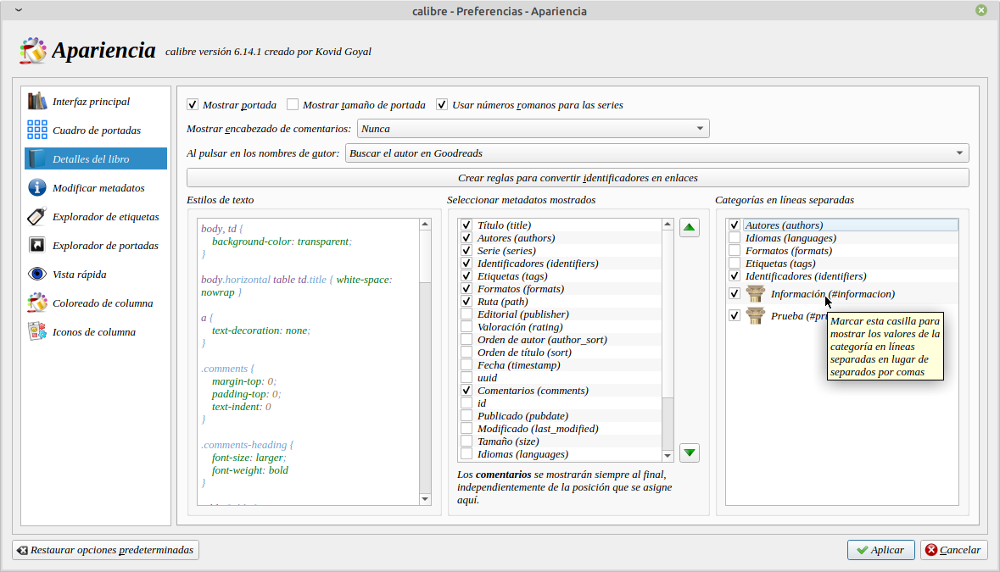

# Información de serie en el detalle del libro

:material-account: [Walter Paterno](https://t.me/Dunhill69){ target=_blank } · :material-link-variant: [Ver el original en Telegraph](https://telegra.ph/Como-tener-la-informaci%C3%B3n-de-la-serie-en-el-detalle-del-libro-04-03){ target=_blank }
{ .tut-datos }

---

Para tener la información de la serie en el detalle del libro y que se ve así

Deberemos crear una columna personalizada que dependa de otra columna.

Y en plantilla colocamos este código:

python:

def evaluate(book, context):

# Use la función de plantilla incorporada para formatear el título y los autores

x = context.funcs.template('{Title} - {authors}')

# Cuenta los libros de la serie. Primero obtenga el nombre de la serie

series = book.get('series')

if series:

# El libro está en una serie. Obtener el recuento de libros de esa serie

db = context.db.new\_api

series\_id = db.get\_item\_id('series', series)

book\_count = len(db.books\_for\_field('series', series\_id))

# Agregar el número de libros al título - cadena de autor

x = x + f' -- De la serie "{series}, que tiene {book\_count} libro{"s" if book\_count \> 1 else ""}'

else:

x = x + " -- Este libro no pertenece a una serie"

return x

 

Y si el libro no tiene una serie asignada aparecería así.

Para que este dato aparezca hay que marcarlos desde Preferencia Apariencia

Ir al mensaje: [https://t.me/calibreconfiguraciones/112333/131653](https://t.me/calibreconfiguraciones/112333/131653)

## [Volver al inicio](https://telegra.ph/Indice-Calibre-en-Espa%C3%B1ol-10-03)

 

 

---

[:material-arrow-left: Volver al índice](../../alfabetico.md) · [:fontawesome-brands-telegram: Preguntar en el grupo](https://t.me/calibreconfiguraciones){ target=_blank }
