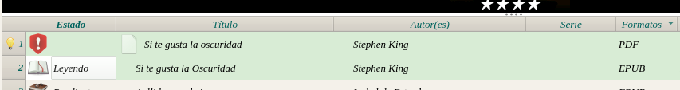
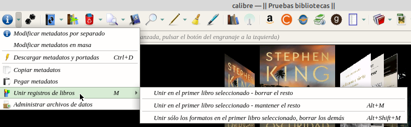
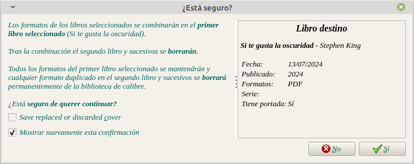
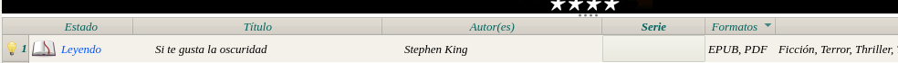

# Cómo tener una sola entrada con dos formatos distintos

:material-account: [Walter](https://t.me/Dunhill69){ target=_blank } · :material-link-variant: [Ver el original en Telegraph](https://telegra.ph/Como-tener-una-entrada-sola-con-dos-formatos-distintos-07-13){ target=_blank }
{ .tut-datos }

---

Por @Inatxo

Pues que tengo el mismo libro en PDF y ePub y tengo una entrada por cada uno, y quiero una entrada sola con los dos formatos.

Es muy fácil. Si te refieres. a libros que ya tengas en la biblioteca, has de seleccionar los libros iguales que tengas en formatos diferentes

y luego apretar la tecla M…

(O lo que es lo mismo seleccionar en la barra de MENU \> MODIFICAR METADATOS \> UNIR REGISTRO DE LIBROS) y tienes varias opciones, pudiendo elegir la que desees…

 

 

Por otra parte, cuando tienes un libro en un formato en la biblioteca e incorporas el mismo libro en otro formato, se muestran automáticamente unidos en una sola entrada…

Ésto último ocurre si y solo si tienen exactamente el mismo nombre en el título y en el autor

También he descubierto otro método que consiste en arrastrar un libro sobre el otro y se produce la unión.

 

Ir al mensaje: [https://t.me/calibreconfiguraciones/112333/167748](https://t.me/calibreconfiguraciones/112333/167748)

## [Volver al inicio](https://telegra.ph/Indice-Calibre-en-Espa%C3%B1ol-10-03)

 

 

---

[:material-arrow-left: Volver al índice](../../alfabetico.md) · [:fontawesome-brands-telegram: Preguntar en el grupo](https://t.me/calibreconfiguraciones){ target=_blank }
