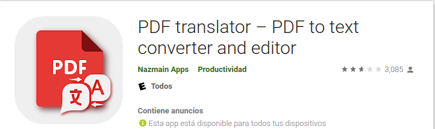
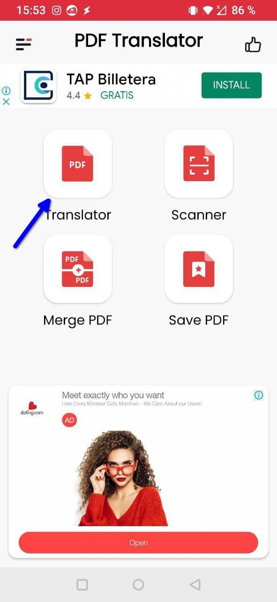
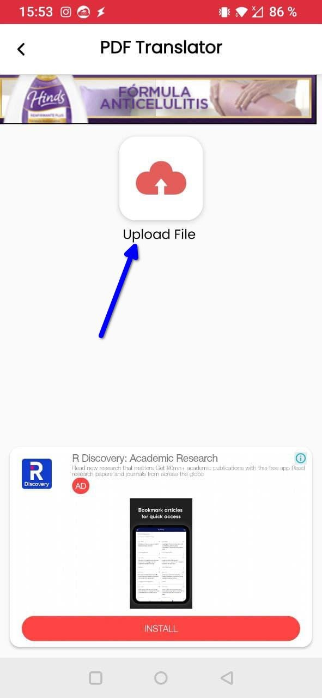
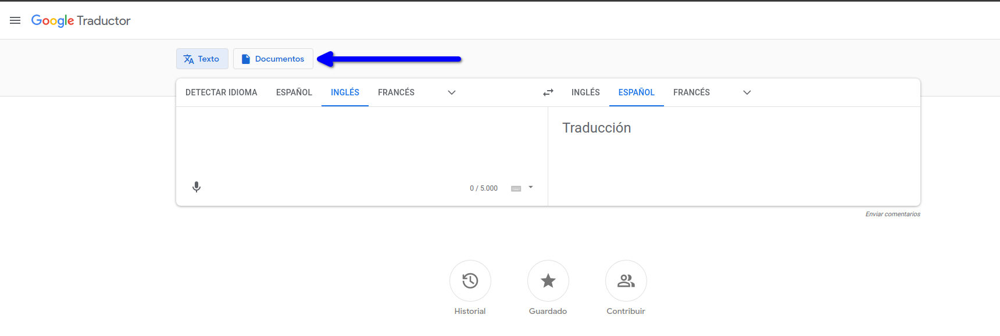
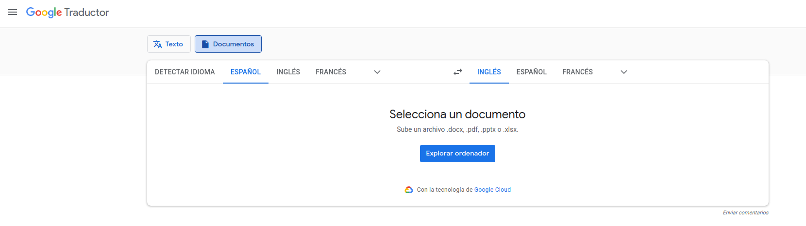
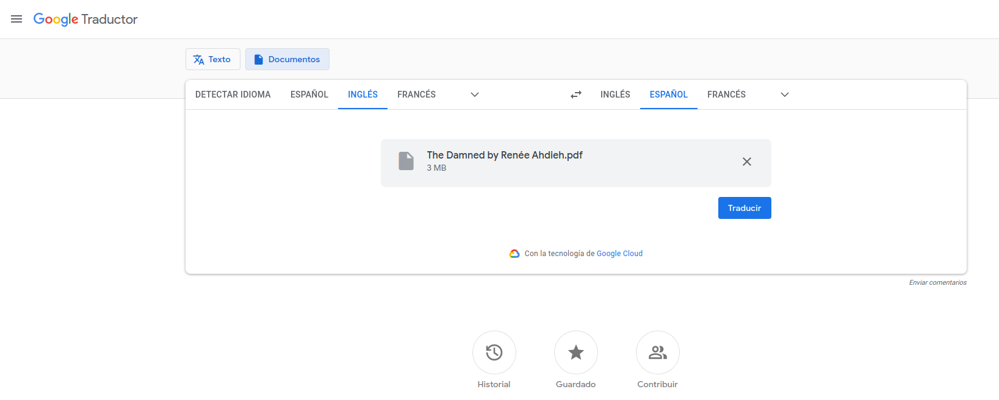
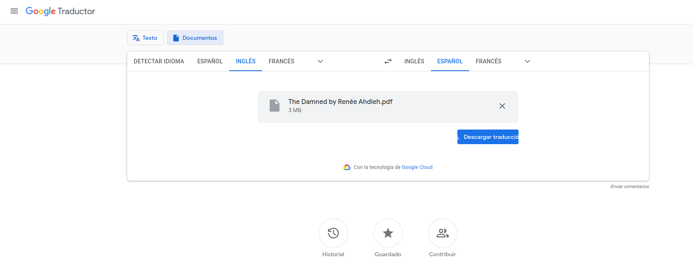
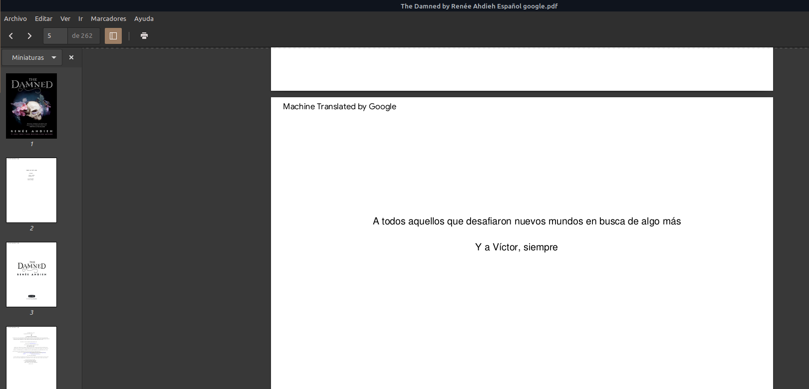

# Traducir un libro

:material-account: [Walter](https://t.me/Dunhill69){ target=_blank } · :material-link-variant: [Ver el original en Telegraph](https://telegra.ph/Como-traducir-un-libro-02-13){ target=_blank }
{ .tut-datos }

---

El otro día esta buscando un libro y solo lo encontre en ingles, preguntando, preguntando @DanaS\_Dana me suguirio una aplicación, para esto yo ya lo estaba traduciendo con google translate. Por ende explicare las dos maneras.

### Método Dana:

Desde android. Lo primero que tenemos que hacer es tener el archivo en pdf y descargarnos esta aplicación:

[https://play.google.com/store/apps/details?id=com.pdf.document.speaker.pdftext.converter.language.translator.pdftool.reader&hl=es\_AR&gl=US](https://play.google.com/store/apps/details?id=com.pdf.document.speaker.pdftext.converter.language.translator.pdftool.reader&hl=es_AR&gl=US)

Tocamos en traducir

Y cargamos el archivo, se nos abre una pantalla para buscar nuestro archivo pdf

Una vez traducido lo descargamos y ya lo tenemos.

 

### Método Google translate

En nuestro navegador entramos al traductor de google

[https://translate.google.com/?hl=es&sl=en&tl=es&op=translate](https://translate.google.com/?hl=es&sl=en&tl=es&op=translate)

Seleccionamos desde el idioma que esta el archivo al idioma de destino.

Tocamos donde dice Documentos

Y nos va a pedir que subamos el archivo, el mismo proceso que con la aplicación.

Y tocamos en traducir

tocamos en descargar tradución

Así se ve el archivo de Google:

Con esta marca de google: Machine Translated by Google en el extremo superior izquierdo de la hoja, que esto se podria sacar con el programa Sigil previa conversion a epub.

Si alguin tiene otro metodo seria bueno poder conocerlo.

Continuara....

 

## [Volver al inicio](https://telegra.ph/Indice-Calibre-en-Espa%C3%B1ol-10-03)

 

 

---

[:material-arrow-left: Volver al índice](../../alfabetico.md) · [:fontawesome-brands-telegram: Preguntar en el grupo](https://t.me/calibreconfiguraciones){ target=_blank }
