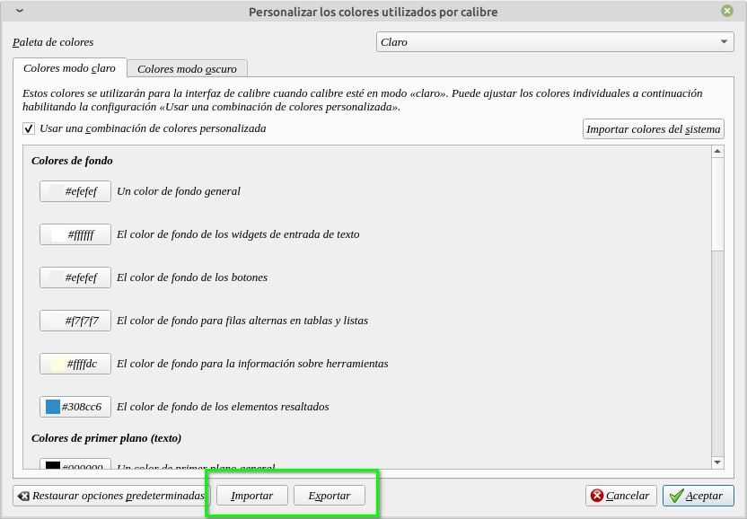
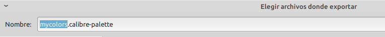
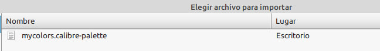

# Compartir paleta de colores

:material-account: [Walter](https://t.me/Dunhill69){ target=_blank } · :material-link-variant: [Ver el original en Telegraph](https://telegra.ph/Compartir-paleta-de-colores-03-02){ target=_blank }
{ .tut-datos }

---

Desde la versión 7,6 ya podemos exportar e importar nuestra configuración de la paleta de colores para la interfaz de Calibre. Si le damos en exportar nos genera un archivo mycolors.calibre-palette. Si lo van a compartir con otra persona o en el grupo deberían cambiar mycolors por una descripción del color o ponerle un nombre. Ej: Lila.calibre-palette

Y para importarlo vamos a Preferencia/Apariencia/Ajustar colores e importar y nos aparece desde donde esta el archivo para importarlo

Ir al mensaje: [https://t.me/calibreconfiguraciones/112333/159266](https://t.me/calibreconfiguraciones/112333/159266)

## [Volver al inicio](https://telegra.ph/Indice-Calibre-en-Espa%C3%B1ol-10-03)

 

---

[:material-arrow-left: Volver al índice](../../alfabetico.md) · [:fontawesome-brands-telegram: Preguntar en el grupo](https://t.me/calibreconfiguraciones){ target=_blank }
