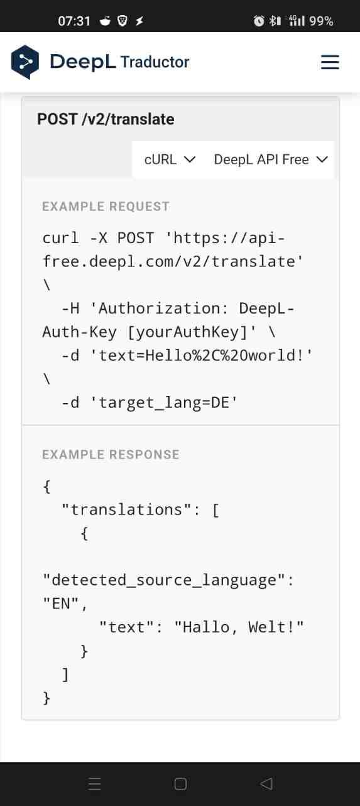
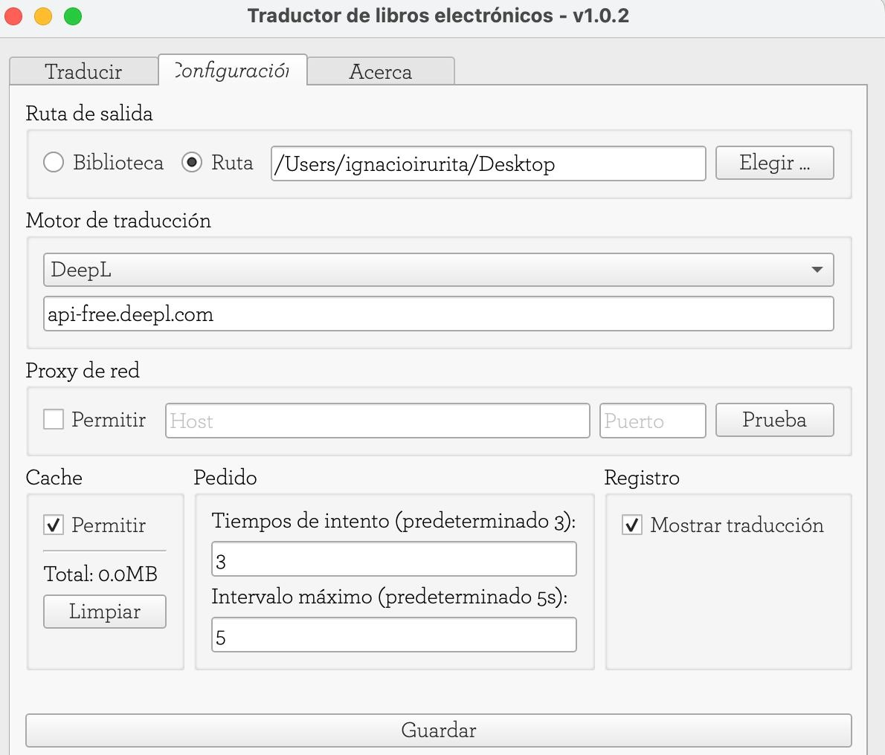
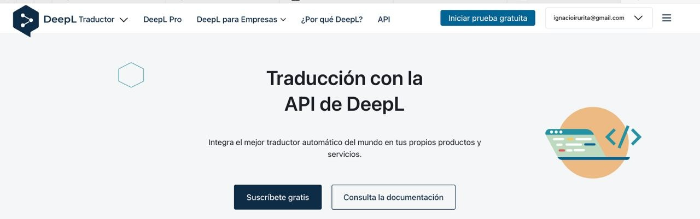
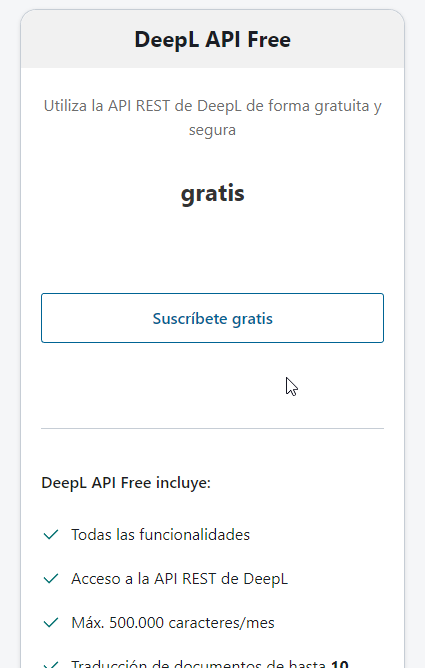
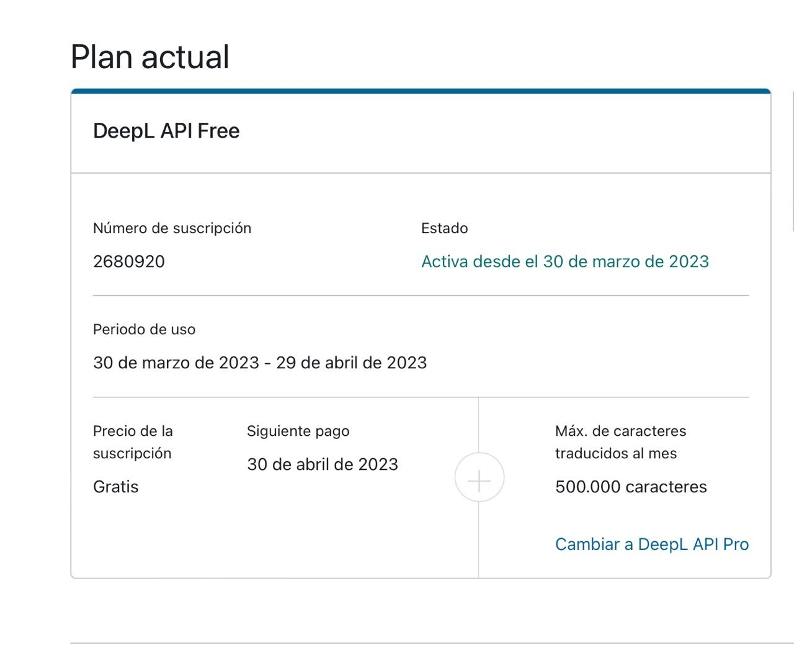
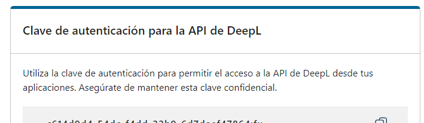
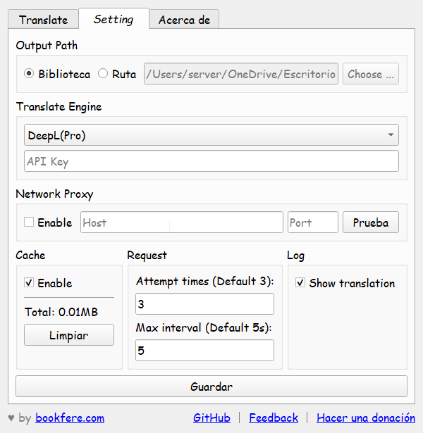

# Complemento - Ebook Translator

:material-account: [Walter](https://t.me/Dunhill69){ target=_blank } · :material-link-variant: [Ver el original en Telegraph](https://telegra.ph/Complemento-ebook-traductor-07-17){ target=_blank }
{ .tut-datos }

---

Nuevo complemento para traducir libros con Calibre.

[https://github.com/bookfere/Ebook-Translator-Calibre-Plugin/releases](https://github.com/bookfere/Ebook-Translator-Calibre-Plugin/releases)

También aparece en el repositorio de complementos dentro de calibre.

Intacto

Lo he instalado y parece prometedor… En la pestaña «SETTINGS» se podría modificar la 'máquina' de traducir «TRANSLATE ENGINE» pero si se modifica el de GOOGLE que viene por defecto (y personalmente no es mi preferida) a cualquiera de las otras posibles (DeepL, ChatGPT), te pide una  «API KEY» que desconozco y sin ella no te permite guardar ni por tanto emplear esta opción…

¿Sabrías cual seria la de DeepL, p.e., que es mi preferida?  ¿Alguno la conoce?

En la pestaña «ACERCA DE» algo dice sobre ello, pero no acabo de entenderlo…

Con el plan DeepL API Free puedes traducir hasta 500 000 caracteres al mes de manera gratuita.

El plan DeepL API Pro ofrece un servicio ampliado: traducción ilimitada con precio por consumo, máxima seguridad de datos y prioridad en la ejecución de peticiones enviadas a la API.

[https://www.deepl.com/docs-api](https://www.deepl.com/docs-api)

En la primera linea a la derecha ves que estoy suscrito.

Pero no se donde aparece la api

el código, dirección o número que he de poner.

Ve a tu cuenta. Mira la pestaña cuenta y abajo del todo esta la api.

Creo que veo donde esta la confusion. Lo que tienes que poner en la pagina de settings debajo de deepl (cuando seleccionas el motor de busqueda es la api, no la web.

Lo de DeepLX, funciona, lo que pasa es que el programador no lo ha explicado bien, lo que el ha hecho es una interfaz api con la web. Cuando pides muchas traducciones te termina bloqueando. Ahora estoy jugando con los tiempos y quiero pedirle al programador que se pueda cambiar también el UserAgent y quiero también probar usando el proxy pasarlo por un router de la Red Tor. Cuando salga algo os cuento.

 

 

---

[:material-arrow-left: Volver al índice](../../alfabetico.md) · [:fontawesome-brands-telegram: Preguntar en el grupo](https://t.me/calibreconfiguraciones){ target=_blank }
