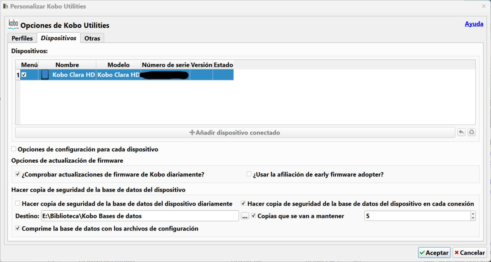

# Complemento - Kobo Utilities: configuración

:material-account: [Walter](https://t.me/Dunhill69){ target=_blank } · :material-link-variant: [Ver el original en Telegraph](https://telegra.ph/Configuraci%C3%B3n-del-plugin-Kobo-Utilities-04-02){ target=_blank }
{ .tut-datos }

---

Explicado por @KikuKimyo

Ir al mensaje: [https://t.me/calibreconfiguraciones/124636/162356](https://t.me/calibreconfiguraciones/124636/162356)

## [Volver al inicio](https://telegra.ph/Indice-Calibre-en-Espa%C3%B1ol-10-03)

 

---

[:material-arrow-left: Volver al índice](../../alfabetico.md) · [:fontawesome-brands-telegram: Preguntar en el grupo](https://t.me/calibreconfiguraciones){ target=_blank }
