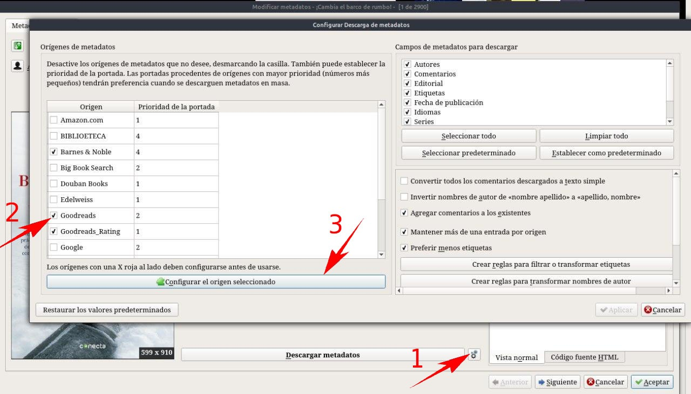
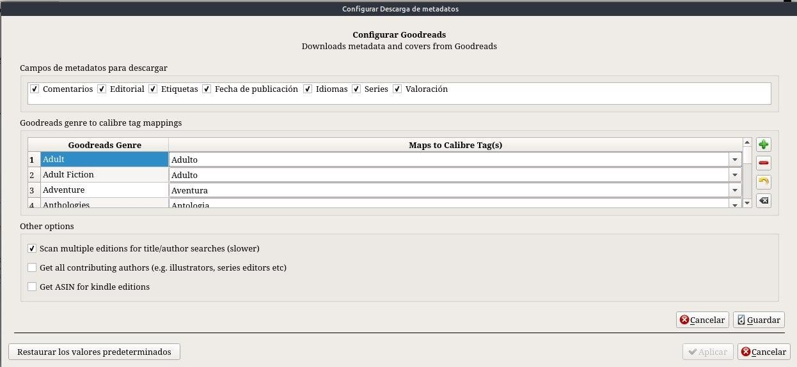

# Configurar etiquetas de categorías en español

:material-account: [Walter](https://t.me/Dunhill69){ target=_blank } · :material-link-variant: [Ver el original en Telegraph](https://telegra.ph/Configurar-etiquetas-de-Categor%C3%ADas-en-espa%C3%B1ol-09-14){ target=_blank }
{ .tut-datos }

---

Cuando descargamos metadatos las etiquetas de las categorías se nos descarga en ingles. Como se podría hacer para tenerlas en español ?

En la pantalla de editar metadatos tocamos en el engranaje (1) y nos aparece una ventana donde están los plugin que tenemos instalados para la descarga de metadatos. Tocamos el que más usemos, que se marcara de azul (2) Y tocamos en la barra de configurar el plugin seleccionado.

En la columna de la izquierda esta el nombre en ingles y a la derecha le vamos cargando el nombre en español, También se puede ir agregando las categoría que falten.

Tocamos Guardar y Aplicar. En la próxima descarga la etiqueta de categoría nos aparecerá en español

ir al mensaje: [https://t.me/calibreconfiguraciones/380](https://t.me/calibreconfiguraciones/380)

## [Volver al inicio](https://telegra.ph/Indice-Calibre-en-Espa%C3%B1ol-10-03)

##  

 

---

[:material-arrow-left: Volver al índice](../../alfabetico.md) · [:fontawesome-brands-telegram: Preguntar en el grupo](https://t.me/calibreconfiguraciones){ target=_blank }
