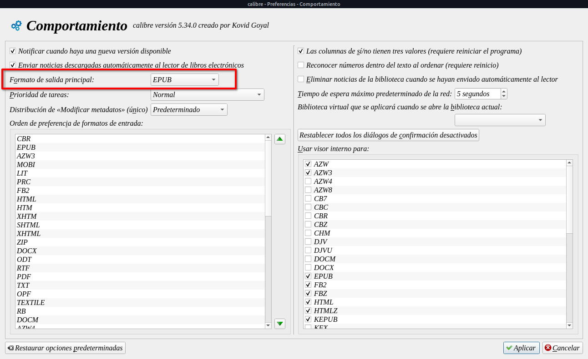
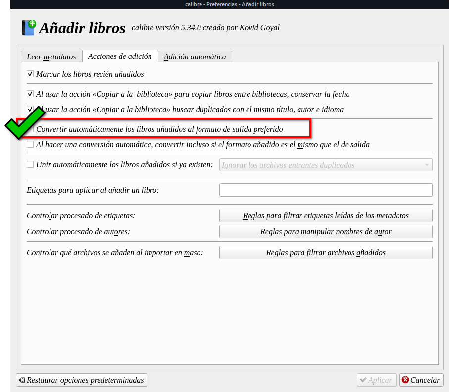

# Convertir automáticamente a nuestro formato favorito al ingresar un libro

:material-account: [Walter](https://t.me/Dunhill69){ target=_blank } · :material-link-variant: [Ver el original en Telegraph](https://telegra.ph/Convertir-autom%C3%A1ticamente-a-nuestro-formato-favorito-al-ingresar-libro-08-27){ target=_blank }
{ .tut-datos }

---

Si tomamos la decisión, por favoritismo, de tener nuestra biblioteca con un formato, Calibre al ingresar un libro lo puede convertir directamente al momento de ingresarlo.

Para eso debemos hacer algunas configuraciones:

Primer paso:

En Preferencias/Comportamiento

Debemos seleccionar nuestro formato de salida preferido.

Donde dice formato de salida principal buscamos el de nuestra elección. Y damos Aplicar.

Segundo paso:

Una vez configurado el paso uno, vamos otra vez a Preferencias/Añadir Libros

Y tildamos la opción de Convertir automáticamente los libros añadidos al formato de salida preferido. Y le damos a Aplicar

## [Volver al inicio](https://telegra.ph/Indice-Calibre-en-Espa%C3%B1ol-10-03)

 

 

---

[:material-arrow-left: Volver al índice](../../alfabetico.md) · [:fontawesome-brands-telegram: Preguntar en el grupo](https://t.me/calibreconfiguraciones){ target=_blank }
