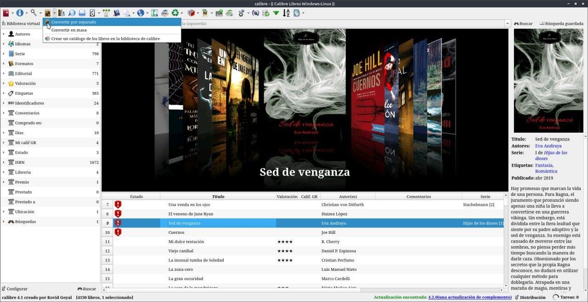
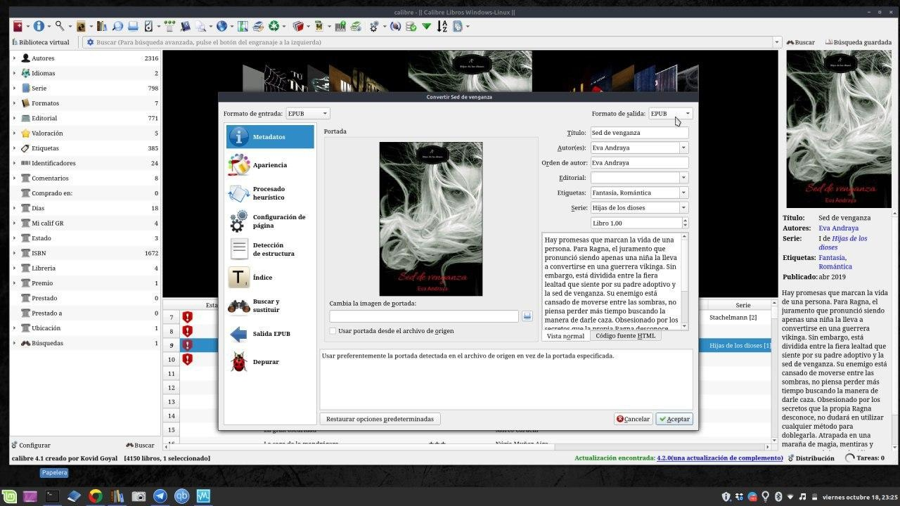

# Convertir formatos de libros

:material-account: [Walter](https://t.me/Dunhill69){ target=_blank } · :material-link-variant: [Ver el original en Telegraph](https://telegra.ph/Convertir-formatos-de-libros-08-16){ target=_blank }
{ .tut-datos }

---

Me preguntaron como se cambia el formato de un libro con Calibre, conozco dos maneras:

Con un libro seleccionado de nuestra biblioteca en Calibre, pulsamos sobre la opción Convertir libros y automáticamente se nos abrirá una ventana.

En la que, en la parte superior izquierda se nos mostrará el formato de entrada del libro, mientras que en la parte superior derecha encontraremos un desplegable para elegir el formato de salida. Es decir, al formato que queremos convertirlo. Pulsamos en Aceptar y automáticamente Calibre iniciará el proceso de conversión del libro de un formato a otro. A continuación, ya podremos ir a la ruta configurada y comprobar cómo tenemos el libro en el formato que hemos seleccionado.

Y la otra manera es que al agregar el libro a Calibre lo convierta automáticamente. Esta Opción está en Preferencias / Añadir Libros, solapa Adición Automática (En este lugar y si dejamos marcada las opciones que se ven en la imagen Calibre nos avisa si el libro que queremos agregar está duplicado.

## [Volver al inicio](https://telegra.ph/Indice-Calibre-en-Espa%C3%B1ol-10-03)

##  

 

---

[:material-arrow-left: Volver al índice](../../alfabetico.md) · [:fontawesome-brands-telegram: Preguntar en el grupo](https://t.me/calibreconfiguraciones){ target=_blank }
