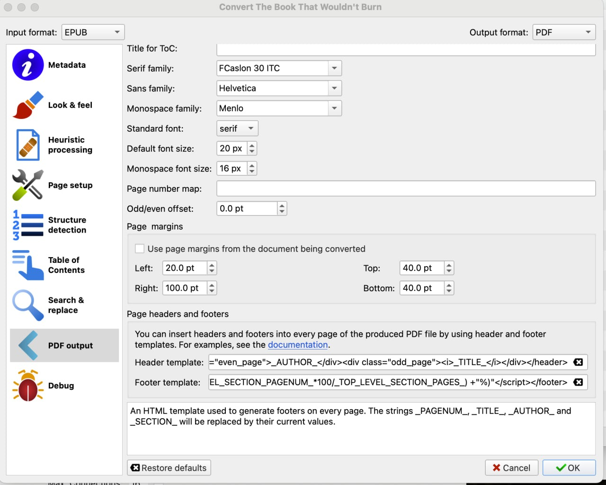
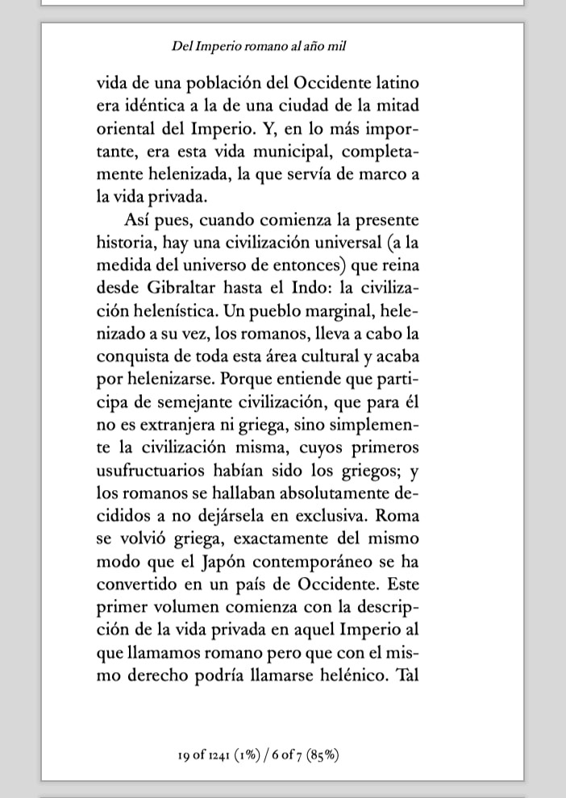

# Crear un PDF

:material-account: [Walter](https://t.me/Dunhill69){ target=_blank } · :material-link-variant: [Ver el original en Telegraph](https://telegra.ph/Convertir-un-pdf-06-14){ target=_blank }
{ .tut-datos }

---

Explicado por @rfog42

Pues lo cuento aquí.

Primero paso el ebook por el complemento Hyphenate para que genere los soft-hyphens y no queden las palabras demasiado separadas.

En Look & Feel, pestaña de Styling, pongo

 

p { line-height: 0.9; }

 

Porque me gusta el interlineado apretadillo. Aquí a gusto del consumidor.

En PDF output (luego subo captura),

Tamaño personalizado 15.5x22 cm

Familia Serif: FCaslon 30 ITC (una fuente encontrada por ahí que imita las impresiones antiguas)

Tamaño de fuente por defecto: 20 px

Tamaño monoespacio: 16 px

Márgenes: Arriba y abajo 40 pt, Izda 20 pt, dcha 100 pt (espacio para anotar)

Y luego el truco del almendruco, las plantillas de cabecera y pie, que ahora pongo separado.

Cabecera:

 

\<header style="justify-content: center;font-size:x-small"\>\
\_AUTHOR\_\</div\>\
\<i\>\_TITLE\_\</i\>\</div\>\</header\>

 

Pie:

\<footer style="justify-content: center;font-size:x-small"\>\<div\>\</div\>\<script\>document.currentScript.parentNode.querySelector("div").innerHTML =  ""+ \_PAGENUM\_ +" of " + \_TOTAL\_PAGES\_ +" (" + parseInt(\_PAGENUM\_\*100/\_TOTAL\_PAGES\_) + "%) / " +\_TOP\_LEVEL\_SECTION\_PAGENUM\_ + " of " + \_TOP\_LEVEL\_SECTION\_PAGES\_ + " ("+ parseInt(\_TOP\_LEVEL\_SECTION\_PAGENUM\_\*100/\_TOP\_LEVEL\_SECTION\_PAGES\_) +"%)"\</script\>\</footer\>

Tal que así

Y eso me genera unos PDF como estos:

Fijaos en el pie: página actual/total (%), y lo mismo del capítulo

Y con ese tamaño se ve bien en un ebook, en un teléfono en apaisado y en tabletas a doble página

Ir al mensaje: [https://t.me/calibreconfiguraciones/112368/137939](https://t.me/calibreconfiguraciones/112368/137939)

[**Volver al inicio**](https://telegra.ph/Indice-Calibre-en-Espa%C3%B1ol-10-03)

 

 

---

[:material-arrow-left: Volver al índice](../../alfabetico.md) · [:fontawesome-brands-telegram: Preguntar en el grupo](https://t.me/calibreconfiguraciones){ target=_blank }
