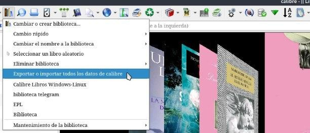
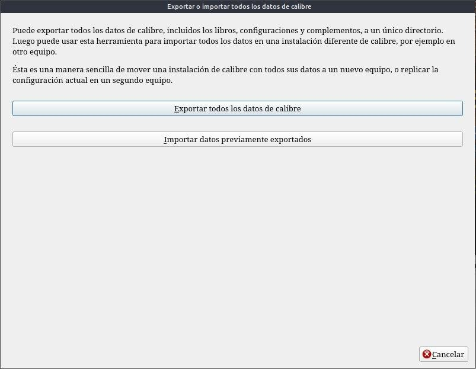
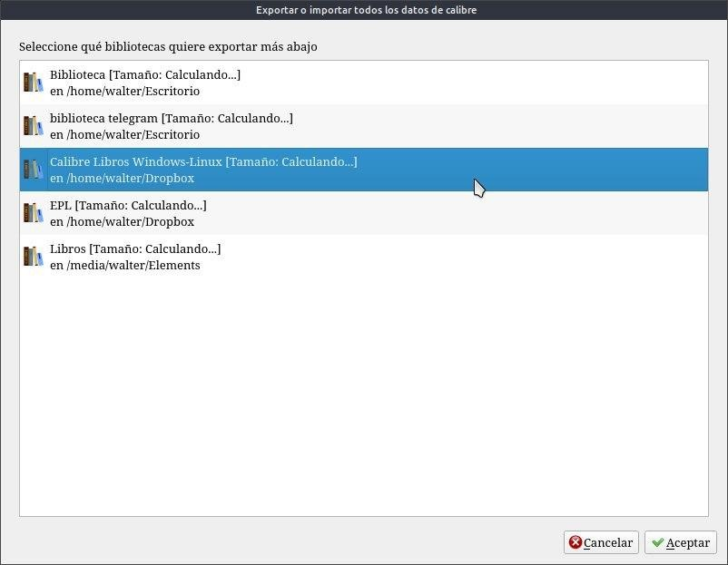
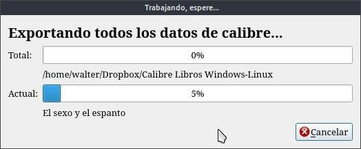
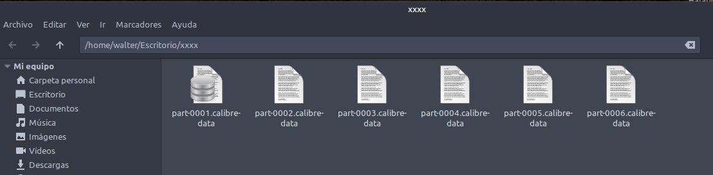
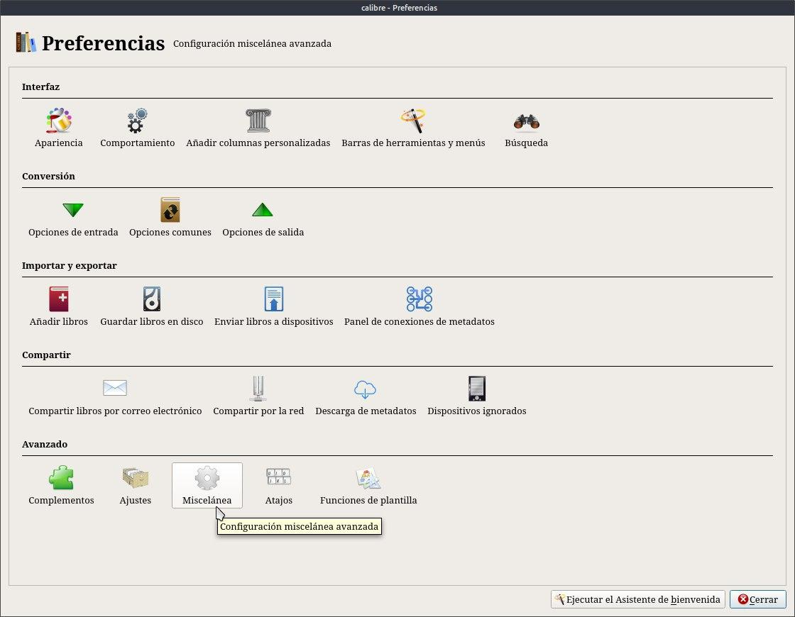
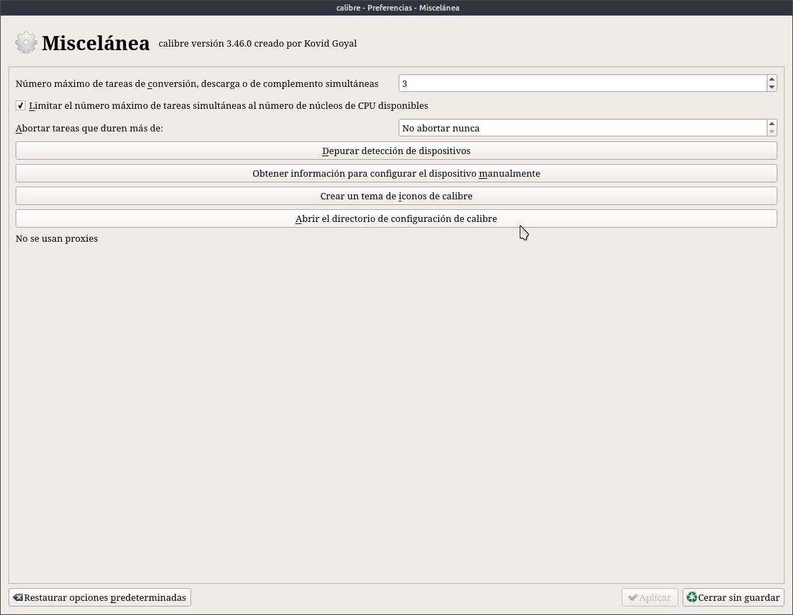

# Copia de seguridad

:material-account: [Walter](https://t.me/Dunhill69){ target=_blank } · :material-link-variant: [Ver el original en Telegraph](https://telegra.ph/Copia-de-seguridad-08-17){ target=_blank }
{ .tut-datos }

---

Cómo hacer una copia de seguridad, mover y exportar su biblioteca en calibre

¿Alguna vez has perdido tus archivos? La falla de los discos duros y las eliminaciones accidentales nos enseñan que hay dos tipos de personas: las que respaldan sus archivos y las que comenzarán a respaldar sus archivos. Afortunadamente, calibre viene con herramientas para hacer eso, de manera rápida y fácil . De esa manera , no perderá su colección la próxima vez que su computadora portátil falle.

Cómo exportar tu biblioteca de libros electrónicos

Si desea prepararse para un desastre o simplemente mover su colección a su nuevo dispositivo, haga una copia de seguridad . Para exportar su biblioteca de calibre:

Primero, haga clic en el botón "\[nombre de su biblioteca\]" en la pantalla principal y seleccione "Exportar / Importar todos los datos de calibre".

En el cuadro de diálogo, seleccione la biblioteca que desea exportar y haga clic en "Aceptar".

Finalmente, seleccione la carpeta donde desea guardar su copia de seguridad. Y comienza automáticamente a exportar los datos.

Este proceso creará una serie de archivos de 1 GB con toda su biblioteca. Luego puede guardarlo en una unidad de respaldo , grabarlo en DVD o simplemente guardarlo en un lugar seguro.

Copia de seguridad, si guardas tu biblioteca en un disco externo y se te quema tu computadora, lo único que debes haber guardado aunque sea una vez es la configuración de Calibre. Esa carpeta guarda todos los datos de cómo configuramos nuestro calibre. (los libros van a estar en el disco externo, junto con un archivo que crea calibre de la biblioteca) Esa carpeta la encontramos en Preferencias / misceláneas/

Abrir el directorio de configuración de Calibre.

Copia estos datos como backup cada vez que se haga una nueva configuración en calibre y santo remedio.

## [Volver al inicio](https://telegra.ph/Indice-Calibre-en-Espa%C3%B1ol-10-03)

##  

 

 

---

[:material-arrow-left: Volver al índice](../../alfabetico.md) · [:fontawesome-brands-telegram: Preguntar en el grupo](https://t.me/calibreconfiguraciones){ target=_blank }
