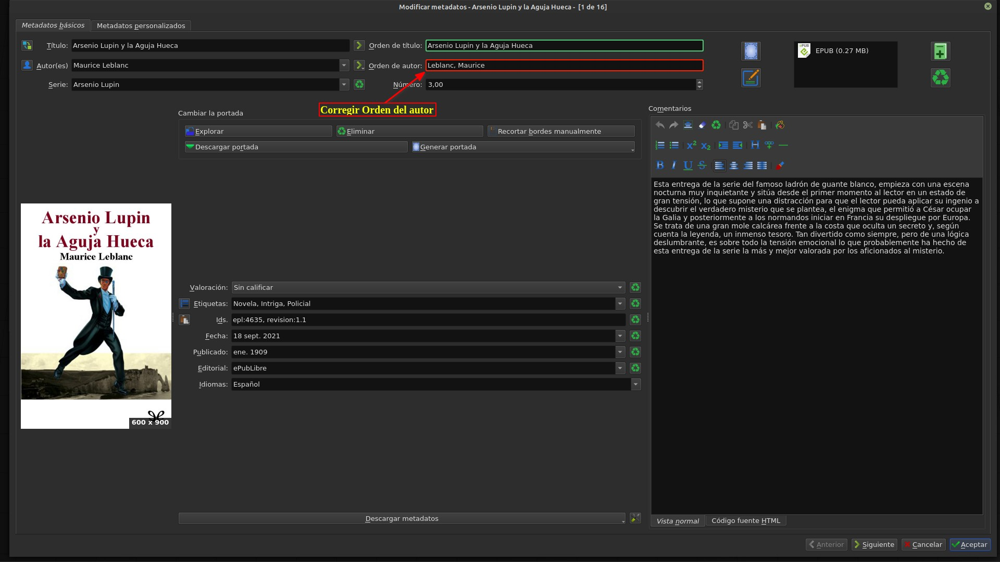
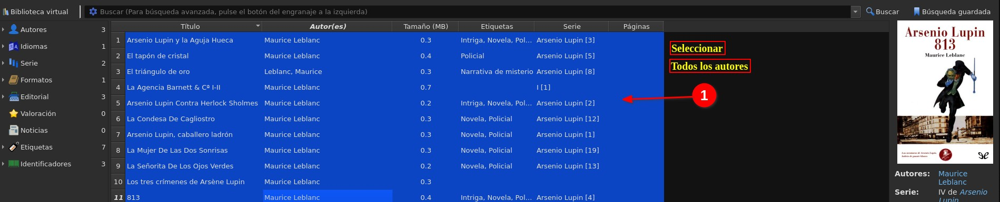
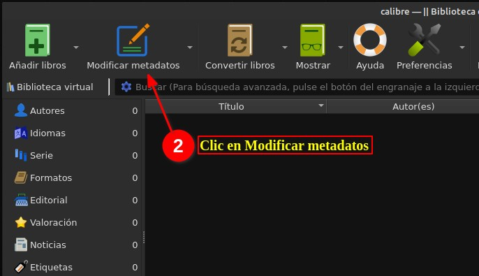
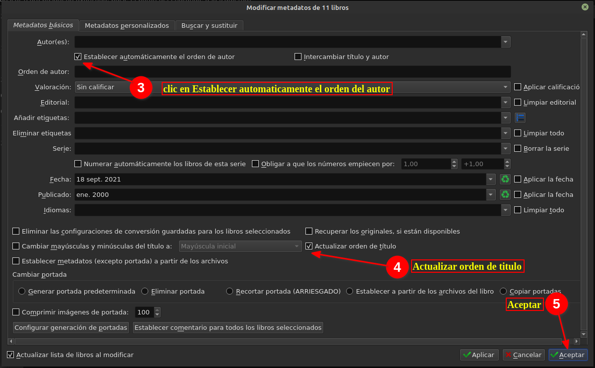

# Cómo corregir el orden de autor

:material-account: [Walter](https://t.me/Dunhill69){ target=_blank } · :material-link-variant: [Ver el original en Telegraph](https://telegra.ph/Corregir-orden-de-autor-09-19){ target=_blank }
{ .tut-datos }

---

Explicado por @Llogur

Suelo añadir todos los libros de un autor por lo que selecciono todos los libros y corrijo el orden del

autor. De esa forma si hay uno o varios autores se corrigen de una sola ves.

Selecciono todos los libros.

Selecciono Modificar metadatos.

Selecciono Establecer automáticamente el orden del autor y Actualizar orden de titulo. Por ultimo, pulsar sobre Aceptar.

## [Volver al inicio](https://telegra.ph/Indice-Calibre-en-Espa%C3%B1ol-10-03)

##  

 

---

[:material-arrow-left: Volver al índice](../../alfabetico.md) · [:fontawesome-brands-telegram: Preguntar en el grupo](https://t.me/calibreconfiguraciones){ target=_blank }
