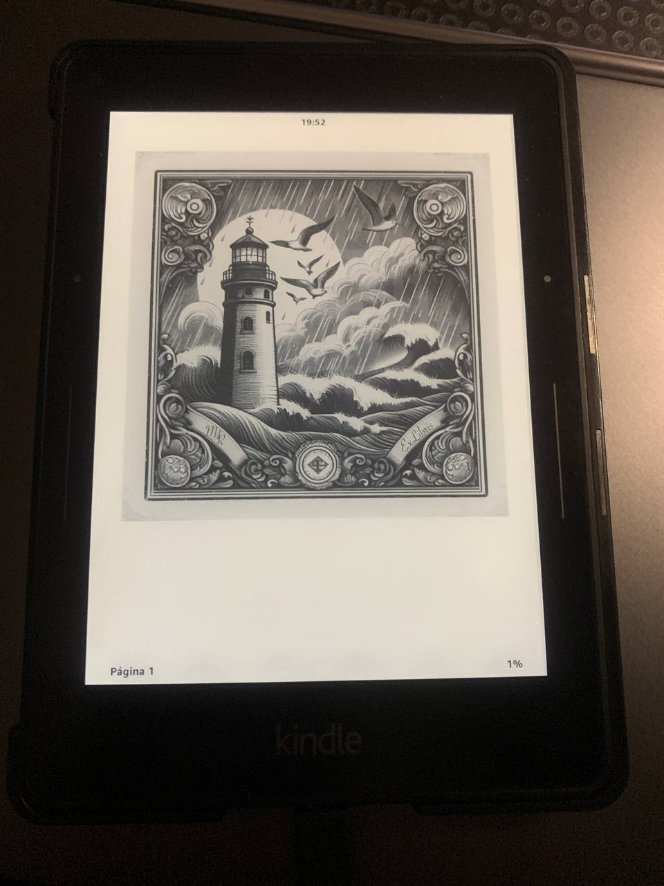
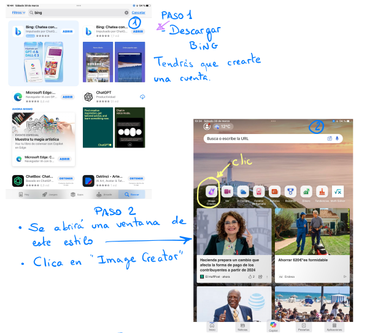
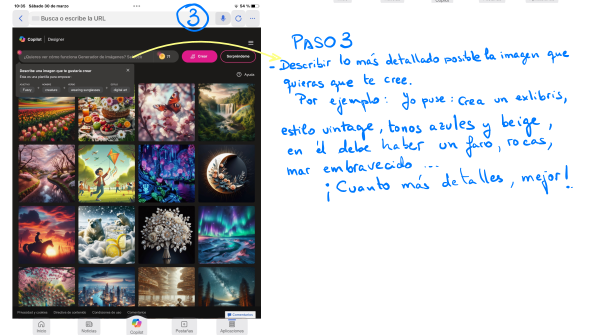
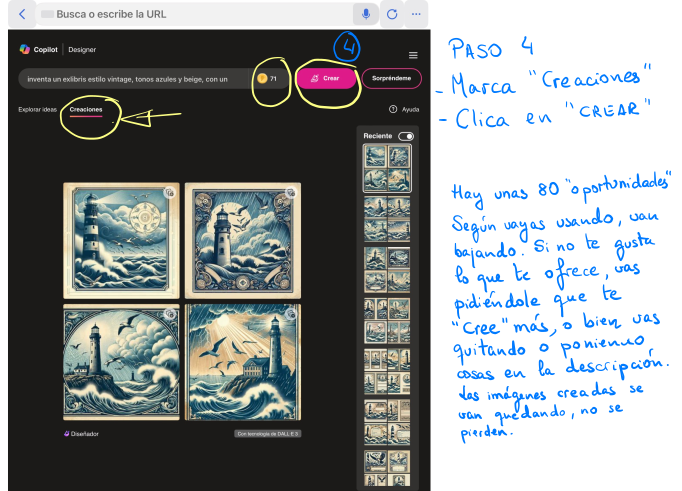
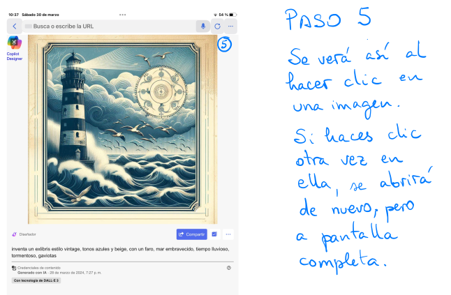
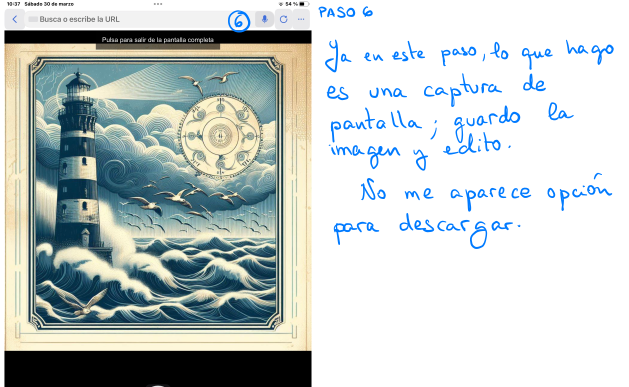

# Crear exlibris con IA

:material-account: [Walter](https://t.me/Dunhill69){ target=_blank } · :material-link-variant: [Ver el original en Telegraph](https://telegra.ph/Crear-exlibris-con-Ai-03-30){ target=_blank }
{ .tut-datos }

---

Explicado por @lighthousea

Este es el resultado

 

[Ir al archivo donde lo explica ](https://t.me/calibreconfiguraciones/144967/162019)

 

## [Volver al inicio](https://telegra.ph/Indice-Calibre-en-Espa%C3%B1ol-10-03)

 

 

---

[:material-arrow-left: Volver al índice](../../alfabetico.md) · [:fontawesome-brands-telegram: Preguntar en el grupo](https://t.me/calibreconfiguraciones){ target=_blank }
