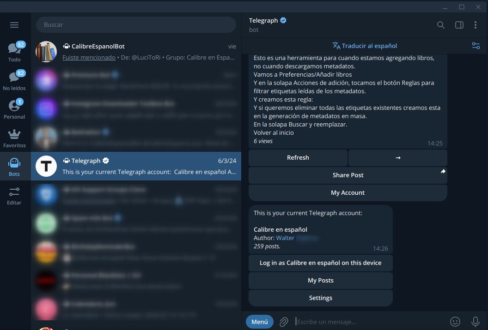
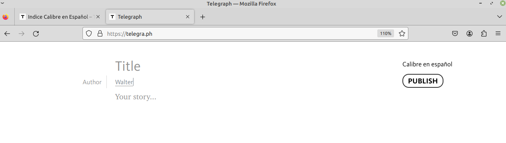
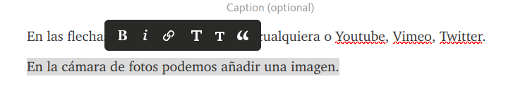
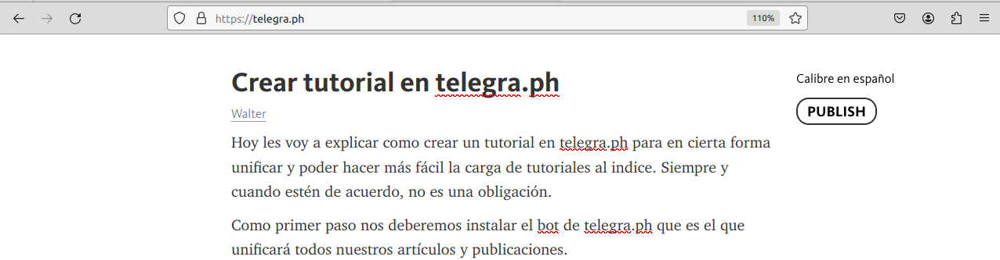
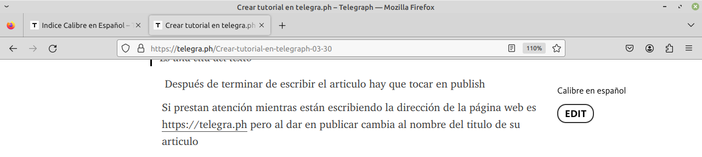

# Crear tutorial en Telegraph

:material-account: [Walter](https://t.me/Dunhill69){ target=_blank } · :material-link-variant: [Ver el original en Telegraph](https://telegra.ph/Crear-tutorial-en-telegraph-03-30){ target=_blank }
{ .tut-datos }

---

Hoy les voy a explicar como crear un tutorial en telegra.ph para en cierta forma unificar y poder hacer más fácil la carga de tutoriales al indice. Siempre y cuando estén de acuerdo, no es una obligación.

Como primer paso nos deberemos instalar el bot de telegra.ph que es el que unificará todos nuestros artículos y publicaciones.

Y una vez instalado en este caso desde telegram de escritorio para hacer más fácil la carga de tutoriales, porque se vinculará a tu navegador por defecto, debemos tocar en "Log in "aparecerá su usuario" as on divice.

Y se abrirá su navegador en la dirección [https://telegra.ph](https://telegra.ph/) con los siguientes campos por defecto:

1. Titulo \> Título del articulo
2. Autor \> Nuestro Nombre o en caso contrario se puede editar ( yo cuando cargo tutoriales de otras personas, empiezo en Your story diciendo quien explica el tema en cuestión.
3. Your story \> Es el desarrollo del tema

Al hacer enter en un renglón aparecen estos signos:

En las flechas podemos pegar un link cualquiera o Youtube, Vimeo, Twitter.

En la cámara de fotos podemos añadir una imagen.

 

Remarcando el texto tenemos 6 opciones posibles:

**B Es en negritas**

*i  Texto sin negritas con inclinación*

El símbolo de la cadena hace que el texto seleccionado se convierta en un link

Ir al mensaje:

T grande es un título

## Título

T chica es un subtítulo

### Subtítulo

" hace referencia a una cita

> Es una cita del texto

Después de terminar de escribir el articulo hay que tocar en publish

Si prestan atención mientras están escribiendo la dirección de la página web es [https://telegra.ph](https://telegra.ph/) pero al dar en publicar cambia al nombre del titulo de su articulo

Una vez tocado en publish el articulo está cerrado y solo el creador del mismo lo podrá editar.

 

Y si el autor quisiera modificar algo puede editarlo desde el botón edit

Como única referencia es poner al final del articulo este link que es para volver al inicio del indice en la palabra volver al indice en formato titulo (T grande)

[Volver al inicio](https://telegra.ph/Indice-Calibre-en-Espa%C3%B1ol-10-03)   [https://telegra.ph/Indice-Calibre-en-Espa%C3%B1ol-10-03](https://telegra.ph/Indice-Calibre-en-Espa%C3%B1ol-10-03)

 

Y publicar el link como un articulo del indice que cargaré al mismo.

 

## [Volver al inicio](https://telegra.ph/Indice-Calibre-en-Espa%C3%B1ol-10-03)

 

 

---

[:material-arrow-left: Volver al índice](../../alfabetico.md) · [:fontawesome-brands-telegram: Preguntar en el grupo](https://t.me/calibreconfiguraciones){ target=_blank }
