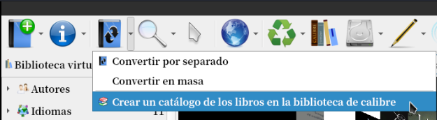
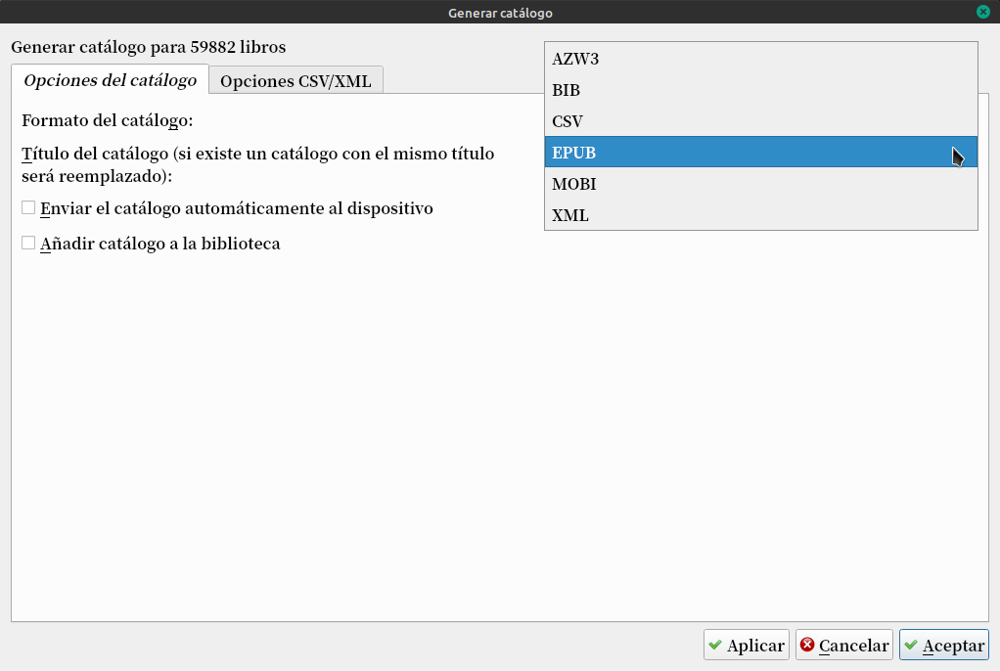
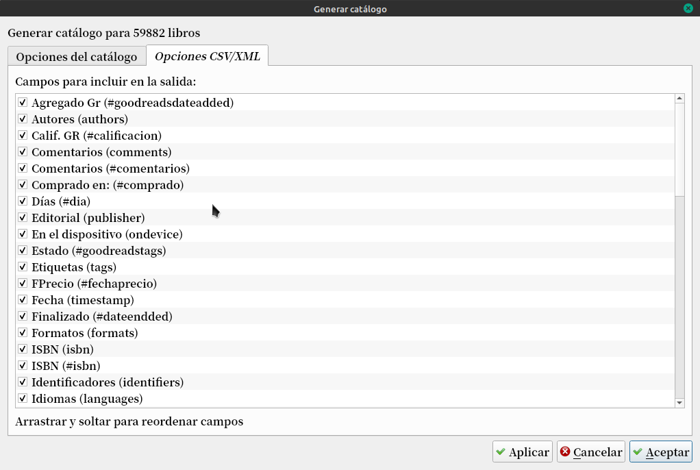

# Crear un catálogo de nuestros libros

:material-account: [Walter](https://t.me/Dunhill69){ target=_blank } · :material-link-variant: [Ver el original en Telegraph](https://telegra.ph/Crear-un-catalogo-de-nuestros-libros-08-17){ target=_blank }
{ .tut-datos }

---

Para crear un catálogo con todos los libros en nuestra biblioteca, basta con ir al botón Convertir libros, y en el menú que se abre elegir Crear un catálogo de los libros en la biblioteca de Calibre.

 

Acá tan sólo deberemos elegir el formato y el título que queramos para nuestro catálogo. Si lo vamos a importar desde una hoja de cálculo tipo Excel, o desde una base de datos como Access, entonces el formato adecuado será el CSV (texto separado por comas). Si lo único que necesitamos es un listado para visualizarlo en nuestro e-reader, podemos crear un EPUB, MOBI o AZW3. También se puede crear un catálogo del tipo BIB, o un XML.

En la misma ventana, pulsando en la pestaña de opciones del formato seleccionado podremos seleccionar qué columnas de nuestra biblioteca van a formar parte del catálogo.

Una vez creado el catálogo, Calibre lo guardará en la carpeta que le digamos.

## [Volver al inicio](https://telegra.ph/Indice-Calibre-en-Espa%C3%B1ol-10-03)

 

---

[:material-arrow-left: Volver al índice](../../alfabetico.md) · [:fontawesome-brands-telegram: Preguntar en el grupo](https://t.me/calibreconfiguraciones){ target=_blank }
