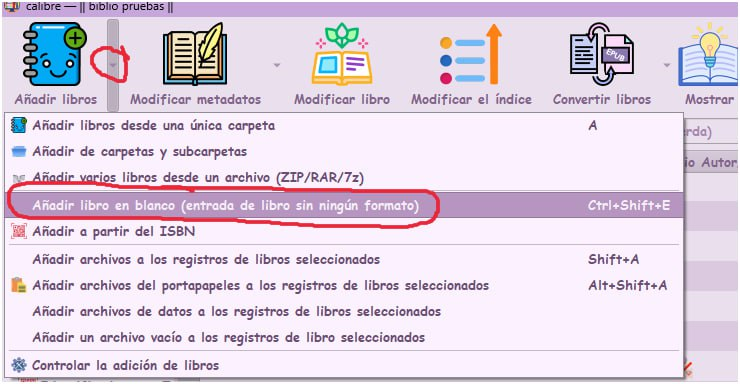
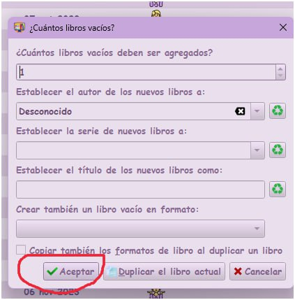
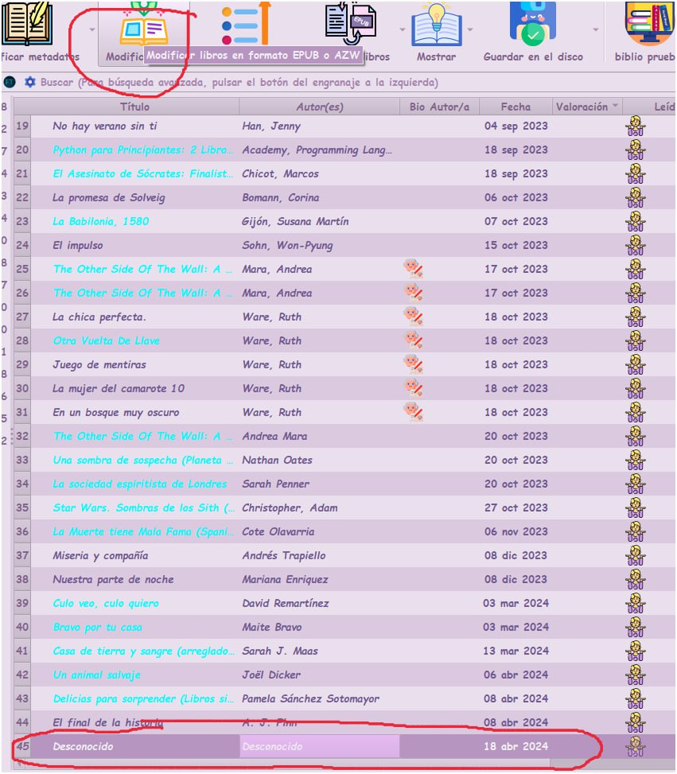
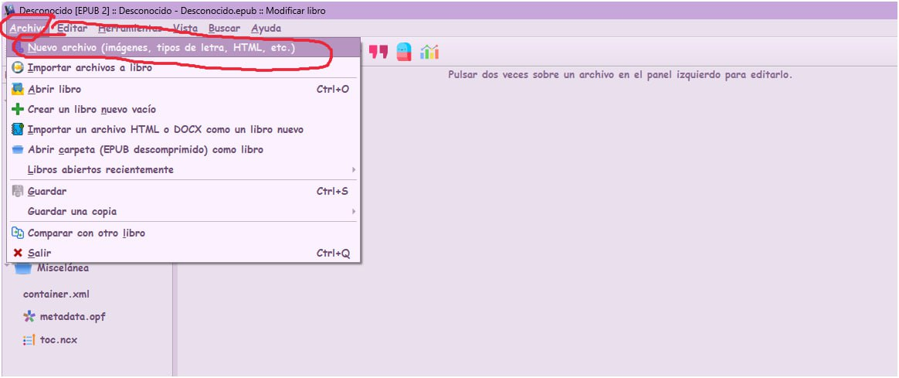
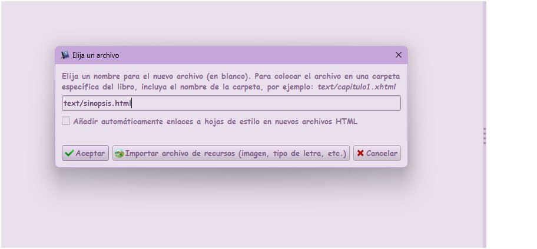
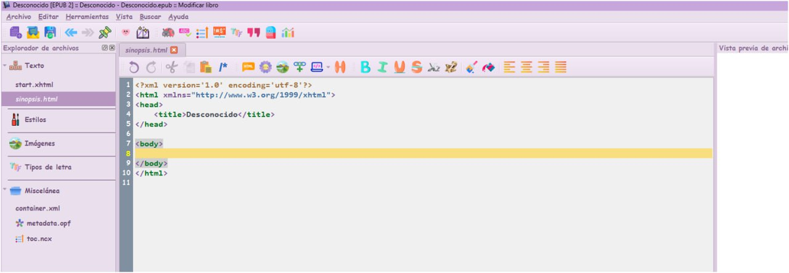
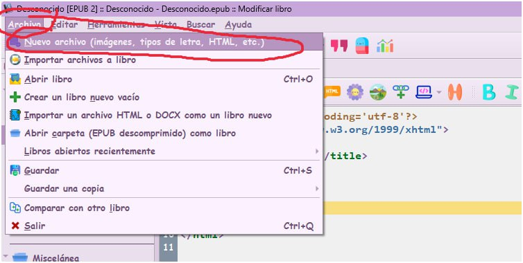

# Crear libro vacío

:material-account: [Walter](https://t.me/Dunhill69){ target=_blank } · :material-link-variant: [Ver el original en Telegraph](https://telegra.ph/Crear-un-libro-vacio-04-20){ target=_blank }
{ .tut-datos }

---

Explicado por @jane\_morris

Tocando en la flecha al lado del icono de añadir libros, seleccionamos Añadir libros en blanco.

Ponemos la cantidad de libros a crear en este caso 1 (también se podría poner el nombre de autor.

Después seleccionando el libro agregado tocamos el icono de Modificar libro.

y dentro ya de modificar libro empiezas a hacer los html.

Desde Archivo/nuevo archivo

así por ejemplo.

y ya te sale para escribir lo que quieras.

 

y así cada vez, puedes añadir html (hojas) o imágenes, lo que quieras.

 

Ir al mensaje: [https://t.me/calibreconfiguraciones/112333/163513](https://t.me/calibreconfiguraciones/112333/163513)

 

## [Volver al inicio](https://telegra.ph/Indice-Calibre-en-Espa%C3%B1ol-10-03)

 

 

---

[:material-arrow-left: Volver al índice](../../alfabetico.md) · [:fontawesome-brands-telegram: Preguntar en el grupo](https://t.me/calibreconfiguraciones){ target=_blank }
