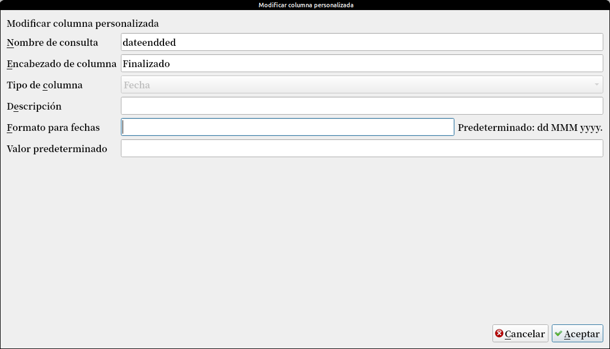
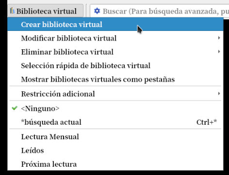
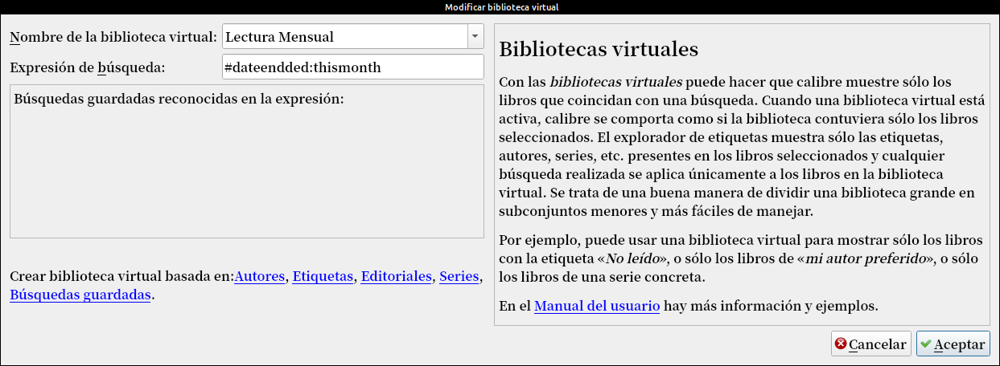
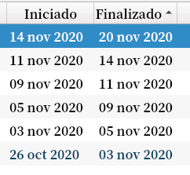
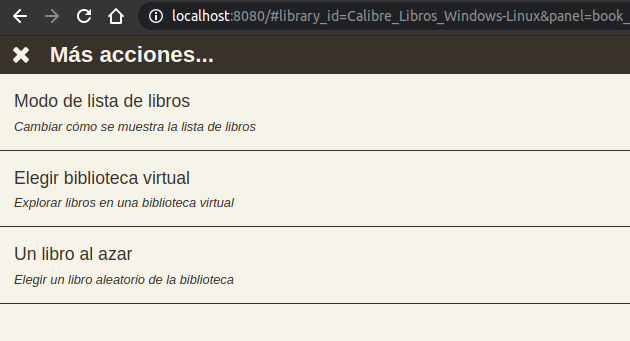
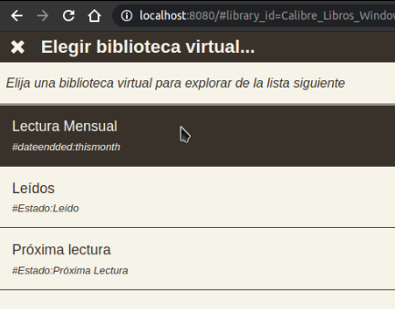
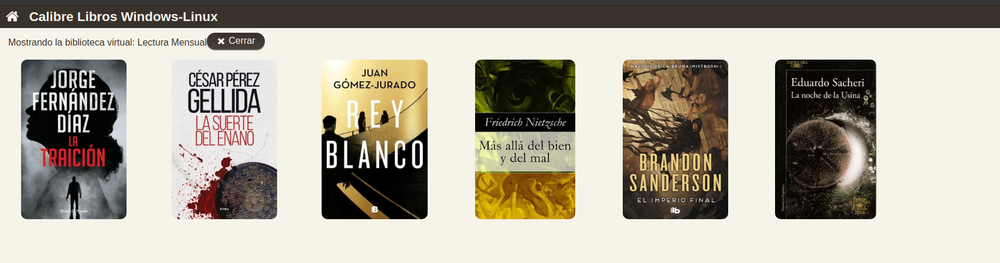
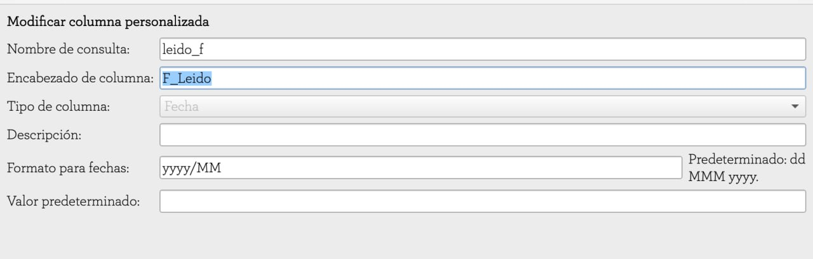

# Cómo crear una biblioteca virtual de nuestra lectura mensual

:material-account: [Walter](https://t.me/Dunhill69){ target=_blank } · :material-link-variant: [Ver el original en Telegraph](https://telegra.ph/crear-una-Biblioteca-virtual-de-nuestra-lectura-mensual-11-23){ target=_blank }
{ .tut-datos }

---

Estaba buscando la manera de que Calibre me mostrara los libros que había leído en el mes.

Yo tengo unas columnas personalizadas donde anoto la fecha del inicio y del fin de la lectura, pero como hacer para que los filtre por mes.

Partiendo de la columna de finalizado.



<br>



Tocamos en biblioteca virtual y en Crear biblioteca virtual



Como el nombre de consulta es dateendded se usa ese y se pone thismonth (para el mes en curso.

Si se quisiera hacer por días:

```
>7daysago
```



Y acá tenemos la filtración de la columna

Y desde el navegador con el servidor de contenidos activado tocando en los tres puntos


En más acciones elegimos mostrar biblioteca virtual



Elegimos la lectura mensual que creamos



Y así se nos ven las caratulas



<br>

ir al mensaje: [https://t.me/calibreconfiguraciones/24449](https://t.me/calibreconfiguraciones/24449)

[https://telegra.ph/crear-una-Biblioteca-virtual-de-nuestra-lectura-mensual-11-23](https://telegra.ph/crear-una-Biblioteca-virtual-de-nuestra-lectura-mensual-11-23)

<br>

Otra opción de @Inatxo

Incluso con la siguiente búsqueda, me presenta y contabiliza los que he leido en los últimos 30 días

#leido\_f:\>=30daysago

y con esta:

#leido\_f:=thismonth

puedo saber los que estoy leyendo este mes actual.



Perdón, para ver cuando los he leído, he creado otra columna tal como así, (que voy rellenado cada vez que acabo un libro)

Ir al mensaje: [https://t.me/calibreconfiguraciones/112333/136886](https://t.me/calibreconfiguraciones/112333/136886)

<br>

## [Volver al inicio](https://telegra.ph/Indice-Calibre-en-Espa%C3%B1ol-10-03)

## <br>

---

[:material-arrow-left: Volver al índice](../../alfabetico.md) · [:fontawesome-brands-telegram: Preguntar en el grupo](https://t.me/calibreconfiguraciones){ target=_blank }
