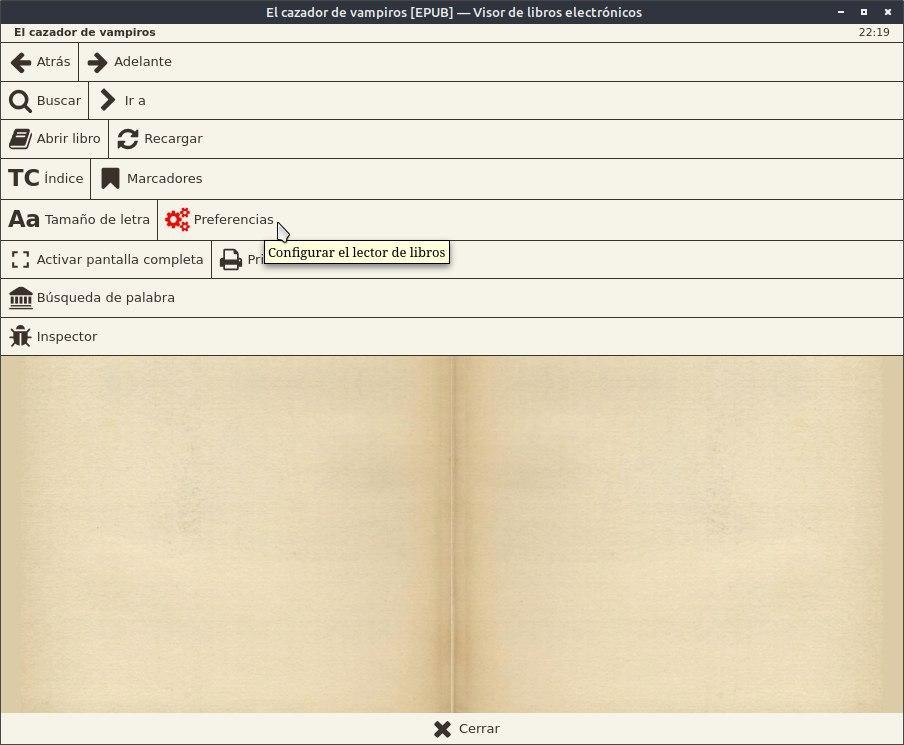
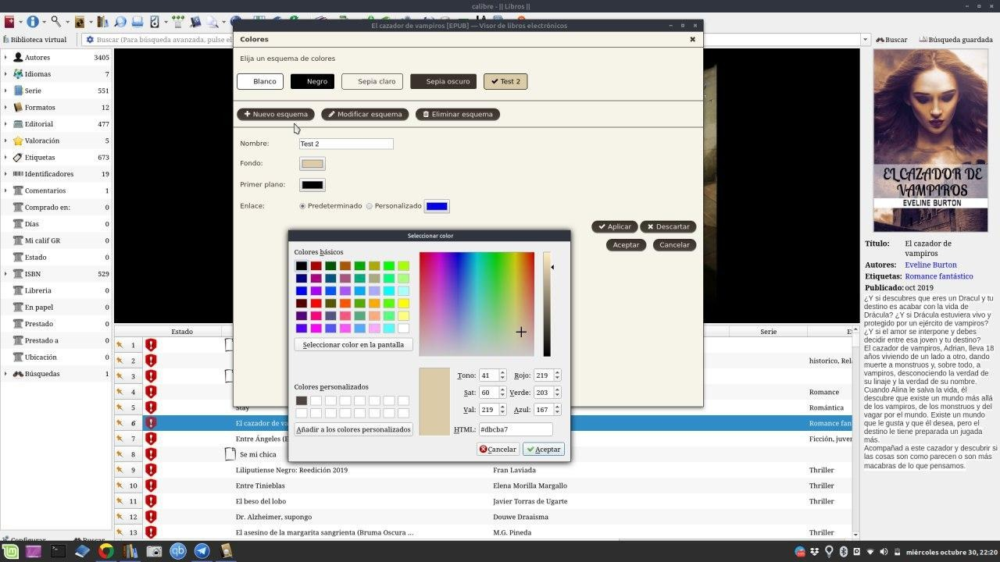
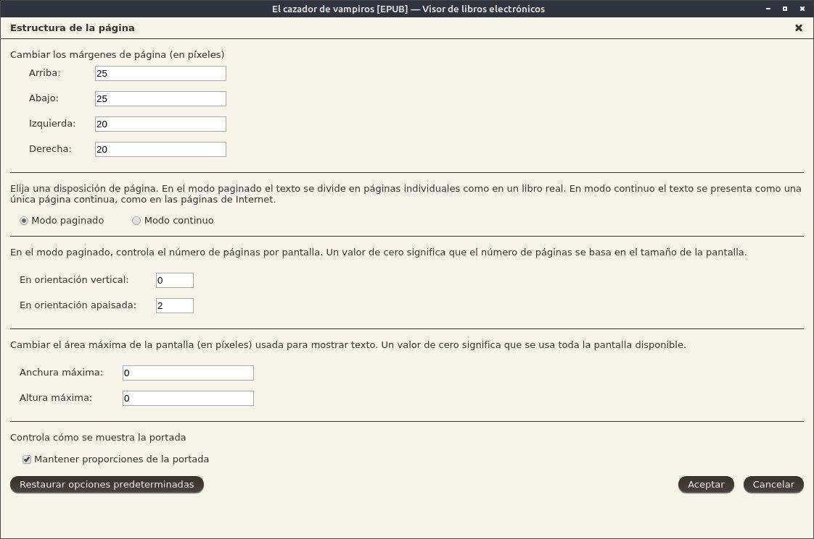
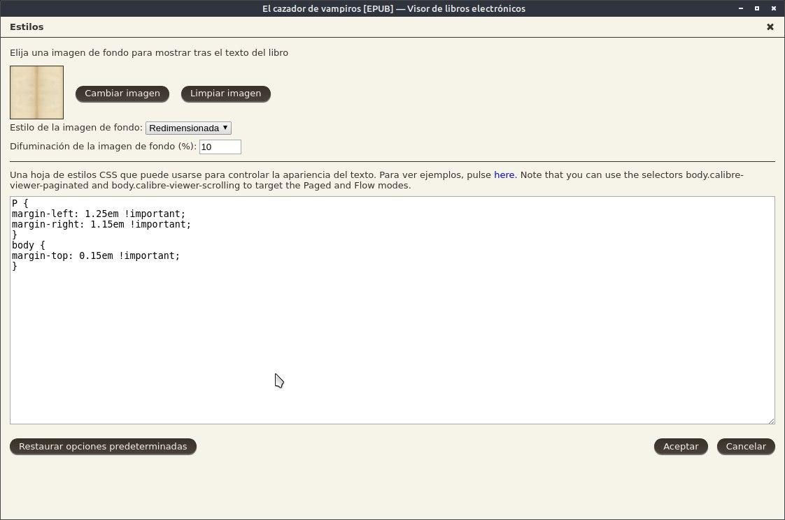
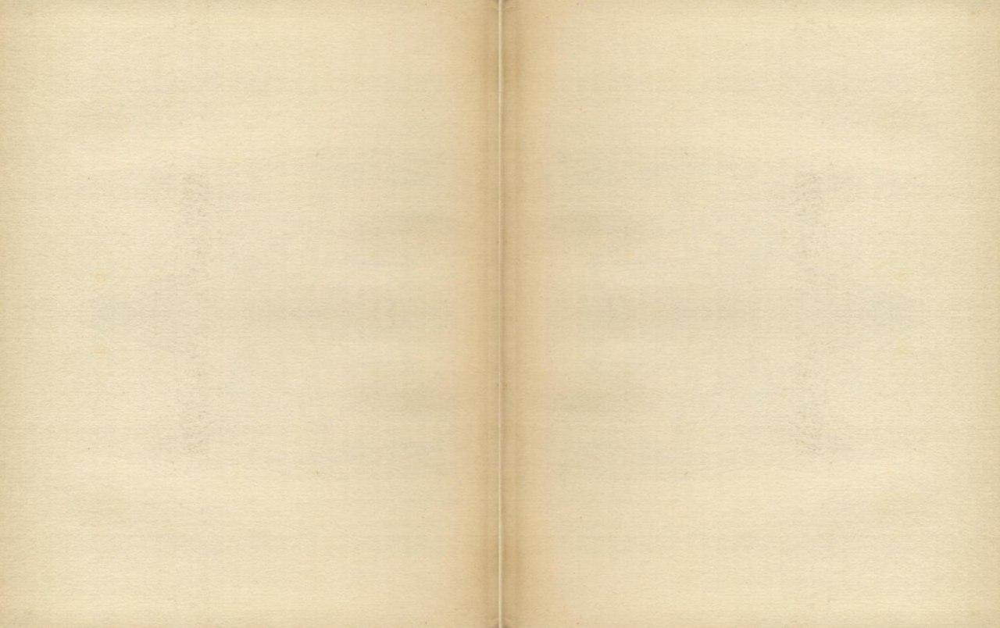
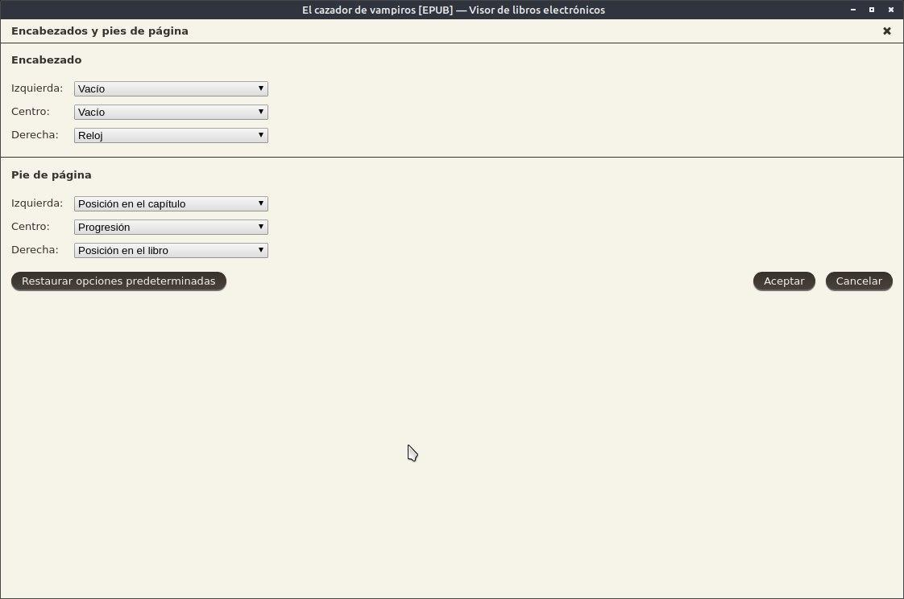
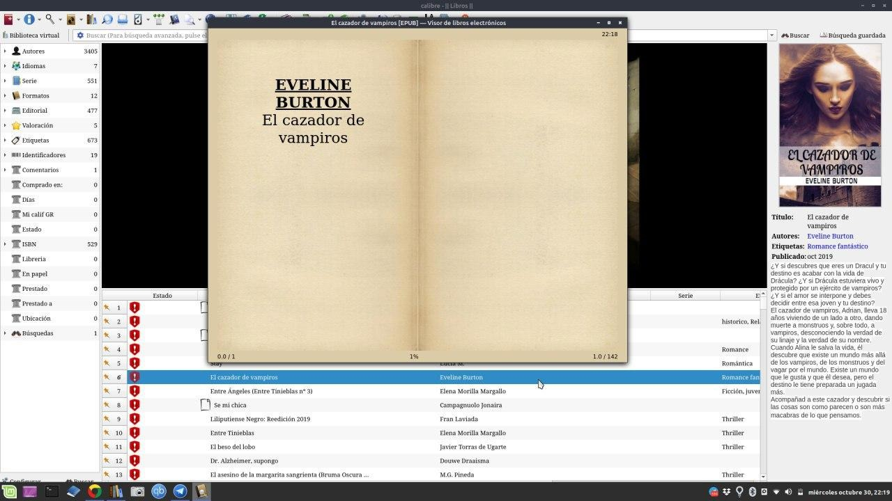

# CSS - Efecto libro antiguo

:material-account: [Walter](https://t.me/Dunhill69){ target=_blank } · :material-link-variant: [Ver el original en Telegraph](https://telegra.ph/CSS---Efecto-libro-antiguo-08-16){ target=_blank }
{ .tut-datos }

---

Esto cambia la manera de como vemos el libro cuando lo leemos con Calibre. Hacemos **click en el libro** y se abre el visor del libro, Apretamos **botón izquierdo del mouse** y nos aparece la ventana de configuración, allí tocamos **Preferencias.**

En el apartado de Colores tocamos Nuevo esquema Le asignamos un nombre y le ponemos un color como este para que nos de es aspecto de un libro viejo. Aceptamos

Esta es la configuración de la estructura de la página

\[ Foto \]

En estilo cargamos la imagen que les agrego después de esta. Y pegamos el siguiente código.

div {

margin-left: 1.25em! important;

margen derecho: 1.15em! importante;

}

body {

margin-top: 0.15em! importante;

}

Acá les dejo la imagen de hojas viejas

Para el encabezado y pie de pagina esta configuración.

Y después de esos pasos vemos el libro de esta manera.

## [Volver al inicio](https://telegra.ph/Indice-Calibre-en-Espa%C3%B1ol-10-03)

 

---

[:material-arrow-left: Volver al índice](../../alfabetico.md) · [:fontawesome-brands-telegram: Preguntar en el grupo](https://t.me/calibreconfiguraciones){ target=_blank }
