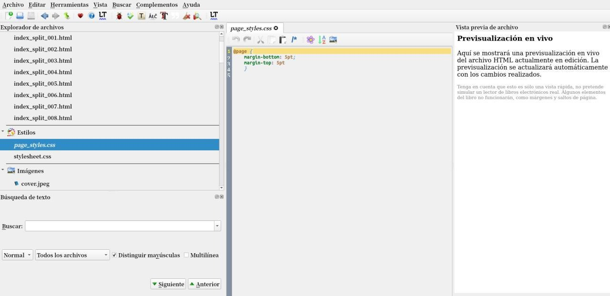
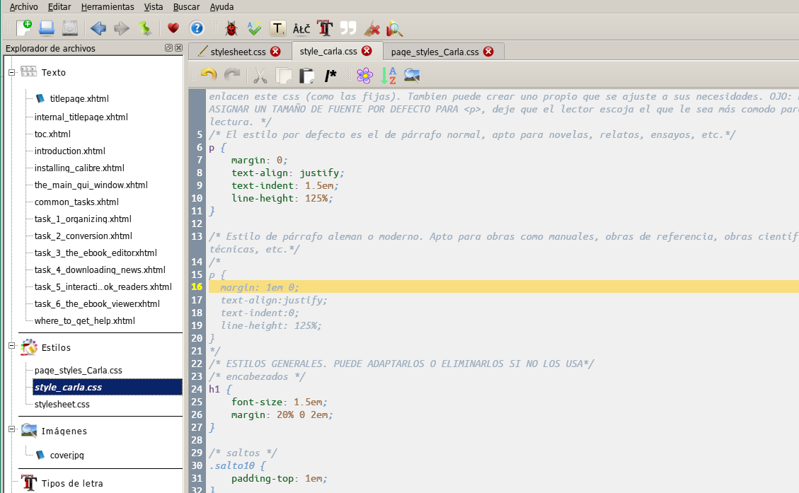

# CSS - Modificar libros

:material-account: [Walter](https://t.me/Dunhill69){ target=_blank } · :material-link-variant: [Ver el original en Telegraph](https://telegra.ph/Css---Modificar-libros-09-13){ target=_blank }
{ .tut-datos }

---

Los css que compartió Clara se colocan cuando seleccionamos un libro y tocamos la letra T del teclado y al hacer doble click en estilos copiamos los códigos en el lugar que corresponda.

page\_styles: ir al mensaje: https://t.me/calibreconfiguraciones/18256

@page {

margin-bottom: 5pt;

margin-top: 5pt

}

styles: ir al mensaje: [https://t.me/calibreconfiguraciones/18257](https://t.me/calibreconfiguraciones/18257)

/\* ePub base r2.1 ePubLibre - style.css\*/

 

/\*ESTILO DE PÁRRAFO POR DEFECTO

Edite y habilite o deshabilite un estilo por defecto para el libro, o cree su propio estilo de párrafo personalizado que se adapte al mismo. Recuerde que afectará a todo el contenido, exceptuando las páginas que no enlacen este css (como las fijas). Tambien puede crear uno propio que se ajuste a sus necesidades. OJO: NO SE DEBE ASIGNAR UN TAMAÑO DE FUENTE POR DEFECTO PARA \<p\>, deje que el lector escoja el que le sea más comodo para la lectura. \*/

/\* El estilo por defecto es el de párrafo normal, apto para novelas, relatos, ensayos, etc.\*/

p {

margin: 0;

text-align: justify;

text-indent: 1.5em;

line-height: 125%;

}

 

/\* Estilo de párrafo aleman o moderno. Apto para obras como manuales, obras de referencia, obras científicas o técnicas, etc.\*/

/\*

p {

margin: 1em 0;

text-align:justify;

text-indent:0;

line-height: 125%;

}

\*/

/\* ESTILOS GENERALES. PUEDE ADAPTARLOS O ELIMINARLOS SI NO LOS USA\*/

/\* encabezados \*/

h1 {

font-size: 1.5em;

margin: 20% 0 2em;

}

 

/\* saltos \*/

.salto10 {

padding-top: 1em;

}

 

/\*------------------------------YO----------------------\*/

 

.mar15 { margin:20% 15% 0 15%; text-indent:0; }

.mar15b { margin:0 15%; }

 

.cap1 { padding:3em 0 4em 0; text-indent:0; font-size:1.4em; text-align:center; }

.cap1 + p { text-indent:0; }

 

.cap2 { padding:3em 0 1em 0; text-indent:0; font-size:1.4em; text-align:center; }

.cap2 + p { padding:0 0 3em 0; text-indent:0; font-size:1.4em; text-align:center; }

 

.poecur { padding:1em 0 1em 1.5em; font-style:italic; }

 

.cit { margin:1.5em; font-size:.9em; }

.cap2 + p + p { text-indent:0; }

 

ir al mensaje: [https://t.me/calibreconfiguraciones/18260](https://t.me/calibreconfiguraciones/18260)

[https://telegra.ph/Css---Modificar-libros-09-13](https://telegra.ph/Css---Modificar-libros-09-13)

## [Volver al inicio](https://telegra.ph/Indice-Calibre-en-Espa%C3%B1ol-10-03)

 

---

[:material-arrow-left: Volver al índice](../../alfabetico.md) · [:fontawesome-brands-telegram: Preguntar en el grupo](https://t.me/calibreconfiguraciones){ target=_blank }
