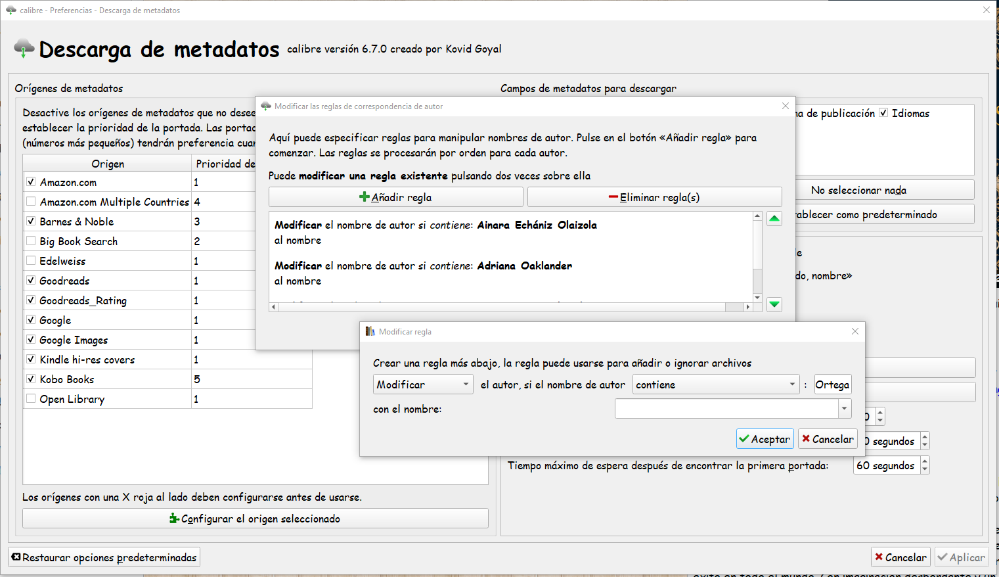
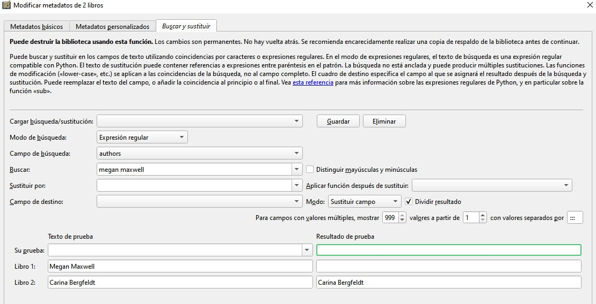

# Cuando descargo los metadatos, ¿hay manera de ignorar ciertos autores?

:material-account: Walter · :material-link-variant: [Ver el original en Telegraph](https://telegra.ph/Cuando-descargo-los-metadatos-hay-alguna-manera-de-ignorar-ciertos-autores-11-01){ target=_blank }
{ .tut-datos }

---

Explicado por @Killo\_3967

Cuando descargo los metadatos, hay alguna manera de ignorar ciertos autores?

Resulta que en algunos sitios meten a los traductores como autores y me gustaria hacer una especie de blacklist de traductores.

He intentado en las reglas de modificacion de autores en las descargas de metadatos poner el traductor y que lo sustituya por espacio en blanco, pero no funciona.

La solución :

En Preferencias -\> Descargas de Metadatos -\> Crear Reglas para transformar nombres de autor -\> Añadir Regla -\>

Se agregan uno a uno los traductores y quedan excluidos de los autores que se descargan.

Propuesta, alternativa de @wiso\_wolo

Os dejo lo mismo para modificar el autor a eliminar en caso de que ya tengáis muchos libros con este caso.

Sería lo mismo, ir creando reglas, para cada uno de los que quieras eliminar.

Ir al inicio del mensaje: [https://t.me/calibreconfiguraciones/108791](https://t.me/calibreconfiguraciones/108791)

 

## [Volver al inicio](https://telegra.ph/Indice-Calibre-en-Espa%C3%B1ol-10-03)

 

 

---

[:material-arrow-left: Volver al índice](../../alfabetico.md) · [:fontawesome-brands-telegram: Preguntar en el grupo](https://t.me/calibreconfiguraciones){ target=_blank }
