# Curso básico para Calibre

:material-account: [Walter](https://t.me/Dunhill69){ target=_blank } · :material-link-variant: [Ver el original en Telegraph](https://telegra.ph/Curso-b%C3%A1sico-para-Calibre-09-14){ target=_blank }
{ .tut-datos }

---

Calibre es un gestor de biblioteca de libros electrónicos. Con calibre puede leer, convertir y catalogar libros electrónicos en la mayoría de los principales formatos. También puede comunicarse con muchos dispositivos de lectura de libros electrónicos. Puede obtener metadatos para los libros de Internet. Puede descargar periódicos y convertirlos en libros electrónicos para una lectura más cómoda. Es multiplataforma, funciona en Linux, Windows y macOS.

Para instalarlo vamos a su página principal [https://calibre-ebook.com/download](https://calibre-ebook.com/download) donde eligiéremos nuestro sistema operativo.

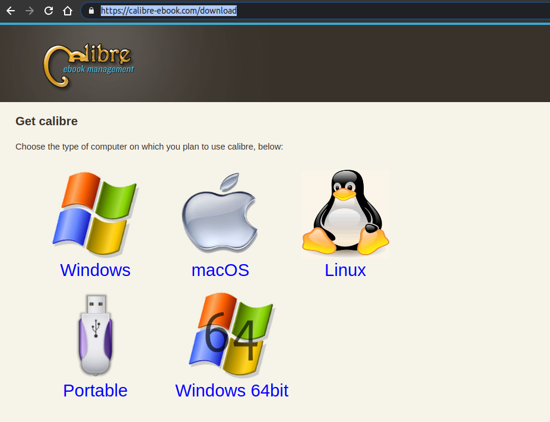

La primera vez que lanzamos Calibre, se nos mostrará una ventana donde se nos pedirá que elijamos el idioma y la ubicación para los ebooks, es decir, la ruta en nuestro disco donde cada vez que añadamos un libro se copiarán.

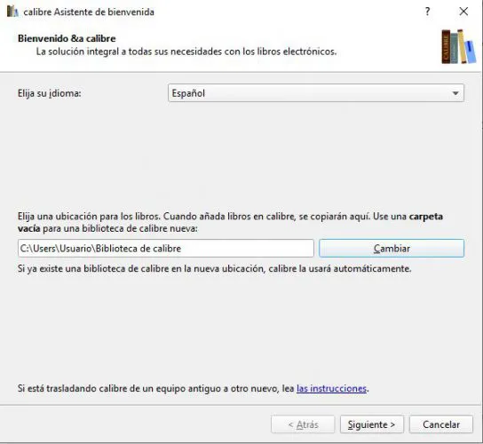

Después de pulsar en Siguiente, Calibre nos pedirá que elijamos nuestro eReader o lector de libros electrónicos. En esta ocasión, si es un Kindle, elegimos Amazon en la lista de fabricantes y a continuación, el modelo exacto en la lista de dispositivos.

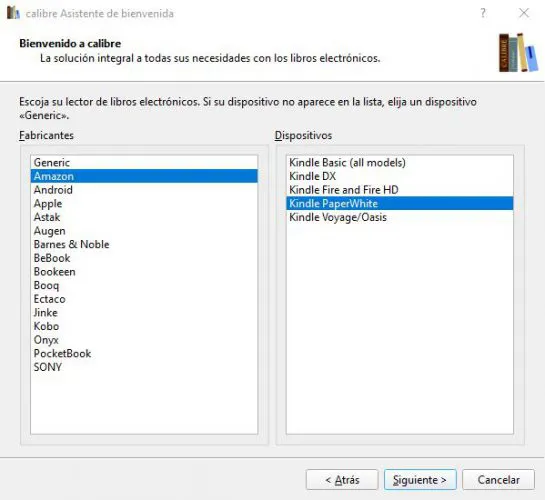

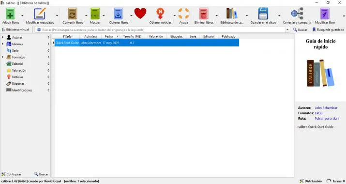

Como podemos ver a primera vista, las principales opciones y funciones de Calibre las tendremos a un simple clic. En la parte central se nos mostrará nuestra biblioteca de libros, en el lateral izquierdo vamos a poder ver un listado de autores, idiomas, géneros, etc, mientras que en el menú principal que aparece en la parte superior, encontramos las opciones principales de la herramienta para añadir y convertir libros, modificar metadatos, etc.

Llegados a este punto, el proceso básico para usar Calibre comienza añadiendo libros o ebooks a nuestra biblioteca desde el disco duro de nuestro ordenador. Para ello, basta con pulsar sobre la opción Añadir libros, que encontramos en el menú superior de Calibre y seleccionar la ruta donde tenemos nuestros ebooks almacenados. En el proceso de añadir un libro, Calibre intetará leer automáticamente los metadatos de cada uno de ellos y los añadirá a nuestra biblioteca.

Modificar metadatos. Al hacer clic sobre esta opción con un libro seleccionado, se nos mostrará una ventana con todos los metadatos de dicho ebook y desde ahí mismo vamos a poder modificarlos o incluso descargarlos. Si hacemos clic sobre la pestaña de esta opción y desplegamos las opciones que nos ofrece, encontramos que nos permite modificar metadatos por separado, en lote o en masa, descargar los metadatos y portadas de nuestros libros o unir registros de libros.

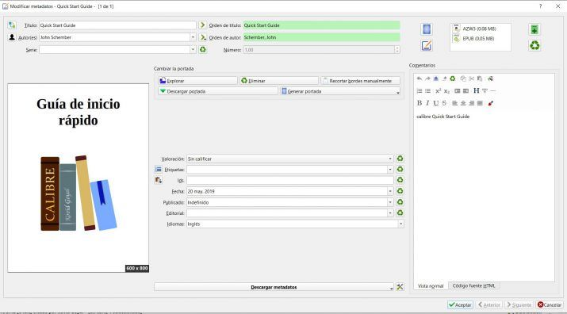

La interfaz gráfica de usuario *(GUI)* da acceso a todas las funciones de gestión de biblioteca y conversión de formatos de libro electrónico. El proceso básico para usar calibre comienza añadiendo libros a la biblioteca desde el disco duro. calibre intentará leer automáticamente los metadatos de los libros y los añadirá a la base de datos interna. Una vez que están en la base de datos, puede realizar distintas [Acciones](https://manual.calibre-ebook.com/es/gui.html#actions) sobre ellos, incluidas la conversión de un formato a otro, la transferencia a un dispositivo de lectura, la visualización en el equipo y la modificación de metadatos. Esta última acción incluye la modificación de la portada, descripción y etiquetas entre otros detalles. Tenga en cuenta que calibre crea copias de los archivos que añada. Los archivos originales no se alteran.

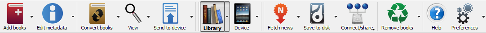

La barra de herramientas de acciones ofrece un acceso inmediato a algunas acciones usuales. Si pulsa con el botón derecho sobre los botones puede realizar variaciones de la acción predeterminada. Tenga en cuenta que la barra de herramientas de acciones puede tener un aspecto distinto dependiendo de si hay algún dispositivo de lectura conectado al equipo.

## [Añadir libros](https://manual.calibre-ebook.com/es/gui.html#id33)

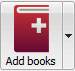  
<small>adbi</small>

La acción Añadir libros tiene siete variantes accesibles pulsando con el botón derecho sobre el botón.

1. **Añadir libros desde un único directorio**: Abre un diálogo de selección de archivo y le permite especificar qué libros de un directorio añadir. Esta acción es *sensible al contexto*, es decir, depende de qué [catálogo](https://manual.calibre-ebook.com/es/gui.html#catalogs) esté seleccionado. Si está seleccionada la Biblioteca, los libros se añadirán a la biblioteca. Si está seleccionado el dispositivo de lectura, los libros se copiarán al dispositivo, etc.
2. **Añadir libros de directorios y subdirectorios**: Le permite elegir un directorio. Se buscará en el directorio y todos sus subdirectorios de manera recursiva y todos los libros que se encuentren se añadirán a la biblioteca. Puede elegir si calibre añadirá todos los archivos presentes en un directorio a un único registro de libro o a múltiples registros. calibre asume que cada directorio contiene un único libro y que todos los archivos de libro en el directorio corresponden al mismo libro en distintos formatos. Esta acción es la inversa de la acción [Guardar en el disco](https://manual.calibre-ebook.com/es/gui.html#save-to-disk-multiple), es decir, puede Guardar en el disco, eliminar los libros y volver a añadirlos en el modo de un libro por directorio, sin pérdida de información excepto por la fecha (suponiendo que no haya modificado ninguna configuración de la acción Guardar en el disco).
3. **Añadir varios libros desde un archivo (ZIP/RAR)**: Le permite añadir múltiples libros que estén almacenados en los archivos ZIP o RAR seleccionados. Es una vía rápida para evitar tener que descomprimir los archivos primero y luego añadir los libros con alguna de las dos opciones anteriores.
4. **Añadir libro en blanco (entrada de libro sin ningún formato)**: Le permite añadir un registro de libro en blanco. Esto se puede usar para después rellenar manualmente la información de un libro que quizá aún no tenga en la colección.
5. **Añadir a partir del ISBN**: Le permite añadir uno o más libros introduciendo sus ISBN.
6. **Añadir archivos a los registros de libros seleccionados**: Le permite añadir o actualizar los archivos asociados con un libro existente en la biblioteca.
7. **Añadir un archivo vacío a los registros de libros seleccionados**: Le permite añadir un archivo vacío del formato especificado a los registros de libros seleccionados.

La acción Añadir libros puede leer metadatos de una amplia variedad de formatos de libro electrónico. Además, intenta extraer metadatos a partir del nombre de archivo. Vea la sección [Extraer metadata de los nombres de archivo](https://manual.calibre-ebook.com/es/gui.html#config-filename-metadata) para saber cómo configurar esto.

Para añadir un formato adicional a un libro existente, puede hacer cualquiera de estas tres cosas:

1. Arrastrar y soltar un archivo en el panel de detalles del libro, en la parte derecha de la ventana principal.
2. Pulse con el botón derecho sobre Añadir libros y elija Añadir archivos a los registros de libros seleccionados.
3. Pulsar sobre el Añadir libros en la parte superior derecha del diálogo Modificar metadatos, accesible mediante la acción [Editar metadatos](https://manual.calibre-ebook.com/es/gui.html#edit-meta-information).

## [Editar metadatos](https://manual.calibre-ebook.com/es/gui.html#id34)

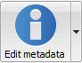  
<small>emii</small>

La acción Modificar metadatos tiene cuatro variantes accesibles pulsando con el botón derecho sobre el botón de la acción.

1. **Modificar metadatos por separado**: Le permite modificar los metadatos de los libros uno a uno, con la opción de obtener los metadatos, incluidas las portadas, de Internet. También le permite añadir o eliminar formatos específicos de un libro.
2. **Modificar metadatos en masa**: Le permite modificar campos de metadatos comunes a un gran número de libros simultáneamente. La operación se realiza sobre todos los libros que estén seleccionados en la [Vista de biblioteca](https://manual.calibre-ebook.com/es/gui.html#search-sort).
3. **Descargar metadatos y portadas**: Descarga metadatos y portadas (si están disponibles) para los libros seleccionados en la lista de libros.
4. **Unir registros de libros**: Le ofrece la posibilidad de unir los metadatos y formatos de dos o más registros de libros. Puede elegir borrar o mantener los registros distintos del primero seleccionado.

Para más detalles vea [Modificar los metadatos de los libros](https://manual.calibre-ebook.com/es/metadata.html#metadata).

## [Convertir libros](https://manual.calibre-ebook.com/es/gui.html#id35)

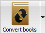  
<small>cei</small>

Los libros electrónicos pueden convertirse de una variedad de formatos al formato que su lector de libros electrónicos prefiera. Muchos libros electrónicos a la venta estarán protegidos por tecnología de gestión digital de derechos \<drm\> *(DRM)*. calibre no convertirá estos libros. Es sencillo eliminar la DRM de muchos formatos, pero como esto puede ser ilegal, es su responsabilidad encontrar las herramientas para liberar sus libros y luego usar calibre para convertirlos.

Para la mayoría de los usuarios, la conversión es cuestión de una sola pulsación. Si quiere saber más sobre el proceso de conversión, vea [Conversión de libros](https://manual.calibre-ebook.com/es/conversion.html#conversion).

La acción Convertir libros tiene tres variantes accesibles pulsando con el botón derecho sobre el botón de la acción.

1. **Convertir por separado**: Le permite especificar opciones de conversión para personalizarla conversión de cada libro seleccionado.
2. **Convertir en masa**: Le permite especificar opciones una sola vez y convertir un número de libros en masa.
3. **Crear un catálogo de los libros en la biblioteca de calibre**: Le permite generar un listado completo de los libros en la biblioteca, incluyendo todos los metadatos, en formatos como XML, CSV, BiBTeX, EPUB y MOBI. El catálogo contendrá todos los libros que se muestren actualmente en la vista de biblioteca. Esto le permite usar las funciones de búsqueda para limitar los libros catalogados. Además, si selecciona varios libros con el ratón, sólo se incluirán esos libros. Si genera el catálogo en un formato de libro electrónico como EPUB, MOBI o AZW3, la próxima vez que conecte un dispositivo de lectura el catálogo se enviará automáticamente al dispositivo. Para más información sobre cómo funcionan los catálogos, lea [Crear catálogos AZW3 • EPUB • MOBI](https://manual.calibre-ebook.com/es/catalogs.html#catalog-tut).

## [Mostrar](https://manual.calibre-ebook.com/es/gui.html#id36)

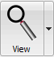  
<small>vi</small>

La acción Mostrar abre el libro en un programa visualizador de libros electrónicos. calibre tiene un visor incorporado para muchos formatos de libro electrónico. Para otros formatos usa la aplicación predeterminada del sistema operativo. Puede configurar qué formatos se abren con el visor interno en Preferencias \> Interfaz \> Comportamiento. Si un libro tiene más de un formato, puede abrir un formato específico pulsando con el botón derecho sobre el botón de la acción.

## [Enviar al dispositivo](https://manual.calibre-ebook.com/es/gui.html#id37)

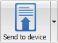  
<small>stdi</small>

La acción Enviar al dispositivo tiene ocho variantes accesibles pulsando con el botón derecho sobre el botón de la acción.

1. **Enviar a la memoria principal**: Los libros seleccionados se copian en la memoria principal del dispositivo de lectura.
2. **Enviar a la tarjeta de memoria A**: Los libros seleccionados se copian a la tarjeta de memoria (A) en el dispositivo de lectura.
3. **Enviar a la tarjeta de memoria B**: Los libros seleccionados se copian a la tarjeta de memoria (B) en el dispositivo de lectura.
4. **Enviar formato específico a**: Los libros seleccionados se copian al lugar de almacenamiento seleccionado en el dispositivo, en el formato que especifique.
5. **Desconectar dispositivo**. Desconecta el dispositivo de calibre.
6. **Asignar acción predeterminada de enviar al dispositivo**: Le permite especificar cuál de las acciones (1 a 5, o 7) será la acción predeterminada cuando se pulsa el botón principal.
7. **Enviar y eliminar de la biblioteca**: Los libros seleccionados se copian al lugar de almacenamiento seleccionado en el dispositivo y despues se **borran** de la biblioteca.
8. **Obtener anotaciones (experimental)**: Copia las anotaciones que pueda haber en un libro del dispositivo al campo de comentarios en los metadatos del libro en la biblioteca de calibre.

Puede controlar el nombre de archivo y la estructura de carpetas de los archivos que se envían al dispositivo estableciendo una plantilla en Preferencias \> Importar y exportar \> Enviar libros a dispositivos. Véase también [El lenguaje de plantillas de calibre](https://manual.calibre-ebook.com/es/template_lang.html#templatelangcalibre).

## [Descargar noticias](https://manual.calibre-ebook.com/es/gui.html#id38)

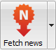  
<small>fni</small>

La acción:Obtener noticias descarga noticias de distintos sitios web y las convierte en un libro electrónico que pued leer en un dispositivo de lectura. Normalmente, el libro electrónico creado se añade a la biblioteca, pero si tiene un dispositivo conectado cuando termina la descarga, el libro también se copia al lector automáticamente.

La acción Obtener noticias usa fórmulas simples (10-15 líneas de código) por cada sitio de noticias. Para saber cómo crear fórmulas para sus fuentes de noticias preferidas, vea [Añadir su sitio de noticias favorito](https://manual.calibre-ebook.com/es/news.html#news).

La acción Obtener noticias tiene tres variantes accesibles pulsando con el botón derecho sobre el botón de la acción.

1. **Planificar descarga de noticias**: Le permite planificar la descarga de las fuentes de noticias seleccionadas de los cientos disponibles. La planificación puede establecerse de manera individual para cada fuente de noticias seleccionada y permite seleccionar días de la semana específicos o un número de días de intervalo entre descargas.
2. **Añadir una nueva fuente de noticias**: Le permite crear una fórmula simple para descargar noticias de un sitio de noticias personalizado al que quiera acceder. Crear una fórmula puede ser tan simple como especificar la dirección URL de un canal RSS, o puede ser más detallado, creando un código basado en python para la tarea. Para más información véase [Añadir su sitio de noticias favorito](https://manual.calibre-ebook.com/es/news.html#news).
3. **Descargar todas las fuentes de noticias planificadas**: Hace que calibre empiece inmediatamente a descargar todas las fuentes de noticias que tenga planificadas.

## [Biblioteca](https://manual.calibre-ebook.com/es/gui.html#id39)

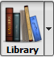  
<small>lii</small>

La acción Biblioteca le permite crear, eliminar o cambiar el nombre a una biblioteca, o cambiar de una biblioteca a otra. calibre le permite crear tantas bibliotecas como desee. Puede, por ejemplo, crear una biblioteca de ficción, una de no ficción, una de idiomas extranjeros, una de proyectos, o cualquier estructura que le convenga. Las bibliotecas son la estructura de organización de mayor nivel dentro de calibre. Cada biblioteca tiene su propio conjunto de etiquetas, categorías y ubicación de almacenamiento base.

1. **Cambiar o crear biblioteca…**: Le permite: a) conectar con una biblioteca de calibre existente en otra ubicación, b) crear una biblioteca vacía en una nueva ubicación o c) mover la biblioteca actual a una nueva ubicación.
2. **Cambio rápido**: Le permite cambiar de una biblioteca a otra si han sido registradas o creadas con calibre.
3. **Cambiar el nombre a la biblioteca**: Le permite cambiar el nombre a una biblioteca.
4. **Elegir un libro aleatorio**: Elige un libro aleatorio de la biblioteca
5. **Eliminar biblioteca**: Le permite dar de baja una biblioteca en calibre.
6. **Exportar o importar todos los datos de calibre**: Le permite exportar los datos de calibre para migrar a un nuevo equipo o importar los datos previamente exportados.
7. **\<nombre de biblioteca\>**: Las acciones 7, 8, etc. le dan acceso inmediato a las bibliotecas que haya creado o registrado. Esta lista contiene sólo las 5 bibliotecas más usadas. Para tener la lista completa, use el menú Cambio rápido.
8. **Mantenimiento de la biblioteca**: Le permite comprobar la coherencia de los datos en la biblioteca actual, detectar problemas y restaurar la base de datos de la biblioteca a partir de copias de respaldo.

NotaLos metadatos de los libros, como el título, autor y etiquetas, se almacenan en un único archivo en la carpeta de la biblioteca de calibre, llamado metadata.db. Si este archivo se corrompe (un suceso muy infrecuente) pueden perderse los metadatos. Por suerte, calibre copia automáticamente los metadatos de cada libro en su correspondiente carpeta como un archivo OPF. Mediante la acción Restaurar base de datos bajo Mantenimiento de la biblioteca, descrita anteriormente, puede hacer que calibre reconstruya el archivo metadata.db a partir de los archivos OPF individuales.

Puede copiar o mover libros entre diferentes bibliotecas (una vez que haya configurado más de una biblioteca) pulsando con el botón derecho sobre un libro y seleccionando la acción Copiar a biblioteca.

## [Dispositivo](https://manual.calibre-ebook.com/es/gui.html#id40)

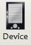  
<small>dvi</small>

La acción Dispositivo le permite ver los libros en la memoria principal o en las tarjetas de almacenamiento de un dispositivo o desconectarlo de calibre. Este icono aparece automáticamente en la barra de herramientas principal de calibre cuando se conecta un dispositivo soportado. Puede pulsar sobre él para ver los libros en el dispositivo. También puede arrastrar y soltar libros de la biblioteca de calibre sobre el icono para copiarlos al dispositivo. Análogamente, puede arrastrar y soltar libros del dispositivo sobre el icono de la biblioteca en la barra de herramientas para copiarlos del dispositivo a la biblioteca de calibre.

## [Guardar en el disco](https://manual.calibre-ebook.com/es/gui.html#id41)

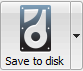  
<small>svdi</small>

La acción Guardar en el disco tiene cinco variantes, accesibles pulsando con el botón derecho sobre el botón de la acción.

1. **Guardar en el disco**: Guarda los libros seleccionados en el disco, organizados por directorios. La estructura de directorios es algo así:

```
Author_(sort)
    Title
        Book Files
```

> Puede controlar el nombre de archivo y la estructura de carpetas de los libros guardados en el disco estableciendo una plantilla en Preferencias \> Importar y exportar \> Guardar libros en disco. Véase también [El lenguaje de plantillas de calibre](https://manual.calibre-ebook.com/es/template_lang.html#templatelangcalibre).

1. **Guardar en el disco, en un único directorio**: Guarda los libros seleccionados en el disco, en un único directorio.

> Con las opciones 1 y 2 se guardan en el disco todos los formatos, incluidos los metadatos, de cada libro seleccionado. Los metadatos se almacenan en un archivo OPF. Los libros guardados pueden volver a ser importados a la biblioteca sin pérdida de información usando la acción [Añadir libros](https://manual.calibre-ebook.com/es/gui.html#add-books).

1. **Guardar solamente el formato \*\<principal\>\* en disco**: Guarda los libros seleccionados en el disco con la estructura de directorios mostrada en (1), pero sólo en el formato principal. Puede establecer el formato preferido en Preferencias \> Interfaz \> Comportamiento \> Formato de salida principal.
2. **Guardar sólo el formato \*\<principal\>\* en un único directorio**: Guarda los libros seleccionados en el disco, en un único directorio, pero sólo en el formato principal.
3. **Guardar un solo formato en disco…**: Guarda los libros seleccionados en el disco con la estructura de directorios mostrada en (1), pero sólo en el formato que seleccione en la lista emergente.

## [Conectar y compartir](https://manual.calibre-ebook.com/es/gui.html#id42)

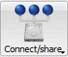  
<small>csi</small>

La acción Conectar y compartir le permite conectar manualmente con un dispositivo o carpeta en el equipo. También le permite configurar la biblioteca de calibre para que pueda accederse a través de un navegador web o por correo electrónico.

> La acción Conectar y compartir tiene cuatro variantes accesibles pulsando con el botón derecho sobre el botón de la acción.

1. **Conectar a carpeta**: Le permite conectar con cualquier carpeta en el equipo como si fuera un dispositivo y usar las funciones que calibre ofrece para los dispositivos con esa carpeta. Esto es útil si tiene un dispositivo que no está soportado por calibre pero que está disponible como un disco USB.
2. **Iniciar servidor de contenido**: Inicia el servidor web incorporado en calibre. Cuando se ha iniciado, la biblioteca de calibre será accesible mediante un navegador web a través de Internet (si quiere que así sea). Puede configurar cómo se accede al servidor web en Preferencias \> Compartir \> Compartir por la red.
3. **Configurar el intercambio de libros por correo electrónico**: Le permite compartir libros y canales de noticias por correo electrónico. Después de configurar las direcciones de correo para esta opción, calibre enviará actualizaciones de noticias y de libros a las direcciones suministradas. Puede configurar cómo se envían los correos electrónicos en Preferencias \> Compartir \> Compartir libros por correo electrónico. Una vez que haya configurado una o varias direcciones de correo, esta entrada del menú se sustituirá por entradas para enviar libros a las direcciones configuradas.

## [Eliminar libros](https://manual.calibre-ebook.com/es/gui.html#id43)

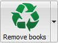  
<small>rbi</small>

La acción Eliminar libros **elimina libros permanentemente**, así que úsela con cuidado. Es *sensible al contexto*, es decir, su comportamiento depende de qué [catálogo](https://manual.calibre-ebook.com/es/gui.html#catalogs) tenga seleccionado. Si tiene seleccionada la Biblioteca, los libros se eliminarán de la biblioteca. Si tiene seleccionado el dispositivo de lectura, los libros se eliminarán del dispositivo. Para eliminar un formato específico de un libro use la acción [Editar metadatos](https://manual.calibre-ebook.com/es/gui.html#edit-meta-information). Eliminar libros también tiene seis variantes accesibles pulsando con el botón derecho sobre el menú de la acción.

1. **Eliminar libros seleccionados**: Le permite eliminar **permanentemente** todos los libros seleccionados en la lista de libros
2. **Eliminar archivos de un formato específico de los libros seleccionados…**: Le permite eliminar **permanentemente** archivos de un formato determinado de los libros seleccionados en la lista de libros.
3. **Eliminar todos los formatos de los libros seleccionados, excepto…**: Le permite eliminar **permanentemente** los archivos de libro de cualquier formato excepto el especificado de los libros seleccionados en la lista de libros.
4. **Eliminar todos los formatos de los libros seleccionados**: Le permite eliminar **permanentemente** todos los archivos de libro de los libros seleccionados en la lista de libros. Sólo quedarán los metadatos.
5. **Eliminar portadas de los libros seleccionados**: Le permite eliminar **permanentemente** los archivos de imagen de portada de los libros seleccionados en la lista de libros.
6. **Eliminar los libros correspondientes del dispositivo**: Le permite eliminar de un dispositivo conectado los archivos de libro que correspondan a los libros seleccionados en la lista de libros.

NotaTenga en cuenta que al usar Eliminar libros para eliminar libros de la biblioteca de calibre, el registro del libro se borra permanentemente, pero en Windows y macOS los archivos se mueven a la papelera de reciclaje. Esto le permite recuperarlos si cambia de opinión.

## [Preferencias](https://manual.calibre-ebook.com/es/gui.html#id19)

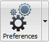  
<small>cbi</small>

La acción Preferencias le permite cambiar la manera en que funcionan distintos aspectos de calibre. Tiene cuatro variantes accesibles pulsando con el botón derecho sobre el botón de la acción.

1. **Preferencias**: Le permite cambiar la manera en que funcionan los distintos aspectos de calibre. Esta acción también se activa simplemente pulsando sobre el botón.
2. **Ejecutar el asistente de bienvenida**: Le permite iniciar el Asistente de bienvenida, que apareció la primera vez que se ejectuó calibre.
3. **Obtener complementos para mejorar calibre**: Abre una nueva ventana que muestra complementos para calibre. Estos complementos están desarrollados por terceros para extender las funciones de calibre.
4. **Reiniciar en el modo de depuración**: Le permite activar un modo de depuración, que puede ayudar a los desarrolladores de calibre a resolver los problemas que pueda encontrar con el programa. Para la mayoría de los usuarios esta opción debe permanecer desactivada, a menos que un desarrollador le indique que la active.

## Pantalla principal

Según se arranca el programa, tendremos esta pantalla, solo que vacía y sin libros.

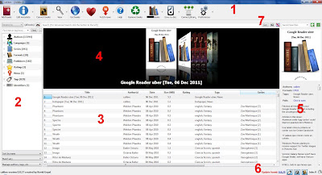  
<small>Tutorial Calibre</small>

[ Pincha en la imagen para verla más grande.](https://lh3.googleusercontent.com/-9lrS9IUHqEU/Tt3uAbtAe1I/AAAAAAAAA0A/rWahU2dIlac/s800/Calibre_tutorial_planetahuevo_es_002.jpg)

Las distintas secciones:

1. Menú principal, del que hablo un poco más abajo.
2. Etiquetas y tags. Permite filtrar la colección por etiquetas, formatos, colecciones, etc.
3. Listado de libros con sus características y metadatos en columnas (configurables).
4. Pantalla de portadas de libros (yo la tengo siempre apagada).
5. Información del libro seleccionado, con enlaces a su carpeta y las diferentes versiones del mismo.
6. Botones que permiten, de izquierda a derecha, encender/apagar la columna de etiquetas (zona 2), encender/apagar la zona de las portadas de libros (zona 4), encender/apagar la columna de la derecha de información (zona 5), ver los trabajos pendientes (Jobs).
7. Búsqueda de libros. Puedes salvar búsquedas y buscar por formato, etc.

## El menú principal

El menú principal varía si tenemos un dispositivo conectado o si no lo tenemos. Básicamente aparecen los botones de enviar al dispositivo o a la tarjeta de memoria.

Como antes, las funciones numeradas:

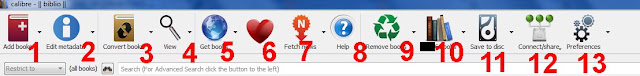  
<small>menu calibre 1</small>

<br>

1. Añadir libros a la biblioteca del Calibre.
2. Editar la información (metadatos) del libro.
3. Convertir libros.
4. Abre el visor de libros del Calibre.
5. Conseguir libros de internet. Busca en las tiendas más famosas, amazón por supuesto y otras.
6. Botón de donación. El programa es gratis, pero bien vale la pena pagarle unos eurillos al creador, no es obligatorio, pero si recomendable.
7. Conseguir noticias. Puedes obtener noticias RSS y pasarlas a tu ereader.
8. Ayuda.
9. Borrar. El botón de reciclado permite borrar libros o formatos de distintos libros.
10. Tu biblioteca. Para poder abrir otras bibliotecas o mover la actual. Importante el botón de mantenimiento.
11. Salvar al disco. Copia uno o varios libros a una carpeta del disco duro.
12. Conectar. Permite conectarse con iTunes, con una carpeta de nuestro disco duro, activar o apagar el servidor web y configurar el envío por email de libros.
13. Preferencias.

Si tenemos conectado el dispositivo, el menú queda como este:

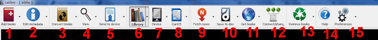  
<small>Menu calibre 2</small>

<br>

1. Añadir libros a la biblioteca del Calibre.
2. Editar la información (metadatos) del libro.
3. Convertir libros.
4. Abre el visor de libros del Calibre.
5. Enviar libros al dispositivo conectado.
6. Tu biblioteca. Para poder abrir otras bibliotecas o mover la actual.
7. Tu dispositivo. Si lo pulsas, el listado de libros pasa a ser el que tienes en tu ereader.
8. La tarjeta de memoria del ereader. Si lo pulsas, el listado de libros pasa a ser el de la tarjeta de memoria del ereader.
9. Conseguir noticias. Puedes obtener noticias RSS y pasarlas a tu ereader.
10. Salvar al disco. Copia uno o varios libros a una carpeta del disco duro.
11. Conseguir libros de internet. Busca en las tiendas más famosas, amazón por supuesto y otras.
12. Conectar. Permite conectarse con iTunes, con una carpeta de nuestro disco duro, activar o apagar el servidor web y configurar el envío por email de libros.
13. Borrar. El botón de reciclado permite borrar libros o formatos de distintos libros.
14. Ayuda.
15. Preferencias.

Añadir libros a nuestra biblioteca

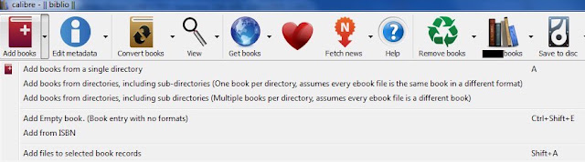  
<small>Tutorial Calibre 2</small>

<br>

Los libros se añaden de varias formas. La primera y más sencilla es arrastrándolos desde el explorador a la pantalla principal del Calibre, al listado de libros concretamente.

Usando el menú principal, tenemos más opciones. De arriba a abajo:

- Añadir libros de un sólo directorio. Si tenemos todos los archivos sueltos en un directorio esta es la opción.
- Añadir libros de un directorio y sus subdirectorios, asumiendo que cada libro tiene su propio directorio. Este es el formato que usa Calibre para guardar los libros, normalmente no usaremos esta opcion.
- Añadir libros de un directorio y sus subdirectorio. Cada directorio tiene múltiples libros, y cada archivo es un libro diferente. Esta es la opción normal. Calibre luego detecta si los libros son el mismo y los pone juntos (pero solo si están bien nombrados). Siempre podemos agruparlos después.

Luego vienen 3 opciones más raras de usar.

- Añadir un libro vacío.
- Añadir desde ISBN.
- Añadir archivos al libro seleccionado. Si lo que tenemos son formatos diferentes de un mismo libro. También podemos añadir el libro y luego juntarlos desde el menú.

## Actualizar la información de los libros (metadatos)

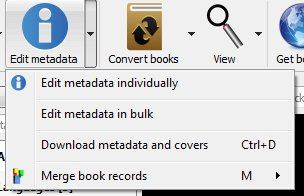  
<small>metadatos calibre</small>

<br>

Esta es la pantalla que aparece si le damos a actualizar los metadatos de un sólo libro. Es muy similar a la que aparece si usamos el editor en bloque (Edit metadata in bulk).

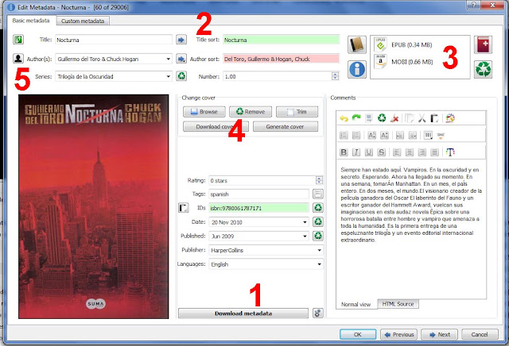  
<small>Metadatos calibre</small>

<br>

- 1.- El botón Download Metadata sirve para bajar la información de Internet, carátula, año, autor, colecciones, etc. Ver siguiente apartado.
- 2.- Aquí viene el autor y el título del libro. Si está en verde es porque coincide el orden usado con el título o autor escrito. Podemos editar las casillas de la izquierda y pulsando los botones pasar la información a la derecha. Si dejamos apretado el botón de Autor, nos aparece un pequeño menú desplegable.

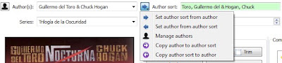  
<small>calibre tutorial 5</small>

<br>

- 3.- Los formatos que tenemos disponibles para este libro. Epub y Mobi en este ejemplo, listo para todos los ereaders del mercado.
- 4.- Botones parar cambiar la carátula del libro. *Generate cover* crea una portada artificial por si no tenemos ninguna a mano y no la encuentra en Internet.
- 5.- Esta fila sirve para crear colecciones (series) y el número de la derecha es el capítulo de este libro dentro de la colección, en el ejemplo el primero de la colección *Trilogía de la Oscuridad.*

## Actualizar la información de los libros desde internet

Si hemos pulsado en el botón de Download Data en la pantalla anterior, Calibre intentará conectarse a Internet para descargar la información del libro que tenemos seleccionado. En libros en castellano es complicado que nos aparezca el resumen, pero si tendrá la fecha de publicación, la caratula y otros datos.

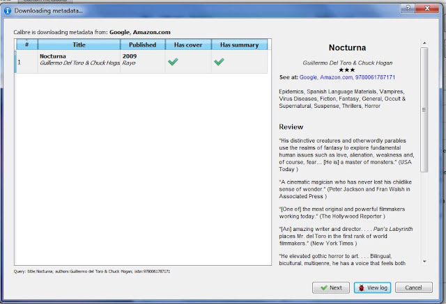  
<small>metadata tutorial calibre</small>

<br>

Seleccionamos el que más nos guste (si es que salen varios) y pulsamos en siguiente (next). Entonces nos aparecen las distintas caratulas disponibles para ese libro.

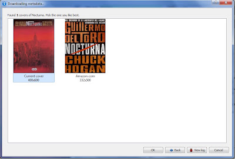  
<small>metadatos tutorial calibre 2</small>

<br>

Nuevamente elegimos la que preferimos y le damos a OK. Y ya tenemos toda la información del libro actualizada (en inglés eso si).

## Convertir libros a otro formato Epub o mobi

Como la mayoría de los libros vienen en epub, las imágenes van a ser de cómo convertir un epub a formato de Kindle .mobi. Para convertir cualquier otro formato hay que seguir los mismos pasos, ya que el formato de origen lo coje directamente el Calibre del archivo que le proporcionamos.

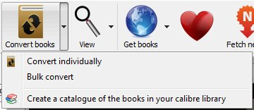  
<small>menu calibre 4</small>

<br>

Lo primero que yo recomiendo es ir a las opciones y modificar los valores por defecto a los que vamos a convertir. Es decir, si tenemos un Kindle, pondremos como valor por defecto que vamos a convertir a formato de Kindle (.mobi) y así nos ahorraremos un paso cada vez que queramos convertir un libro. Además esas son las opciones que usa el programa cuando hacemos transformaciones de varios archivos a la vez ( a menos que le digas lo contrario).

En Preferences\>Behaviour podemos seleccionar cual es el formato predefinido para exportar (epub o mobi normalmente) y en Preferencias\>Common Options tenemos una pantalla como esta:

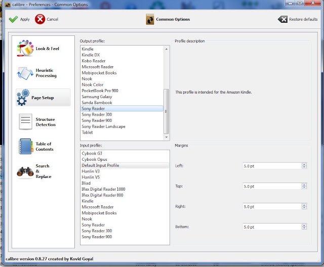  
<small>opciones tutorial calibre</small>

<br>

Pulsando en Page Setup en la izquierda podremos definir el input profile y el output profile predefinidos. Dejamos el Input profile como viene, en Default Input Profile. Ponemos el Output profile marcando el dispositivo que tengamos nosotros. En mi caso he marcado Sony Reader porque yo tengo un Sony PRS-505. Si lo tuyo es un Kindle, pues Kindle.

Una vez hecho esto pulsamos en Apply arriba a la derecha y salimos de las opciones.

Ahora seleccionamos el libro que queremos transformar, y o bien con el botón del menú principal o con el botón derecho del ratón pulsamos en *Convert individually*.

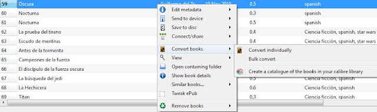  
<small>convertir libro tutorial calibre</small>

<br>

Se nos abre esta pantalla (muy parecida a la de las opciones)

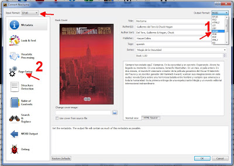  
<small>convertir tutorial calibre</small>

<br>

En la izquierda arriba aparece el formato que va a usar para transformar el libro electrónico.

A la derecha seleccionamos el formato al que queremos transformar el libro. Normalmente será .mobi para el Kindle. Esto hay que cambiarlo lo primero, ya que al modificarlo nos cambia el resto de las opciones a las opciones por defecto.

Después pulsamos en Page Setup (el número 2 en la imagen) y si hemos hecho todo bien debería aparecer una pantalla como esta:

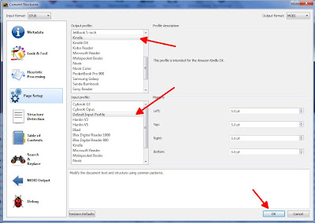  
<small>convertir tutorial calibre 3</small>

<br>

Nos aseguramos que el Output format de arriba a la derecha es correcto.

Comprobamos que el input profile está en Default Input Profile y que el Output está en el que deseamos, en este caso el Kindle, si no lo está lo seleccionamos.

Y pulsamos el botón Ok. El programa cerrará la ventana y en la esquina inferior derecha aparecerá «*Jobs :1*» y una rueda que nos indica que está realizando un trabajo.

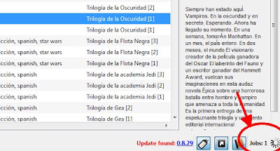  
<small>tutorial calibre 6</small>

<br>

Si pulsamos en esa esquina se nos abre una ventana dónde podemos ver la evolución de los distintos trabajos pendientes del Calibre. Podemos mandar convertir varios libros a la vez, y los irá convirtiendo en orden de llegada.

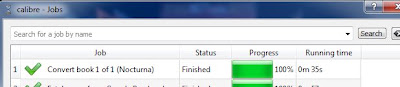  
<small>tutorial calibre 9</small>

<br>

## Convertir archivos de Word a otro formato Epub o mobi

Otra conversión muy típica suele ser la de pasar un documento de word a formato epub o mobi para leerlo en nuestro ereader. El problema es que el Calibre no transforma los archivos \*.doc ni los \*.docx (archivos de Office 2007). La solución es muy sencilla, hay que guardar el archivo desde Office Word o desde Open Office en otro formato compatible con el Calibre y luego convertirlo con el Calibre al formato deseado.

Si lo que tenemos es un archivo \*.doc o un \*.docx, lo ideal es abrirlo con el Office Word y guardarlo en \*.rtf o guardarlo como página web \*.html. Si lo abrimos con el Open Office podremos guardarlo como archivo \*.odt que también lo puede abrir el Calibre.

La ventaja de guardarlo como archivo html (página web) es que muchas veces nos guarda la tabla de contenido, que luego puede ser utilizada al transformarla en versión -mobi o .epub.

Es un problema muy común que al convertir archivos de Word (desde rtf, html u odt) el autor y el título estén cambiados de orden. En cuyo caso es bueno revisar los metadatos al finalizar la transformación.

## Vista previa de los libros en el Calibre

Una vez tenemos los libros transformados, es buena idea ver cómo van a verse en nuestro dispositivo. Para esto Calibre dispone de un estupendo visor que nos permite abrir cualquier ebook de nuestra biblioteca como si lo hiciéramos en nuestro ereader, solo que en color en lugar de blanco y negro.

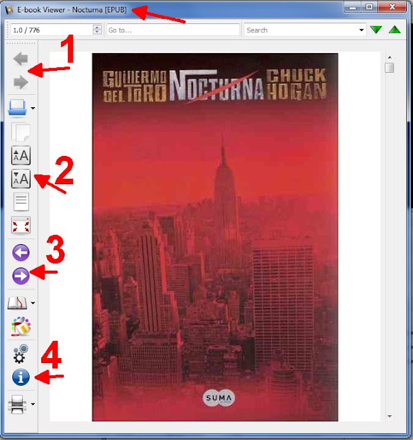  
<small>visor tutorial calibre</small>

<br>

1. Botones para pasar de un libro al siguiente en nuestro listado. Si hemos filtrado el listado de alguna forma, mantendrá el orden del listado en ese momento.
2. Este menú permite abrir otro ebook, copiar al portapapeles un texto seleccionado, cambiar el tamaño de la fuente, mostrar la tabla de contenidos del libro y abrir el visor en pantalla completa.
3. Estos son los botones para pasar página de nuestro ebook.
4. Los ultimos 5 botones son, de arriba a abajo, gestor de favoritos en el libro (*bookmark*s), que si se usan en un epub, se quedan grabados en él de forma que si se lo envíamos a un amigo puede ver esos mismos *bookmarks*. Sigo, modo reference (que nos indica en que lugar del libro estamos, párrafo/página), botón *de preferencias* de lectura, información del libro y el botón de imprimir.
5. En la parte de arriba podemos ver el título y qué tipo de archivo tenemos abierto.

## Pasar los libros a nuestro dispositivo

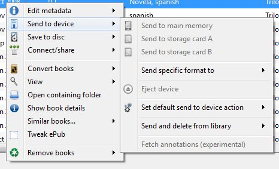  
<small>tutorial calibre 1</small>

<br>

Una vez tenemos el libro transformado y a nuestro gusto (que en el caso de la mayoría de epubs ya viene perfectamente) hay que pasarlo a nuestro ereader. Tan sencillo como pulsar en el libro del listado con el botón derecho y (como se ve en la imagen) darle a enviar al dispositivo (send to device), pudiendo elegir si queremos usar la memoria principal o las diferentes tarjetas de memoria del ereader.

Y listo, aparecerá una nueva tarea pendiente (Job) en el Calibre y comenzará a copiar el archivo solicitado. Si queremos mandar varios, simplemente hay que seleccionarlos en el listado y seguir el mismo procedimiento.

Calibre mandará por defecto el formato predefinido dependiendo de tu ereader. Para la mayoría, el formato predefinido es el EPUB, y luego el específico de la marca (LRF en el caso del sony). Para el Kindle el formato predefinido es el AZW seguido del .MOBI. Si queremos cambiarlo y poner el .mobi como predefinido para el Kindle tenemos que ir a  Preferences – Advanced – Plugins – Device interface plugins – Kindle2/3 – Customize plugin y allí subir el .mobi al primero de la lista con las flechas.

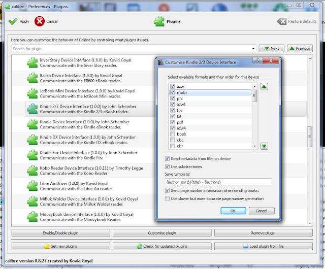  
<small>calibre tutorial</small>

<br>

En cualquier caso siempre podremos usar el menú «Send Specific format to» para enviar un formato diferente a alguno de los ereaders conectados en ese momento.

## Borrar libros o formatos no deseados

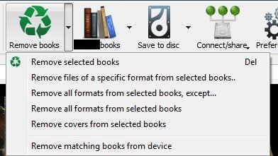  
<small>borrar tutorial calibre</small>

<br>

En el menú principal podemos borrar los archivos seleccionados, tanto de la biblioteca como del dispositivo que tengamos instalado. Puedes además eliminar todos los archivos de un formato específico de toda la biblioteca, por ejemplo, todos esos documentos RTF que hemos creado y transformado y ya no nos hacen falta. Podemos borrar todos los formatos excepto uno, o borrar todos los formatos directamente, dejando solo la información del ebook. También tenemos la opción de borrar todas las carátulas y el último botón sirve para borrar los libros de nuestro ereader que coincidan con los seleccionados.

<br>

## [Volver al inicio](https://telegra.ph/Indice-Calibre-en-Espa%C3%B1ol-10-03)

## <br>

<br>

<br>

<br>

---

[:material-arrow-left: Volver al índice](../../alfabetico.md) · [:fontawesome-brands-telegram: Preguntar en el grupo](https://t.me/calibreconfiguraciones){ target=_blank }
