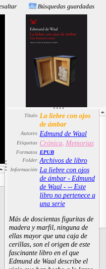

# Color en el detalle del libro (Calibre 6.25)

:material-account: [Walter](https://t.me/Dunhill69){ target=_blank } · :material-link-variant: [Ver el original en Telegraph](https://telegra.ph/Darle-color-al-detalle-de-libro-en-versi%C3%B3n-625-de-Calibre-Como-se-hace-08-21){ target=_blank }
{ .tut-datos }

---

Pera este ejemplo debemos usar este código de debemos pegar en Apariencia/Detalle de libro/ Estilo de texto.

table.fields td.title {color: #A9A9A9;text-align: right; font-size:11px;line-height: 1.1;}

#title\_sort{font-size: 9px !important;font-weight: bold;}

#title{ /\* font-size: 12px !important;\*/

color:orange; font-weight: bold; }

#rating, #rating a, #identifiers, #identifiers  a {font-size: 11px;}

#tags, #tags a {

color:#F578BE;

/\*font-weight: bold;\*/

}

#current\_status a {

color:orange;

font-weight: bold;

}

#timestamp a {

/\*color:orange;\*/

font-weight: bold;

}

#formats a {

/\*color:orange;\*/

font-weight: bold;

font-size: 11px !important;}

---

Dejo el código original a modo de recaudo

body, td {

background-color: transparent;

}

 

body.horizontal table td.title { white-space: nowrap }

 

a {

text-decoration: none;

}

 

.comments {

margin-top: 0;

padding-top: 0;

text-indent: 0

}

 

.comments-heading {

font-size: larger;

font-weight: bold

}

 

table.fields {

margin-bottom: 0;

padding-bottom: 0;

}

 

table.fields td {

vertical-align: top

}

 

table.fields td.title {

font-weight: bold

}

 

.series\_name {

font-style: italic

}

 

/\*

The HTML that this stylesheet applies to looks like this:

 

\<table class="fields"\>

\<tr id="formats" class="datatype\_text"\>\<td class="title"\>Formats:\</td\>\<td\>\<a href="format:572:EPUB"\>EPUB\</a\>, \<a href="format:572:LIT"\>LIT\</a\>\</td\>\</tr\>

\<tr id="series" class="datatype\_series"\>\<td class="title"\>Series:\</td\>\<td\>Book II of \<a href="..."\>\The Sea Beggars\</span\>\</a\>\</td\>\</tr\>

\<tr id="tags" class="datatype\_text"\>\<td class="title"\>Tags:\</td\>\<td\>\<a href="..."\>Fantasy\</a\>, \<a href="..."\>Fiction\</a\>\</td\>\</tr\>

\<tr id="path" class="datatype\_text"\>\<td class="title"\>Path:\</td\>\<td\>\<a href="path:572" title="/home/kovid/test library/Paul Kearney/This Forsaken Earth (572)"\>Click to open\</a\>\</td\>\</tr\>

\</table\>

 

\
\<h3\>From Publishers Weekly\</h3\>\<p\>At the start of Kearney's rousing sequel to \<em\>The Mark of Ran\</em\> (2005), Rol Cortishane, the youthful captain of the privateer \<em\>Revenant\</em\>, captures a slaver and frees its chained slaves. Back in the harbor of Ganesh Ka in the land of Umer, Rol encounters an untrustworthy acquaintance he hasn't seen in years, Canker, a former king of thieves, who urges Rol to join in the fight to save Rowen, a darkly beautiful queen, whose throne is at risk in mountainous Bionar. That Rowen is Rol's half-sister for whom he has lusted in the past doesn't make Rol's decision to help an easy one. If as in \<em\>The Mark of Ran\</em\> the action is more lively at sea than on land, Kearney's solid storytelling and nautical detail worthy of C.S. Forester or Patrick O'Brian will keep readers turning the pages. \<em\>(Dec.)\</em\> \ Copyright © Reed Business Information, a division of Reed Elsevier Inc. All rights reserved. \</p\>\<h3\>From\</h3\>\<p\>The sequel to \<em\>The Mark of Ran\</em\> (2005) finds heroic young Rol Cortishane grown to be a much-feared sea captain. Deciding to ignore his mysterious past, he spends his energy on ship and crew. He is still an outlaw, however, and the only port he can call home is Ganesh Ka, the endangered city of exiles. When word comes from Rowan, his half-sister, asking him to fight on her behalf, he must weigh the safety of Ganesh Ka against Rowan's treachery in the past. Finally persuaded to aid Rowan, he learns more of betrayal and his heritage in the ensuing battles than he had wanted to know. Kearney's characters are much better developed here than they were in \<em\>The Mark of Ran\</em\>, and since the book tells a single story, the plot is tighter. Moreover, because almost all the action transpires in the here and now, the sequel can be read without reference to the predecessor. Since it ends hanging on a particularly bloody cliff, expect to see more of Kearney's excellent maritime fantasy. \<em\>Frieda Murray\</em\>\ \<em\>Copyright © American Library Association. All rights reserved\</em\>\</p\>

\</div\>

 

\<h3 class="comments-heading"\>Custom comments column heading\</h3\>

\
...\</div\>

 

 

 

Ir al mensaje: [https://t.me/calibreconfiguraciones/112333/143015](https://t.me/calibreconfiguraciones/112333/143015)

## [Volver al inicio](https://telegra.ph/Indice-Calibre-en-Espa%C3%B1ol-10-03)

 

 

 

---

[:material-arrow-left: Volver al índice](../../alfabetico.md) · [:fontawesome-brands-telegram: Preguntar en el grupo](https://t.me/calibreconfiguraciones){ target=_blank }
