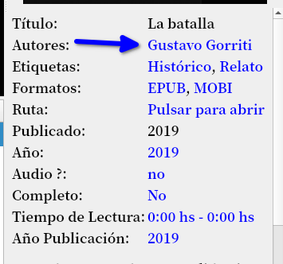
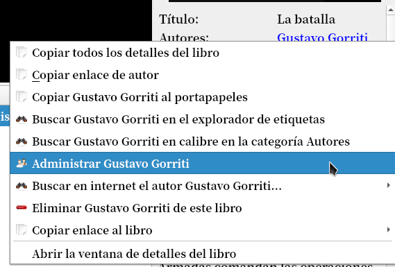
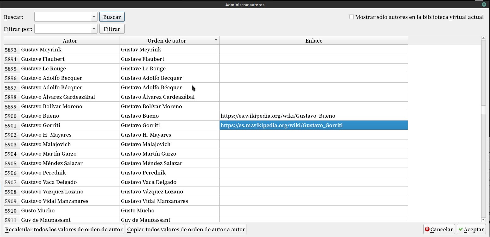

# Datos del autor

:material-account: [Walter](https://t.me/Dunhill69){ target=_blank } · :material-link-variant: [Ver el original en Telegraph](https://telegra.ph/Datos-del-autor-12-21){ target=_blank }
{ .tut-datos }

---

Tenia la intención de tener datos auxiliares de los autores, primero pensé en la foto del autor y después algún dato más.

Si bien Calibre te busca tocando en el panel de Detalle del libro al autor en internet y quería personalizar esa búsqueda.

En el nombre del autor se hace Click derecho.

Y en administrar el autor se nos abre una pantalla donde en la columna link ponemos el enlace que sea de nuestro agrado, en mi caso wikipedia en español. Damos Aceptar.

Y en el panel de detalle del libro al hacer click se nos abre en el navegador la página de wikipedia con los datos del Autor.

 

Ir al mensaje: [https://t.me/calibreconfiguraciones/26818](https://t.me/calibreconfiguraciones/26818)

[https://telegra.ph/Datos-del-autor-12-21](https://telegra.ph/Datos-del-autor-12-21)

## [Volver al inicio](https://telegra.ph/Indice-Calibre-en-Espa%C3%B1ol-10-03)

##  

 

 

---

[:material-arrow-left: Volver al índice](../../alfabetico.md) · [:fontawesome-brands-telegram: Preguntar en el grupo](https://t.me/calibreconfiguraciones){ target=_blank }
