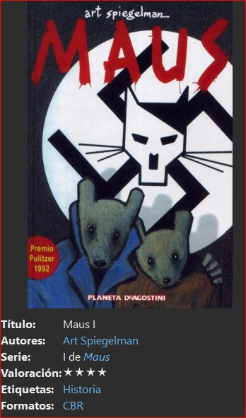
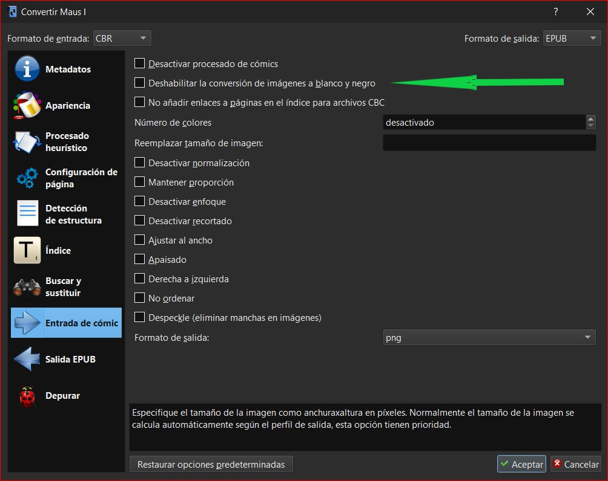
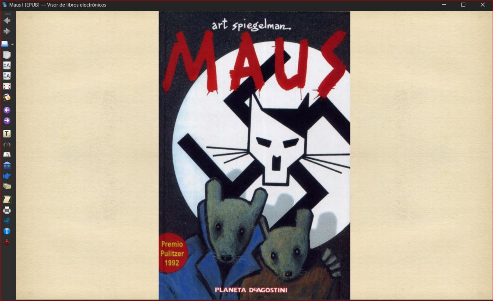
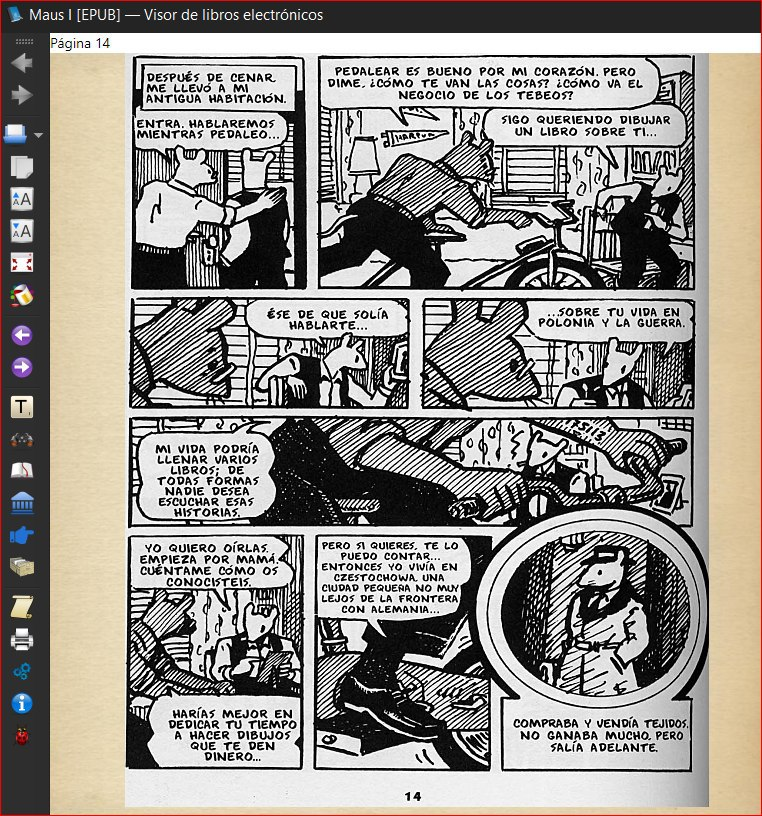

# Convertir de CBR a EPUB

:material-account: [Walter](https://t.me/Dunhill69){ target=_blank } · :material-link-variant: [Ver el original en Telegraph](https://telegra.ph/De-cbr-a-epub--imagen-a-color-12-24){ target=_blank }
{ .tut-datos }

---

Si quieren pasar un cbr a epub pueden probar esto

Tocamos en convertir libro Arriba a la izquierda esta el formato del libro y a la derecha el formato a convertir, nos desplazamos a Entrada Comic y tiene que estar desmarcada la opción Desabilitar la conversiónde imagenes a blanco y negro ( para que las imagenes mantengan el color) Aplicar.

Tarea Funcionando

Acá ya vemos el epub con imagenes coloridas, como ven en la parte superior izquierda dice epub.

Y esta es la parte de la historia que esta en blanco y negro.

Ir al mensaje: [https://t.me/calibreconfiguraciones/15333](https://t.me/calibreconfiguraciones/15333)

## [Volver al inicio](https://telegra.ph/Indice-Calibre-en-Espa%C3%B1ol-10-03)

 

 

 

---

[:material-arrow-left: Volver al índice](../../alfabetico.md) · [:fontawesome-brands-telegram: Preguntar en el grupo](https://t.me/calibreconfiguraciones){ target=_blank }
