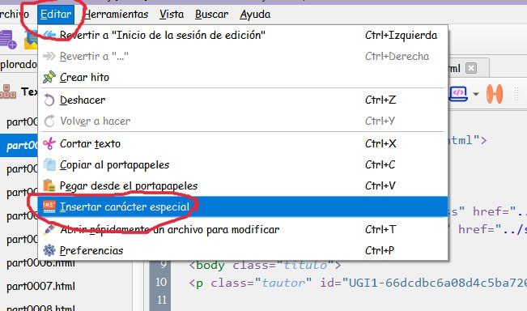
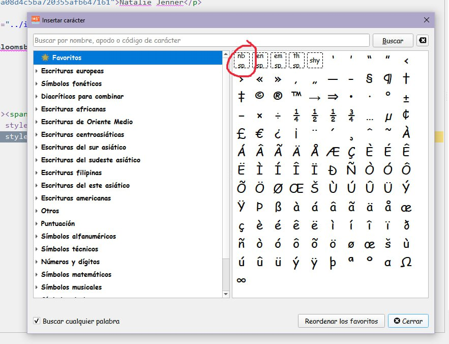
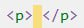

# Dejar espacios (con \<p\> e insertando carácter especial)

:material-account: [Walter](https://t.me/Dunhill69){ target=_blank } · :material-link-variant: [Ver el original en Telegraph](https://telegra.ph/Dejar-espacios-con-p-e-insertando-car%C3%A1cter-especial-02-15){ target=_blank }
{ .tut-datos }

---

Explicado por @jane\_morris

 

Para dejar espacios (con \<p\> e insertando carácter especial) de lineas en blanco para escribir a la distancia deseada 01 pones \<p\> y acto seguido sin dejar espacio pinchas aquí:

Ir al mensaje: [https://t.me/calibreconfiguraciones/144967/145833](https://t.me/calibreconfiguraciones/144967/145833)

Segundo método:

Ir al mensaje: [https://t.me/calibreconfiguraciones/144967/145834](https://t.me/calibreconfiguraciones/144967/145834)

Y se abre esta ventanita, clicas por ejemplo aquí:

Tercer método:

Irl al mensaje: [https://t.me/calibreconfiguraciones/144967/145835](https://t.me/calibreconfiguraciones/144967/145835)

y acto seguido, también sin dejar espacio pones \</p\> de tal forma que te quedará así

y repites lo mismo las veces que necesites para lo abajo que quieras escribir, el espacio que quieras dejar entre lo que está escrito y lo que quieres escribir tú quiero decir.

 

 

## [Volver al inicio](https://telegra.ph/Indice-Calibre-en-Espa%C3%B1ol-10-03)

 

---

[:material-arrow-left: Volver al índice](../../alfabetico.md) · [:fontawesome-brands-telegram: Preguntar en el grupo](https://t.me/calibreconfiguraciones){ target=_blank }
