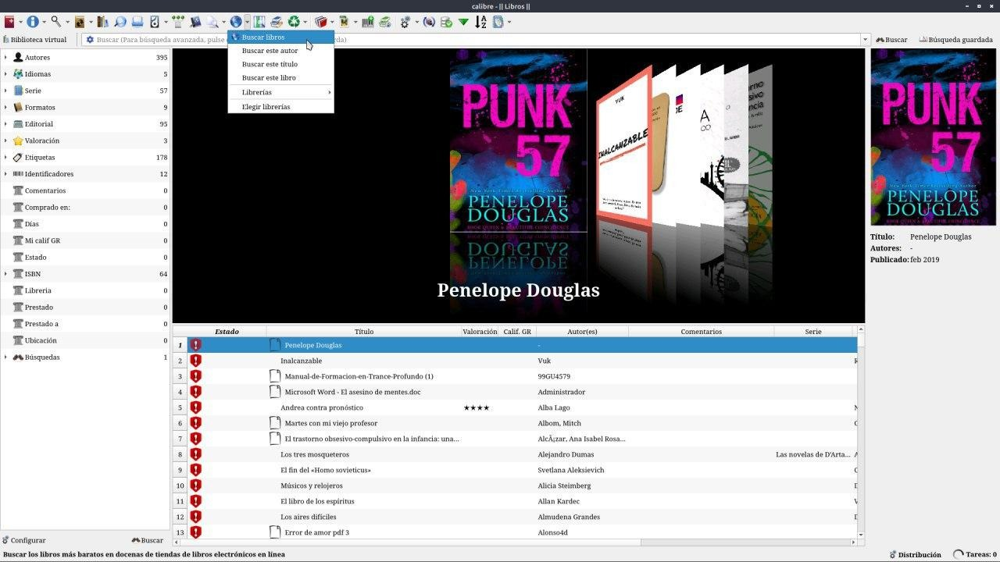
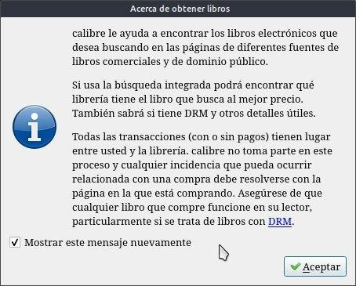
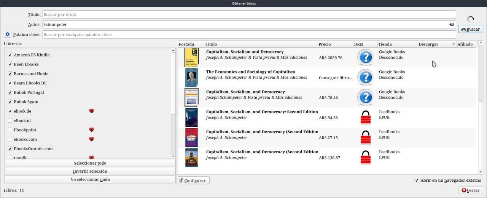

# Descargar libros

:material-account: [Walter](https://t.me/Dunhill69){ target=_blank } · :material-link-variant: [Ver el original en Telegraph](https://telegra.ph/Descargar-libros-08-17){ target=_blank }
{ .tut-datos }

---

Me consultaron si con Calibre se puede descargar Libros .... Ummmm si pero no, como es eso, bueno Calibre tiene una opción donde podemos buscar y descargar libros y lo busca en librerías reconocidas. Pero en si los únicos que podremos descargar son esos libros Clásicos y que ya son parte del patrimonio de la humanidad. Para explorar esta opción: En la ventana principal de Calibre, hacemos clic en la flecha al lado del botón Obtener libros y seleccionamos Buscar libros electrónicos:

Nos sale este recordatorio

Ingresamos el título del libro o el nombre del autor y hacemos clic en Buscar. En la lista de resultados, aparecen los libros encontrados. Además aparece el precio del libro y la librería desde donde puedes descargarlo. Si el libro es gratuito, para descargarlo hacemos clic derecho y selecciona Descargar: Para la descarga del libro, en la columna descarga debe haber un triángulo verde.

 

## [Volver al inicio](https://telegra.ph/Indice-Calibre-en-Espa%C3%B1ol-10-03)

 

---

[:material-arrow-left: Volver al índice](../../alfabetico.md) · [:fontawesome-brands-telegram: Preguntar en el grupo](https://t.me/calibreconfiguraciones){ target=_blank }
