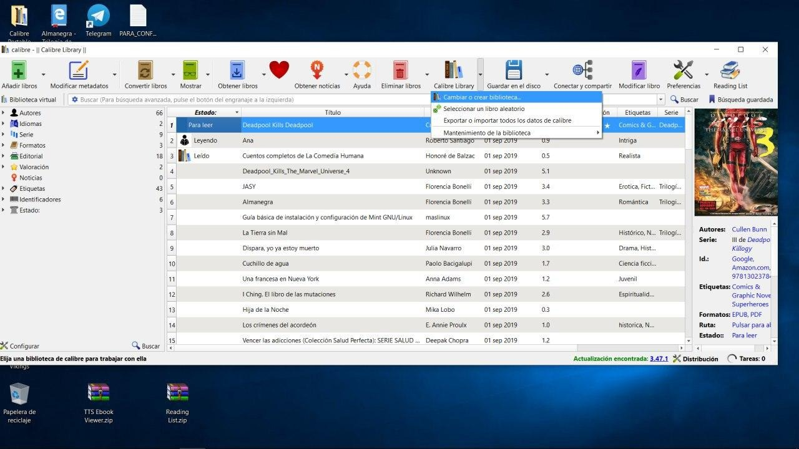
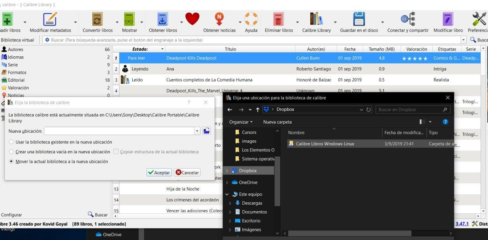
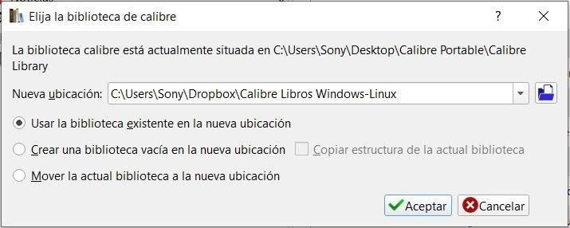
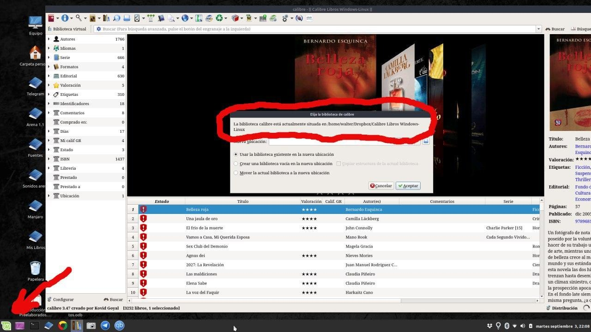

# Dropbox - sincronizar Calibre

:material-account: [Walter](https://t.me/Dunhill69){ target=_blank } · :material-link-variant: [Ver el original en Telegraph](https://telegra.ph/Dropbox---Sincronizar-Calibre-09-08){ target=_blank }
{ .tut-datos }

---

Hola Walter: El asunto es así. Tengo una cuenta de Dropbox sincronizada en todas mis pc y laptop. Tengo Calibre instalado en cada una de ellas, la idea es que si tengo mis libros en Calibre (carpeta sincronizada con Dropbox), bien puedo tenerlos todos en cualquiera de mis computadoras.

Entonces la cosa es más fácil, ejemplo

Máquina 1 calibre y dropbox. Debes saber donde estas guardando la biblioteca. La ruta del archivo, me explico. Por lógica debe ser una carpeta dentro de tu carpeta local de Dropbox.

Máquina 2 y máquina 3 tocas el icono de calibre buscar la ruta de la biblioteca de calibre en Dropbox de esta manera cuando cargues un libro lo vas a tener actualizado en las tres maquinas. Si me das un tiempo subo imágenes yo tengo una máquina con Windows y otra con Linux y funciona de esta manera.

Vamos a pasar la biblioteca a dropbox, el mismo sistema sirve para cualquier servicio de nube que nos de una carpeta en el disco local. Tocamos el icono librería Calibre Flechita lateral - Cambiar o Crear una Biblioteca, marcamos la ultima opción mover la actual biblioteca a una nueva ubicación.

En el renglón de la nueva ubicación ( Carpeta azul ) nos desplazamos hasta el directorio donde este la carpeta de dropbox

Nos tiene que quedar algo así la ruta de la carpeta dropbox, pero con la opción de \*mover marcada\* tocamos aceptar y esperamos a que se sincronice todo depende del tamaño de la biblioteca que tengamos el tiempo puede variar.

Y para tener calibre en otras maquinas una vez instalado Calibre debemos repetir el primer y segundo paso pero en lugar de mover marcaremos USAR BIBLIOTECA EXISTENTE EN LA NUEVA UBICACIÓN y marcamos la misma ruta de la carpeta Dropbox esta sincronización también tarda de acuerdo al tamaño de la biblioteca.

Ahora estoy en una máquina con linux y vean la dirección de la carpeta dropbox, que es donde esta la biblioteca.

Ir al mensaje: [https://t.me/calibreconfiguraciones/867](https://t.me/calibreconfiguraciones/867)

[https://telegra.ph/Dropbox---Sincronizar-Calibre-09-08](https://telegra.ph/Dropbox---Sincronizar-Calibre-09-08)

 

## [Volver al inicio](https://telegra.ph/Indice-Calibre-en-Espa%C3%B1ol-10-03)

##  

 

 

---

[:material-arrow-left: Volver al índice](../../alfabetico.md) · [:fontawesome-brands-telegram: Preguntar en el grupo](https://t.me/calibreconfiguraciones){ target=_blank }
