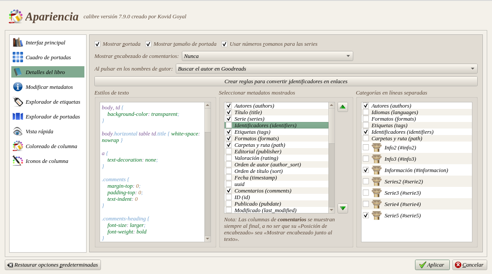
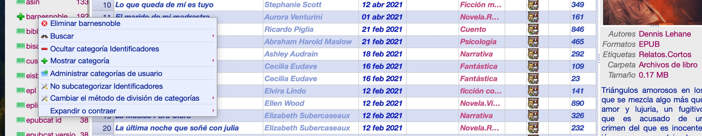

# Eliminar identificadores en masa

:material-account: [Walter](https://t.me/Dunhill69){ target=_blank } · :material-link-variant: [Ver el original en Telegraph](https://telegra.ph/Eliminar-identificadores-desde-la-barra-de-etiquetas-04-20){ target=_blank }
{ .tut-datos }

---

Existen varias opciones:

1. Si no queremos eliminar los datos de identificadores pero que no aparezcan en el detalle del libro.

Vamos a Preferencias/Apariencia y destildamos identificadores en las dos columnas.

2. Si queremos eliminarlos en un solo movimiento: por @metus54

En el listado del explorador de etiquetas seleccionamos el identificador a eliminar, botón derecho del mouse y nos aparece esta pantalla y tocamos en eliminar. En esta imagen se eliminara el identificador de Barnes&Noble

 

Ir al mensaje: [https://t.me/calibreconfiguraciones/112333/163293](https://t.me/calibreconfiguraciones/112333/163293)

 

## [Volver al inicio](https://telegra.ph/Indice-Calibre-en-Espa%C3%B1ol-10-03)

 

 

 

---

[:material-arrow-left: Volver al índice](../../alfabetico.md) · [:fontawesome-brands-telegram: Preguntar en el grupo](https://t.me/calibreconfiguraciones){ target=_blank }
