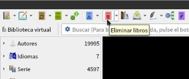
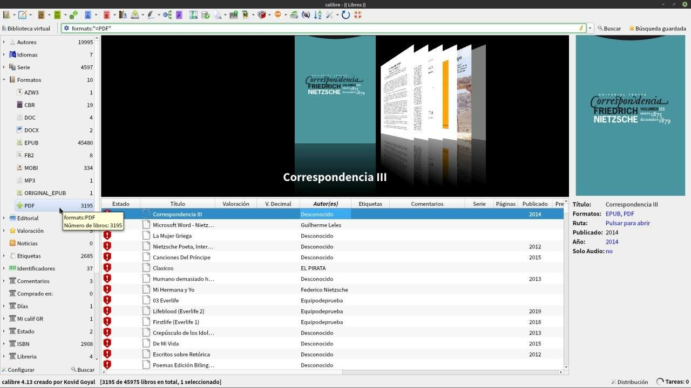
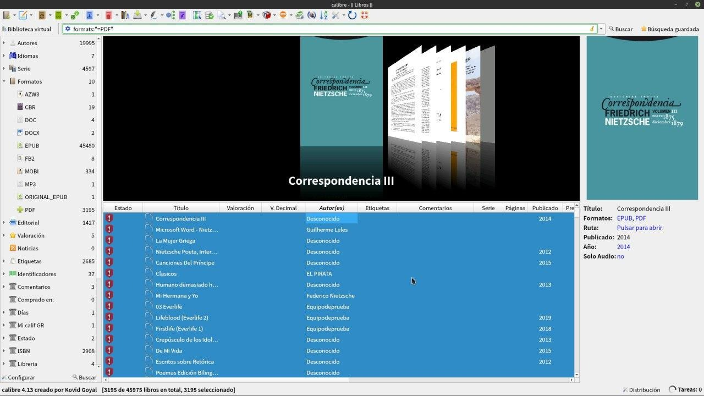
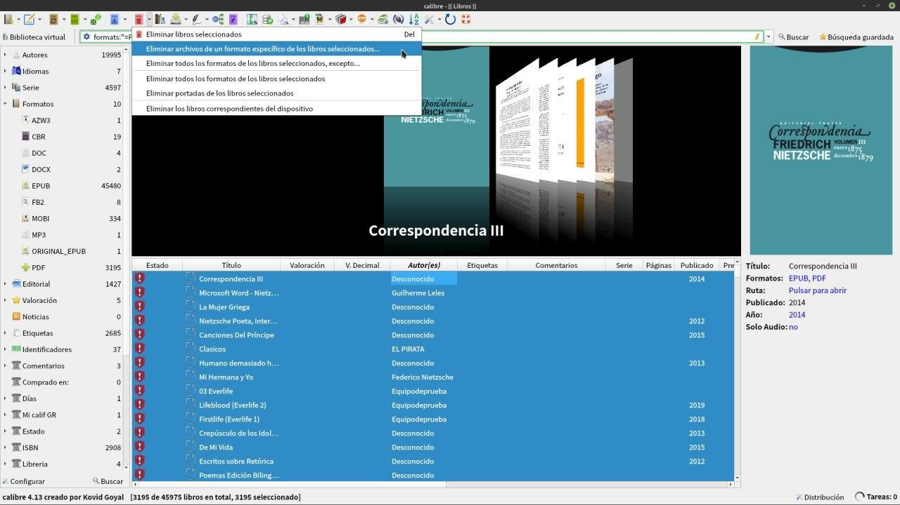
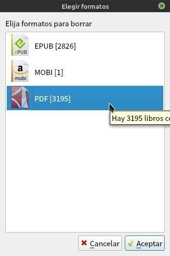
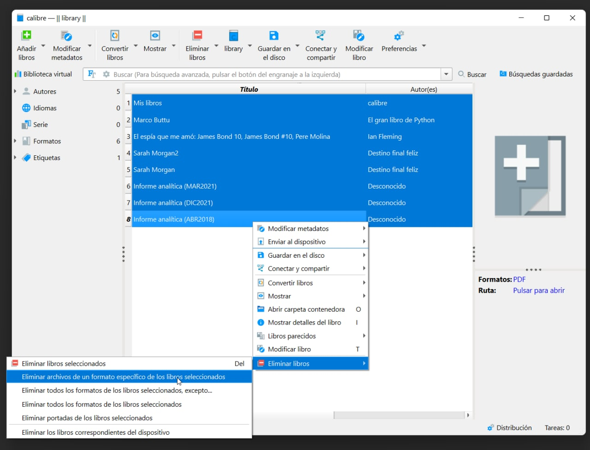
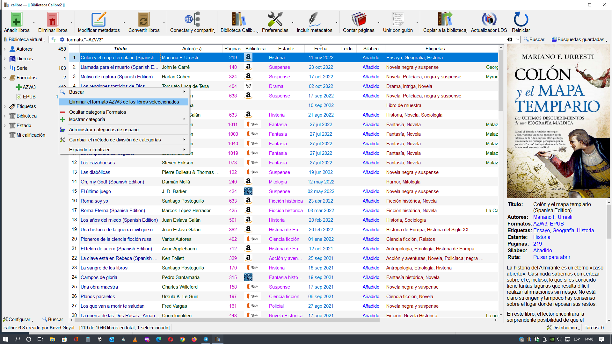
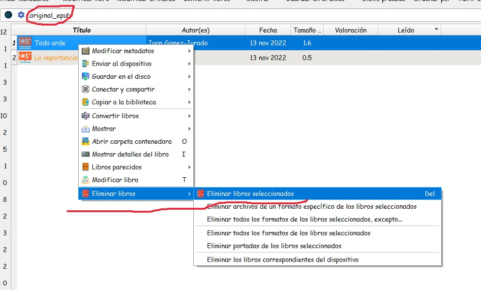

# Eliminar libros en grupo

:material-account: [Walter](https://t.me/Dunhill69){ target=_blank } · :material-link-variant: [Ver el original en Telegraph](https://telegra.ph/Eliminar-libros-en-grupo-08-17){ target=_blank }
{ .tut-datos }

---

Existe una manera de eliminar libros en grupos, para esto esta el icono eliminar libro en la barra de herramientas.

Yo como tengo configurado que el añadir un libro me lo transforme a mi formato favorito puedo irme a la categoría Formatos y en este caso seleccionar pdf ( y estoy seguro que todos esos libros de pdf se transformaron a epub).

Tocando en formatos/ pdf apretó Ctrl+A y de esta manera me selecciona todos los archivos, para no ir uno a uno, nótese el color azul.

Voy al icono de eliminar libro, tocamos en la flecha de la derecha y tocamos Eliminar archivos de un formato especifico de los libros seleccionados.

Y seleccionamos el formato que queremos eliminar.

Otras opciones:

Por @mangel

Una opción fácil seria:

Imagina que esa es tu biblioteca:

1. Seleccionas todos los libros.

2. Botón derecho del ratón encima de la selección y eliges "eliminar libros"

3. Eliges Eliminar archivos de un formato específico.

Ir al mensaje: [https://t.me/calibreconfiguraciones/113037?thread=112333](https://t.me/calibreconfiguraciones/113037?thread=112333)

 

Por @cristobal\_67

Buscando por formato de libro a eliminar.

En este caso formats:"=AZW3"

Libro seleccionado botón derecho del mouse Eliminar formato.

Ir al mensaje: [https://t.me/calibreconfiguraciones/113042?thread=112333](https://t.me/calibreconfiguraciones/113042?thread=112333)

 

Por @Jane\_morris

Eliminar original\_epub

Buscando .original\_epub en la barra de herramientas, libro seleccionado, botón derecho del mouse eliminar libro seleccionado.

 

Ir al mensaje: [https://t.me/calibreconfiguraciones/113050?thread=112333](https://t.me/calibreconfiguraciones/113050?thread=112333)

 

## [Volver al inicio](https://telegra.ph/Indice-Calibre-en-Espa%C3%B1ol-10-03)

 

---

[:material-arrow-left: Volver al índice](../../alfabetico.md) · [:fontawesome-brands-telegram: Preguntar en el grupo](https://t.me/calibreconfiguraciones){ target=_blank }
