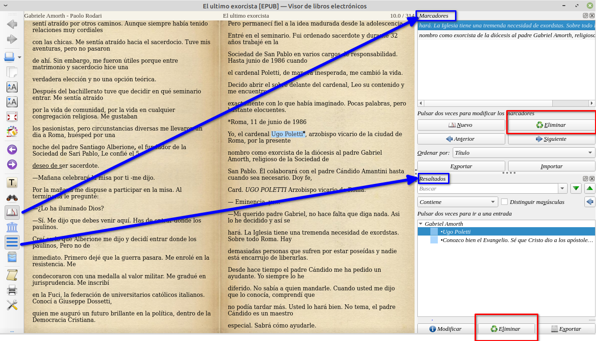

# Eliminar notas o marcadores con Calibre

:material-account: [Walter](https://t.me/Dunhill69){ target=_blank } · :material-link-variant: [Ver el original en Telegraph](https://telegra.ph/Eliminar-notas-o-marcadores-con-calibre-02-16){ target=_blank }
{ .tut-datos }

---

Para eliminar las notas y los remarcados en calibre, lo que debes hacer es abrir el libro con el visor de libros de calibre, haciendo doble clic en la caratula( si tienes la vista de caratulas) o en el libro y te dejo en la imagen identificados los iconos de Marcadores o resaltados y el de notas. Cuando tocas en ellos se abre una ventana para poder eliminarlos, cargar nuevos o modificarlos.

 

Ir al mensaje: [https://t.me/calibreconfiguraciones/112333/157215](https://t.me/calibreconfiguraciones/112333/157215)

## [Volver al inicio](https://telegra.ph/Indice-Calibre-en-Espa%C3%B1ol-10-03)

 

---

[:material-arrow-left: Volver al índice](../../alfabetico.md) · [:fontawesome-brands-telegram: Preguntar en el grupo](https://t.me/calibreconfiguraciones){ target=_blank }
