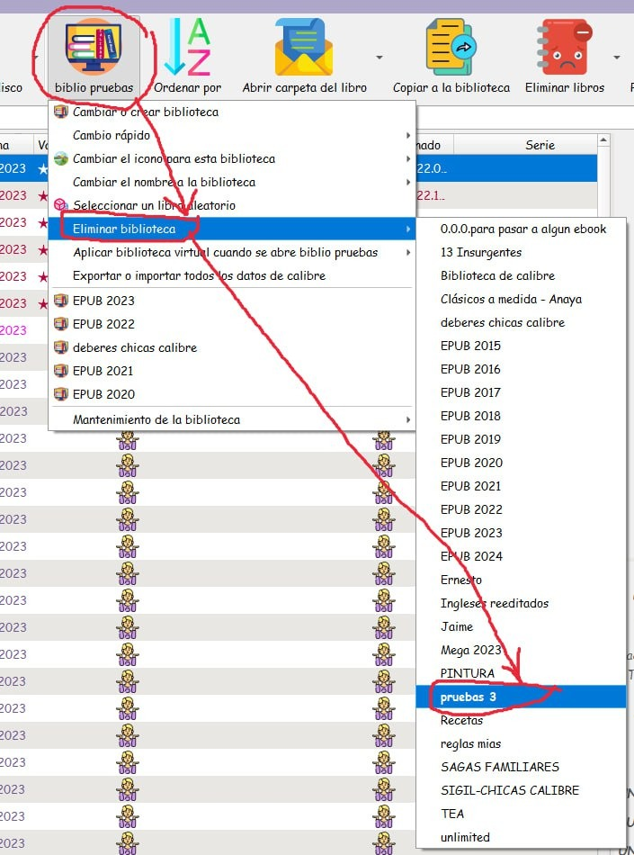
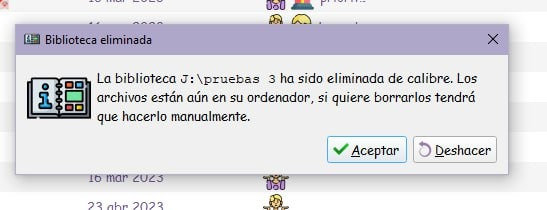
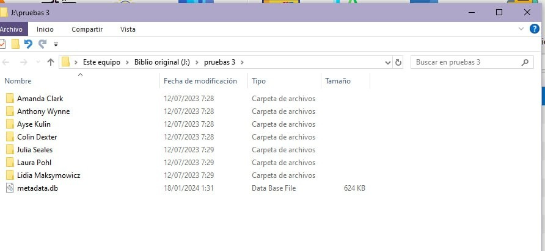
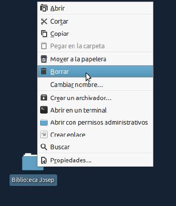
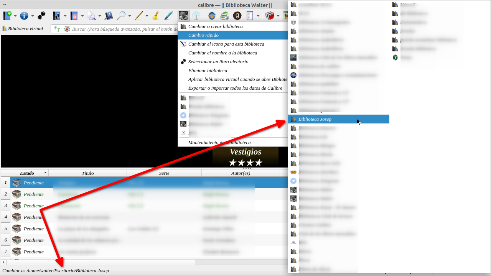
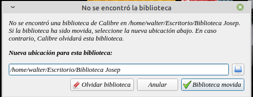

# Eliminar bibliotecas de Calibre (dos maneras)

:material-account: [Walter](https://t.me/Dunhill69){ target=_blank } · :material-link-variant: [Ver el original en Telegraph](https://telegra.ph/Eliminar-una-biblioteca-en-Calibre-01-18){ target=_blank }
{ .tut-datos }

---

Explicado por @jane\_morris

01) Situada en otra biblio distinta a la que se quiere eliminar

click con el botón izquierdo., en la biblioteca en que se está,  en eliminar biblioteca y en la biblioteca que se quiere eliminar.

02) Se abrirá esta ventanita que nos dice esto, aceptamos

03) se nos abrirá la carpeta (abierta) donde teníamos todos los libros de la biblio que hemos eliminado de calibre (hemos eliminado la biblio de calibre, pero no los libros de las carpetas donde estaban).

ahora hay dos posibilidades:

si no queremos eliminar los libros, no hacemos nada mas, los dejamos,

si queremos eliminarlos, nos vamos un paso atrás, hasta ver la carpeta con el nombre de la biblio que hemos eliminado en calibre y la eliminamos entera de un plumazo, tal como está, cerrada con todas las subcarpetas de los autores dentro.

Ir al mensaje: [https://t.me/calibreconfiguraciones/112333/154125](https://t.me/calibreconfiguraciones/112333/154125)

 

Otra alternativa (explicada por @dunhill)

Esta es la otra manera que le comentaba a @jane\_morris si sabemos el nombre de la biblioteca podemos eliminar directamente la carpeta, en este caso la biblioteca de Josep le damos en eliminar por fuera de Calibre. Esto también sirve para que Calibre no registre esta biblioteca copiandola en otro lado y después sacarla de la lista de cambio rápido.

Cuando entremos en Calibre y desde el cambio rápido seleccionemos la biblioteca de Josep que previamente eliminamos o cambiamos de ubicación. Calibre nos dará un aviso.

Y le ponemos olvidar la biblioteca y no aparecerá más en la lista de cambio rápido. Este método nos sirve para resguardar la biblioteca sin la necesidad de eliminarla y que calibre no la registre.

Ir al mensaje: [https://t.me/calibreconfiguraciones/112333/154134](https://t.me/calibreconfiguraciones/112333/154134)

 

## [Volver al inicio](https://telegra.ph/Indice-Calibre-en-Espa%C3%B1ol-10-03)

 

 

---

[:material-arrow-left: Volver al índice](../../alfabetico.md) · [:fontawesome-brands-telegram: Preguntar en el grupo](https://t.me/calibreconfiguraciones){ target=_blank }
