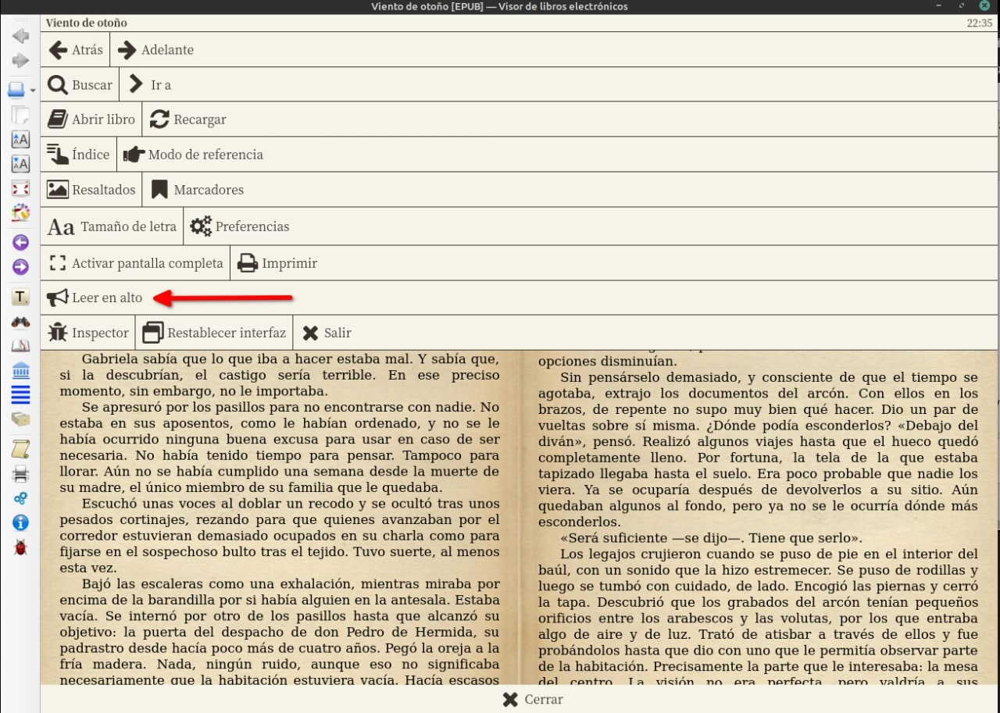
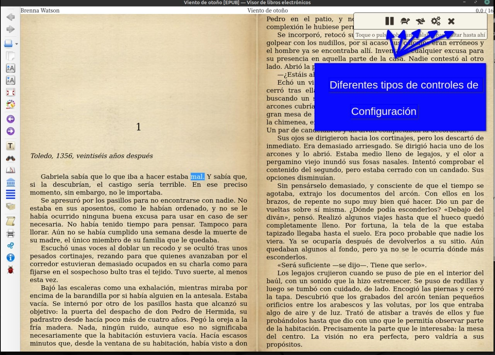
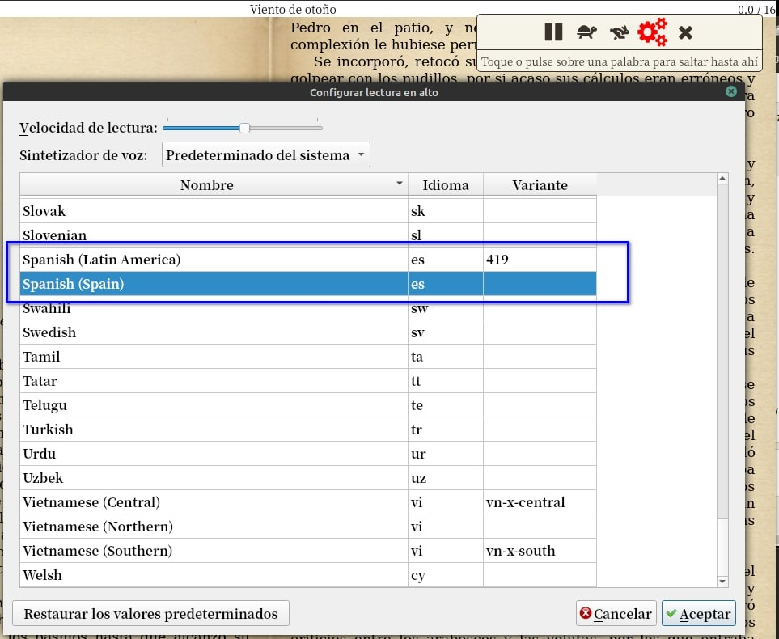

# Habilitar lectura en voz alta con Calibre

:material-account: [Walter](https://t.me/Dunhill69){ target=_blank } · :material-link-variant: [Ver el original en Telegraph](https://telegra.ph/Enable-read-aloud-12-12){ target=_blank }
{ .tut-datos }

---

Mientras calibre lo lee en voz alta, hacemos clic en el libro y el botón derecho del mouse.

Y aparece el icono de megáfono.

Una barra con controles para leer en voz alta.

Y tocando los engranajes de la configuración podemos elegir voces o usar el predeterminado del sistema

## [Volver al inicio](https://telegra.ph/Indice-Calibre-en-Espa%C3%B1ol-10-03)

 

 

 

 

---

[:material-arrow-left: Volver al índice](../../alfabetico.md) · [:fontawesome-brands-telegram: Preguntar en el grupo](https://t.me/calibreconfiguraciones){ target=_blank }
