# Entrar a Calibre fuera de casa (Vodafone)

:material-account: [Walter](https://t.me/Dunhill69){ target=_blank } · :material-link-variant: [Ver el original en Telegraph](https://telegra.ph/Entrar-a-Calibre-fuera-de-casa-Vodafone-08-07){ target=_blank }
{ .tut-datos }

---

Explicado por @janes\_morris

Para entrar en mi calibre desde el móvil o/y pocketbook desde fuera de casa, es decir desde fuera del wifi de mi router (SIEMPRE que el ordenador, el calibre y el servidor de contenido de calibre esté iniciado.):

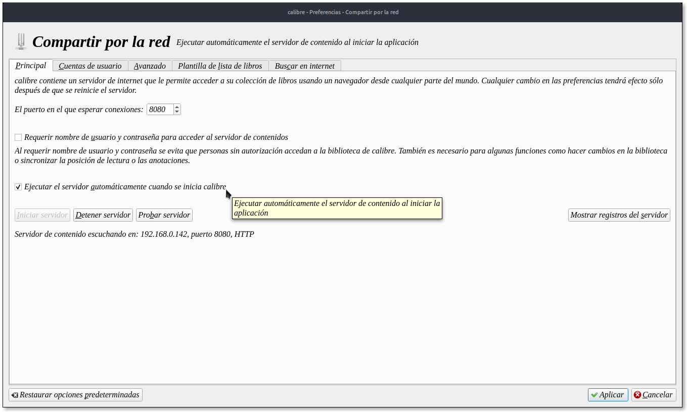

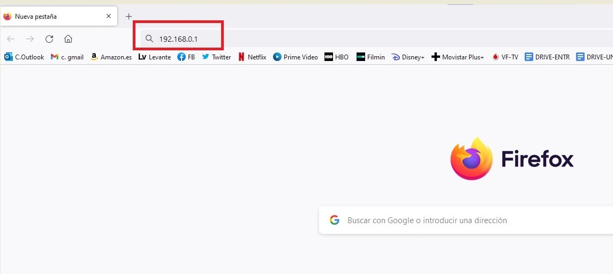

Paso 1: Enterarnos de que puerto TCP/UDP podemos abrir para nuestro calibre, en mi caso con la red Vodafone, ha sido imposible abrir uno nuevo, así que he usado uno de los que ya tenía abierto para emule.

Os explico paso a paso como designar el puerto si teneis Vodafone, si teneis otra compañía tendréis que informaros vosotros de como hacerlo, pero imagino que el procedimiento será muy parecido…

Para ello teneis que escribir en el buscador de google, en mi caso Firefox, vuestra IP interna y darle al intro, en mi caso mi IP interna es la de VF:

192.168.0.1

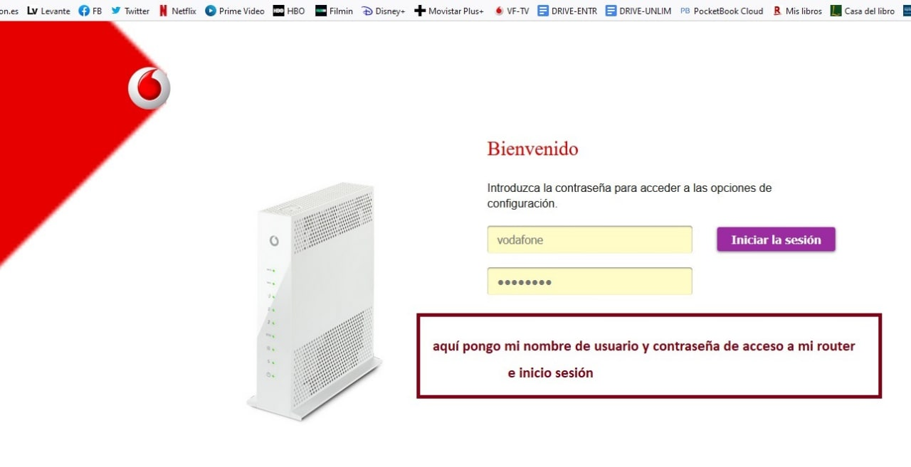

Os sale esta pantalla

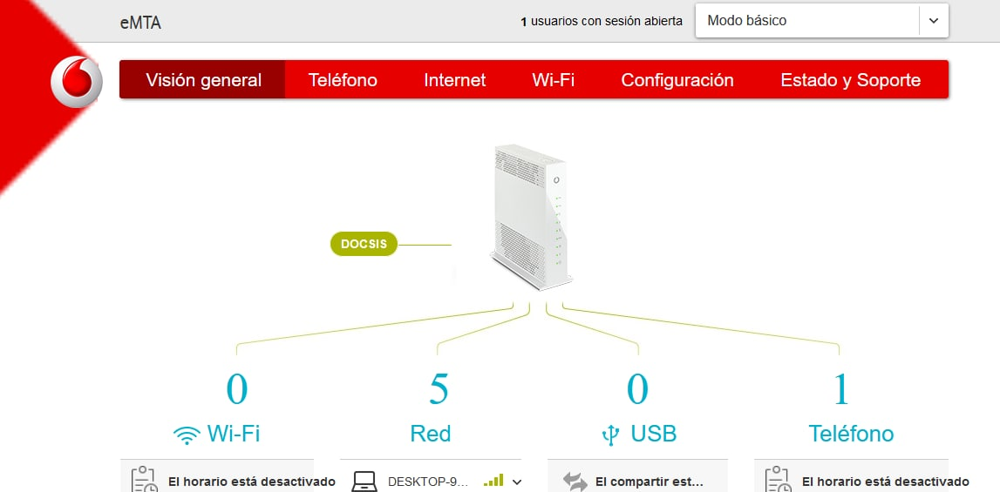

Al inciar sesión os sale esta, cuando os salga, clicais en la pestaña internet

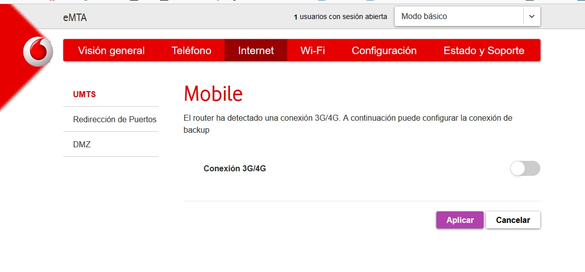

Al clicar en la pestaña internet os sale esta, y cuando os salga clicais en Redirección de Puertos

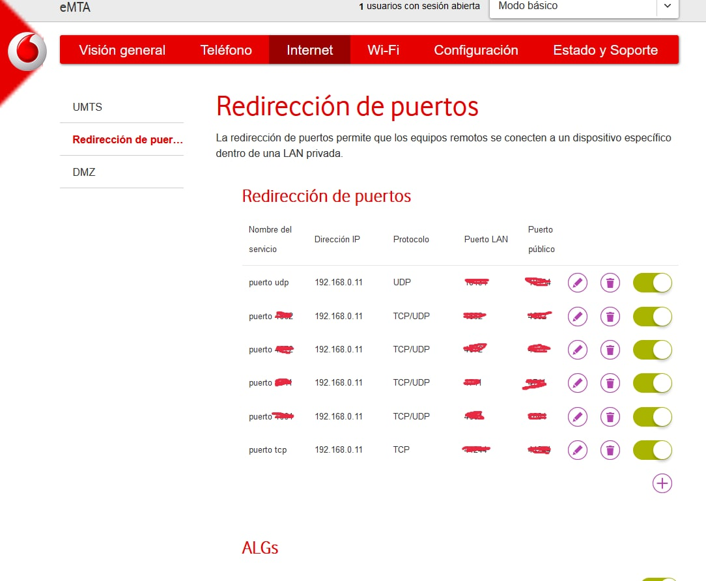

Os saldrá esta, clicais en el signo +

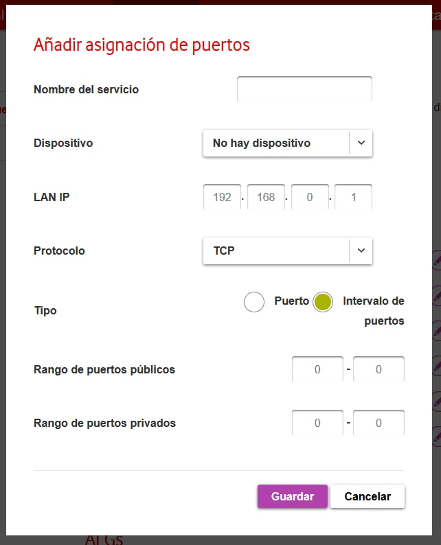

Os sale esta

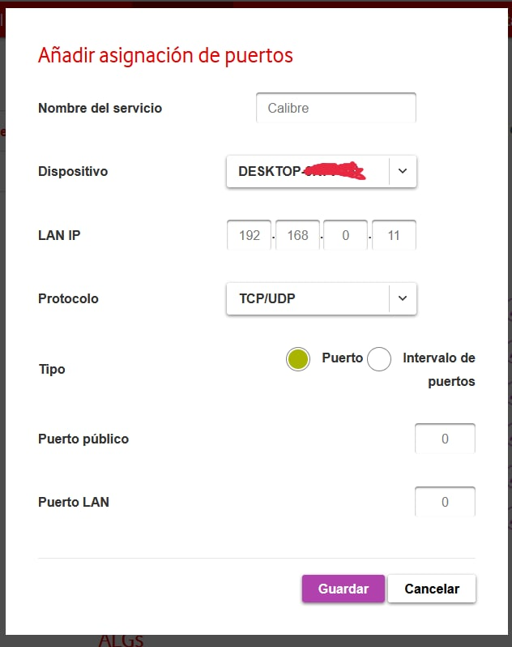

En esta teneis que rellenar,

- El nombre del servicio, en mi caso he puesto Calibre, pero podeis poner el que querais que distingais vosotros

- En Dispositivo, clic en el desplegable y buscais vuestro ordenador o donde sea que está vuestro router

- En Protocolo, clic en el desplegable y elegis TCP/UDP

- En Tipo señalais Puerto

y os cambiará a esta pantalla.

en esta pantalla teneis que poner donde pone Puerto Público y Puerto LAN uno de los puertos que tengais arriba en esta pantalla

https://t.me/c/1268112282/933

pero que sea uno de los TCP/UDP

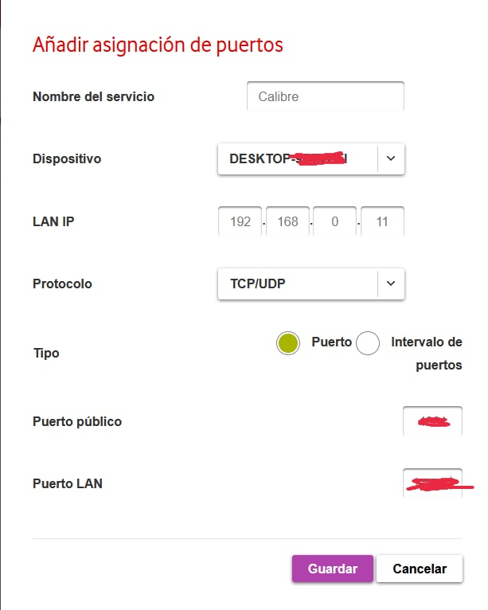

Os quedará así y clicais en guardar

y ahora ya sabeis que vuestra IP privada la que os tiene que salir en el inicio del servidor de contenido del calibre es esta, (en mi caso)

192.168.0.11:4661 (cada uno tendrá la que tenga, según su compañía y el puerto que haya elegido)

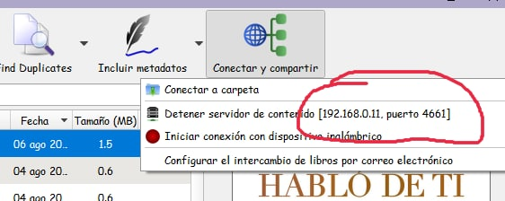

Ahora vamos a Calibre, e iniciamos el servidor de contenido y comprobamos que os sale esta IP (sin los puntitos claro)

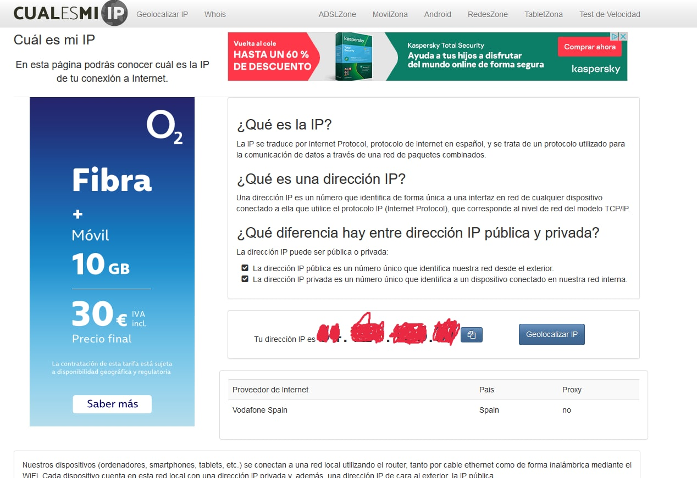

y ya lo teneis todo, ahora solo os falta ir a google y escribir

Cúal es mi IP?

le dais al intro y vereis numerosas entradas, elegis una y veis que IP os sale, esta es la pública y la que es secretísima, no se la podeis decir a nadie en quién no confieis plenamente

ahora escribis en un word o en un papel o donde querais esta IP secreta, y al final le poneis los dos puntos y el puerto que teneis abierto de antes, que quede así

XX.XXX.XXX.XX:4661

y esa IP Pública secreta con los dos puntos y el puerto abierto es la que teneis que poner, así, tal cual, sin mas nada en el navegador de vuestro movil, o de vuestro pocketbook o del lector que tengais, y MIENTRAS TENGAIS EL CALIBRE ABIERTO CON EL SERVIDOR DE CONTENIDO INICIADO, os funcionará muy bien.

Os aparecerá en la pantalla de vuestro movil/lector vuestra biblio calibre, en la que dependiendo como la tengais os saldrán todas las biblios como es mi caso, o si solo teneis una pues ya las portadas de los libros de vuestra única biblio. Solo teneis que tocar en el libro que os apetezca leer y se abrirá y os dará la posiblidad de leerlo ahí mismo o de descargarlo, en mi caso se descarga en la aplicación pocketbook si estoy en el movil, o en mi biblioteca pocketbook si estoy en mi pocketbook

en mi caso como tengo muchas biblios en el mismo calibre , en la pantalla me salen.

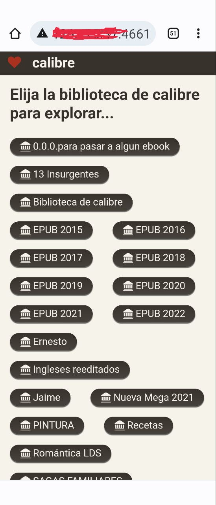

Ahora toco por ejemplo en la biblio del epub 2022 y me sale ya la biblio 2022 abierta

Subo y bajo con el ascensor hasta encontrar el libro que me apetece leer / descargar , cuando lo encuentro toco encima de la portada y me sale ya el libro con las dos posibilidades

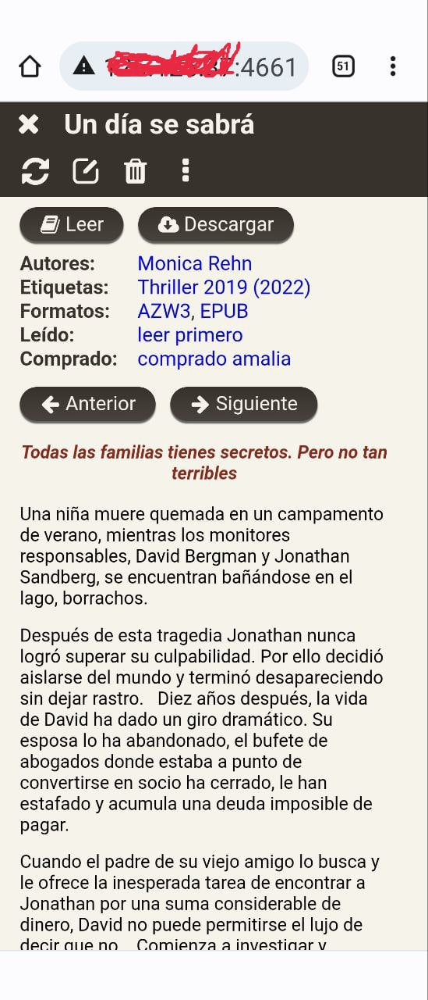

En mi caso al utilizar un puerto de los que ya tenía solo me ha hecho falta entrar en mi router de vodafone para elegir el puerto TCP/UDP , lo he elegido lo he anotado y lo he puesto en calibre tal que así

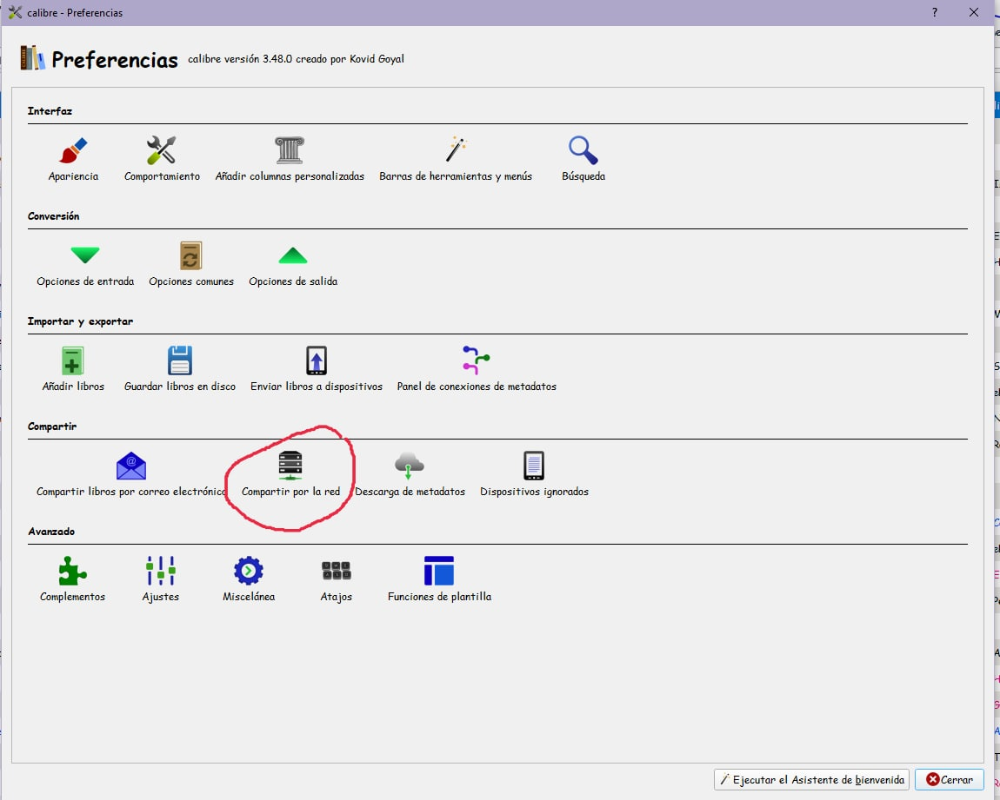

Calibre —\> Preferencias —\> compartir por red, clic y me sale la pantalla siguiente

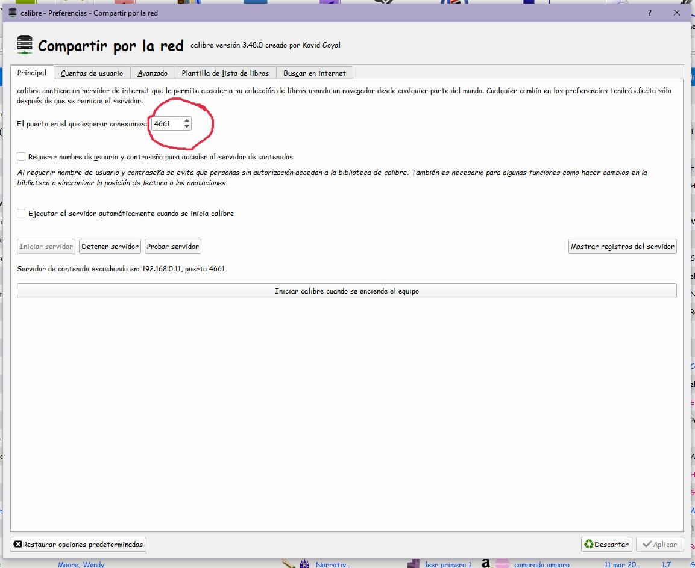

En esta pantalla escribis el puerto elegido, aplicais y salis

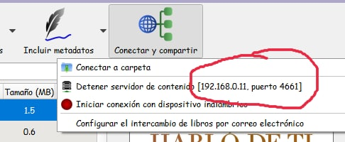

iniciais el servidor de contenido en calibre y comprobais que os figura ya el nuevo puerto

acordaos de que para que os funcione el sistema teneis que tener encendido el calibre e iniciado el servidor de contenido

si vuestra compañía telefónica os acepta un nuevo puerto, entonces si que teneis que hacer todos los pantallazos que os he puesto de dentro del router de vodafone o la que tengais, a mi como no me ha aceptado un puerto nuevo, pues no me ha quedado otra que utilizar uno de los que ya tenía.

 

## [Volver al inicio](https://telegra.ph/Indice-Calibre-en-Espa%C3%B1ol-10-03)

 

 

---

[:material-arrow-left: Volver al índice](../../alfabetico.md) · [:fontawesome-brands-telegram: Preguntar en el grupo](https://t.me/calibreconfiguraciones){ target=_blank }
