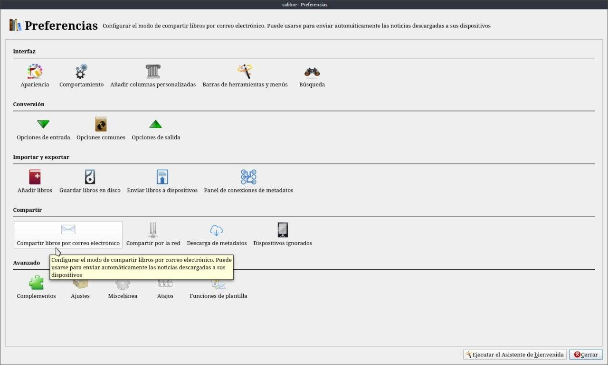
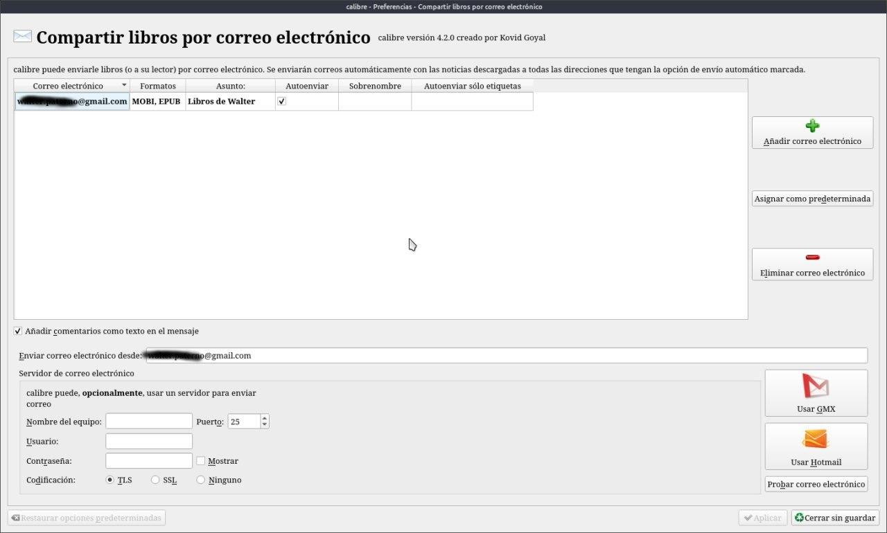
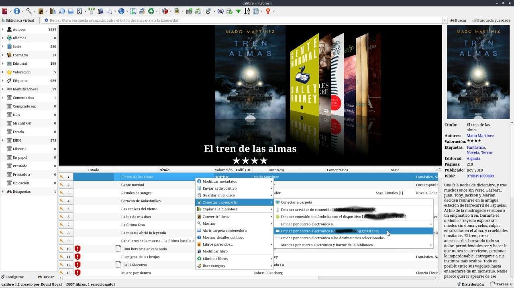
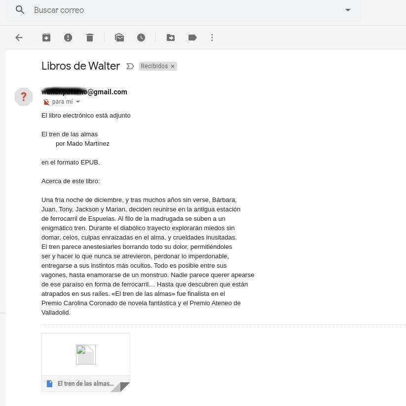
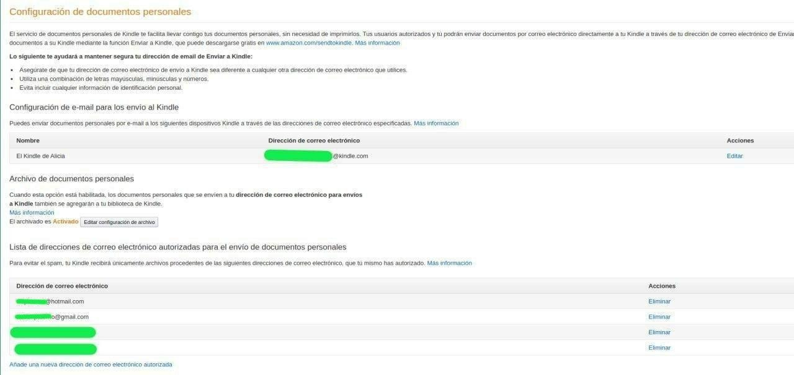

# Enviar libro por correo con Calibre

:material-account: [Walter](https://t.me/Dunhill69){ target=_blank } · :material-link-variant: [Ver el original en Telegraph](https://telegra.ph/Enviar-libro-por-correo-con-Calibre-08-17){ target=_blank }
{ .tut-datos }

---

Con Calibre podemos enviar libros aparte de los dispositivos para leer, a direcciones de correo. Vamos a Preferencias / Compartir libros por correo electrónico.

Ahí vamos agregando nuestra dirección de correo o la de la gente a quien le queremos compartir libros, Es importante poner en el asunto que estamos enviando libros, para que sea mejor visual el correo.

En cuanto a configuraciones de cuentas de correo ver [https://telegra.ph/Env%C3%ADo-de-Correo---Configuraciones-10-14](https://telegra.ph/Env%C3%ADo-de-Correo---Configuraciones-10-14)

Estando en la pantalla principal de Calibre, nos posicionamos en el libro que queremos enviar. Botón Izquierdo del mouse en la opción Conectar y Compartir encontramos opciones para enviar por correo, Estará nuestra cuenta y enviar a destinatarios. Si tocamos Destinatarios podremos agregar la dirección a enviar.

Así se ve el correo enviado desde Calibre a nuestro correo. Para poder hacer esto debe estar activado el SERVIDOR de contenido.

Si quisiéramos enviarlo a nuestro Kindle, lo primero que tenemos que hacer es ir a nuestra cuenta de Amazon y agregar la cuanta de correo desde la cual el kindle podrá recibir correos.

Y repetimos el paso 1 y 2

 

## [Volver al inicio](https://telegra.ph/Indice-Calibre-en-Espa%C3%B1ol-10-03)

 

 

---

[:material-arrow-left: Volver al índice](../../alfabetico.md) · [:fontawesome-brands-telegram: Preguntar en el grupo](https://t.me/calibreconfiguraciones){ target=_blank }
